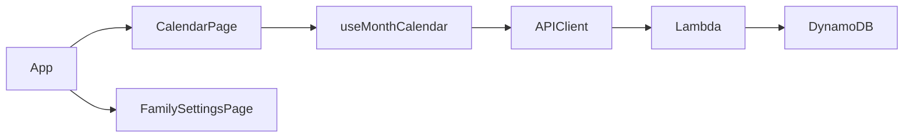
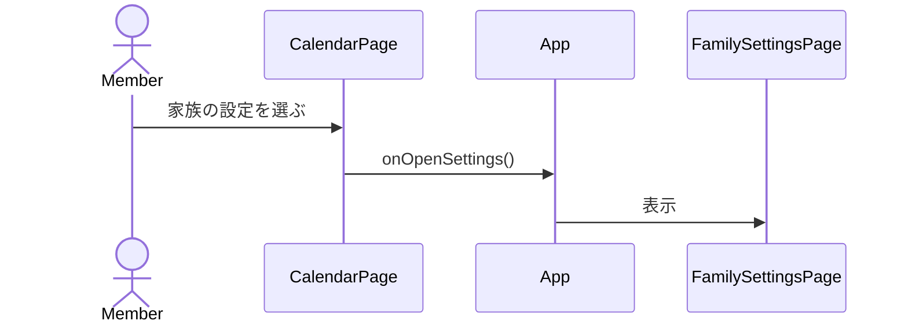

## Architecture Analysis

### System Overview

React の LIFF 画面と AWS Lambda の API / LINE / 通知入口、DynamoDB、CDK からなるサーバーレス構成。

### Architectural Style

npm workspace のモノレポ。共有契約を frontend/backend が利用する。App の React state が画面遷移を管理する。

### Component Relationships

テキスト: App が画面を選び、カレンダーのフックが API を呼ぶ。API が永続化を担う。図は flowchart 構文・辺・識別子を目視確認済み。

### Data Flow

LIFF ログイン後の authorized 関数を各画面に渡す。カレンダーは月変更時に取得し、AbortController で古い要求を取り消す。保存応答を replace で反映する。

### Key Design Decisions

今回の入口は CalendarPage。設定画面は App の callback、割り当ては CalendarPage の editing state と lazy import を使う。既存の役割・月・確定条件を保つ必要がある。新しいアーキテクチャ判断はこの分析では行っていない。

### Improvement Opportunities

長い CalendarPage の責務分離は将来候補。今回の小さな変更で無関係な整理は不要。

## Interaction Diagrams

テキスト: カレンダーから設定を選ぶと callback が App の state を更新し、設定画面を表示する。sequenceDiagram 構文を目視確認済み。
