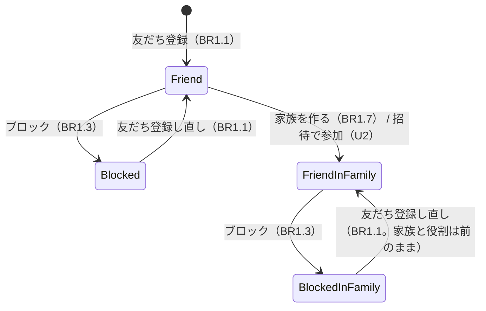
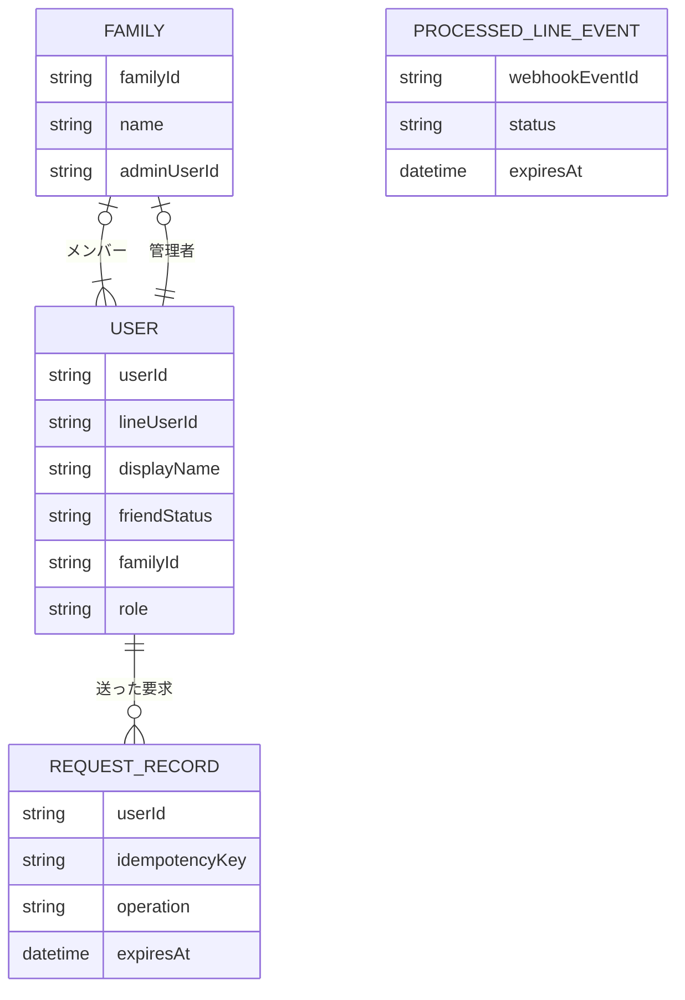

# 機能の仕様（Functional Spec）— U1 最初の形と家族を作る

U1（`u1-skeleton-family`）の流れと状態の変わり方です。この書類が、流れの順番と状態の変わり方の正本です。データの形は `entities.md`、決まりは `rules.md` が正本で、下の図と表はそこから写したものです。

U1 が受け持つストーリーは US1.1（家族を作って子供を招待する。`inception/user-stories/stories.md`）の一部です。招待（AC1.1.6〜AC1.1.9、AC1.1.13）は U2 で作ります。U1 は最初の形（walking skeleton）で、ステージングで次の流れを見せて確かめます（`inception/delivery-planning/bolt-plan.md` の B1）。

1. スマホの LINE で友だち登録すると返事が届く
2. LINE の中で画面を開き、「家族を作る」で管理者として家族ができる
3. 開き直しても家族が残っている
4. パソコンのブラウザでも LINE ログインで同じ家族が表示される

## 流れ

### F1 友だち登録（AC1.1.1、AC1.1.2）

1. LINE から友だち登録（follow）の Webhook が届く
2. LINE 用の受け口が署名を確かめる。合わなければ断って終わる（BR2.6）
3. イベント ID が処理済みなら、何もせず終わる。まだなら処理済みとして記録する（BR2.7）
4. LINE から利用者の表示名を受け取る（契約 C4 の profile）
5. 家族とメンバーの窓口 `registerUser(lineUserId, displayName)` を呼ぶ。初めての人なら記録し、すでにいる人なら新しく作らず「友だち」に戻す。表示名は初めてのときだけ記録する（BR1.1、BR1.4）
6. 返事を送る: あいさつ、アプリを開くボタン、「家族を作る（お母さん）／招待を待つ（子供）」の説明（BR1.2）
7. 終わったらイベントを「処理済み」にする。途中で思いがけない失敗が起きたら、「処理中」の記録を消し、失敗を記録する。LINE の Webhook の再送を有効にしておくので、LINE が送り直したときに処理し直せる。Lambda が時間切れで止まって記録を消せなかったときは、「処理中」のまま決まった時間がたてば、次の送り直しで処理し直す（BR2.7）
8. 友だち登録のイベントを落としても、その人がアプリを開いたときに F3 の手順 5 で記録が直る（BR1.11）

### F2 ブロック（BR1.3）

1. LINE からブロック（unfollow）の Webhook が届く
2. 署名を確かめ、イベント ID の二重処理を防ぐ（BR2.6、BR2.7）
3. 家族とメンバーの窓口 `markBlocked(lineUserId)` を呼ぶ。利用者の記録があれば「ブロック中」にし、家族と役割は残す。記録がなければ何もしない。返事はしない（ブロック中には送れない）

### F3 画面を開いてセッションを発行する（AC1.1.10）

1. 利用者が画面を開く。スマホの LINE の中では LIFF、パソコンのブラウザでは LINE ログインで、LINE の ID トークンを受け取る
2. 画面が ID トークンを裏側に送り、セッションの発行を頼む（契約 C2 の `POST /sessions`）
3. 裏側が ID トークンを LINE の決まりで確かめる。正しくなければ 401 `UNAUTHENTICATED` で断る（BR2.1）
4. ID トークンの LINE のユーザー ID で、家族とメンバーの窓口 `findUserByLineId(lineUserId)` を呼ぶ
5. 記録がない、またはブロック中なら、LINE に友だちかどうかを問い合わせる（BR1.11）
   - 友だちなら、`registerUser` で記録する（記録がなければ新しく、ブロック中なら友だちに戻す）。6 に進む
   - 友だちでなければ、セッションを出さず 403 `NOT_FRIEND` を返す。画面は友だち登録の案内だけを出して終わる（BR1.5）
6. 署名付きのセッショントークン（userId と期限）を返す。画面は以後の要求のたびにそれを送る（BR2.2）

### F4 最初の画面を決める（AC1.1.3、AC1.1.11）

1. 画面が自分の情報を求める（契約 C1 の `GET /me`）。セッションを持つのは友だちだけなので、ここに来るのは友だち（F3）
2. 裏側が F7 の確かめをする。そのあとブロックしていれば 403 `NOT_FRIEND` を返し、画面は友だち登録の案内だけを出す（BR1.5）
3. 友だちなら `Me`（userId、displayName、family）を返す。family が空なら画面は「家族を作る」と「招待を待つ」を出し、family があれば今月のカレンダーの枠を出す（BR1.6、BR1.10。下の「最初の画面の決め方」の表）
4. 家族のデータを求めたのに家族のメンバーでなければ、中身を出さず「このアプリは家族のメンバーだけが使えます」と出す（BR2.3）

### F5 家族を作る（AC1.1.4、AC1.1.5）

1. 「家族を作る」を選ぶと、家族の名前を入れる欄が出る
2. 名前を入れて保存すると、画面は新しい印（`Idempotency-Key`）を作り、家族の作成を頼む（契約 C1 の `POST /families`、本文は `{ "name": "<家族の名前>" }`）。通信が切れて送り直すときは同じ印を送る
3. 裏側がセッションと友だちであることを確かめる（F7、BR2.2、BR1.5）
4. 同じ利用者の同じ印の要求がすでに成功していれば、何もせず前と同じ結果（201 と作った家族）を返す（BR2.8）
5. 名前が前後の空白を除いて 1〜20 文字でなければ 422 `INVALID_FAMILY_NAME` で断る。画面は入力した内容を残したまま「家族の名前を 1〜20 文字で入力してください」と出す（BR1.9）
6. すでに家族に入っていれば 409 `ALREADY_IN_FAMILY` で断り、画面は「すでに家族に入っています」と出す（BR1.8）。送り直しは 4 で先に見分けるので、作ったばかりの人にこの表示は出ない
7. 家族とメンバーの窓口 `createFamily(userId, name)` で家族を作り、作った人を管理者にする。家族の作成と利用者の更新は、両方できるか両方できないか（BR1.7）。結果を印と一緒に残す（BR2.8）
8. 画面は中身のないカレンダーの枠を出す（BR1.10）。開き直しても同じ家族が出る

### F6 招待を待つ（AC1.1.3）

1. 「招待を待つ」を選ぶ
2. 画面は「お母さんから届いた招待のリンクを開いてください」と出す（BR1.10）。この選択は保存しない（次に開いたときも、家族に入っていなければ「家族を作る」と「招待を待つ」が出る）
3. 招待のリンクで参加する流れは U2 で作る

### F7 すべての画面用 API に共通の確かめ（AC1.1.11、AC1.1.12）

1. セッションを確かめる。なければ 401 `UNAUTHENTICATED` で断る（BR2.2）
2. 家族とメンバーの窓口 `getUserStatus(userId)` で、友だちかどうか・家族・役割を受け取る。ブロック中なら 403 `NOT_FRIEND` で断る（BR1.5）
3. 家族のデータの操作なら、家族のメンバーであることを確かめ（`getMembership`）、家族をセッションの利用者から決める。メンバーでなければ 403 `NOT_FAMILY_MEMBER` で断る（BR2.3）
4. 管理者の操作なら、管理者であることを確かめる（BR2.4）
5. 指定された ID がその家族のものでなければ、見つからないとして断る（BR2.5）

U1 で作るのは、この確かめの仕組みです。U1 の操作では 1〜3 を使います。4 と 5 は、管理者の操作や ID を指定する操作を作る単位（U2 以降）で使います。

## U1 で作る画面用 API の操作

| 操作 | U1 で作るか | 流れ |
|------|-----------|------|
| `POST /sessions`（C2） | 作る | F3 |
| `GET /me` | 作る | F4 |
| `POST /families` | 作る | F5 |
| `GET /family/members` | 作らない。メンバーの一覧を初めて画面に出す U2（招待で子供が参加したことを確かめる）で作る | — |

## 契約への追加

契約（`inception/contract-design/contract-summary.md`）の決まりでは、項目・操作・理由の印を足すのは自由です。U1 で足すものは次のとおりです。

| 契約 | 足すもの | 中身 |
|------|---------|------|
| C1 `POST /families` | 本文 | `{ "name": string }`（前後の空白を除いて 1〜20 文字） |
| C1 `POST /families` | ヘッダー | `Idempotency-Key`（必須。送り直しのときは同じ値）（BR2.8） |
| C1 `POST /families` | 応答 | 422 `INVALID_FAMILY_NAME`、400 `IDEMPOTENCY_KEY_REQUIRED` |
| C1 すべての操作 | 応答 | 403 `NOT_FRIEND`（セッションを持つ人がブロックしたとき）（BR1.5） |
| C2 `POST /sessions` | 応答 | 403 `NOT_FRIEND`（セッションを出さない）（BR1.5、BR1.11） |
| C3 unfollow | calls | `家族とメンバー.markBlocked`（BR1.3） |
| C4 profile | 使う場面 | セッションの発行で、記録がない人とブロック中の人が友だちか確かめる（BR1.11） |
| C6 家族とメンバー | 窓口 | `markBlocked(lineUserId): void`、`findUserByLineId(lineUserId): User \| NOT_FOUND`、`getUserStatus(userId): { friendStatus, familyId, role }` |
| C6 家族とメンバー | 引数 | `createFamily(userId, name): Family \| ALREADY_IN_FAMILY \| INVALID_FAMILY_NAME` |
| C10 理由の印 | 印と文言 | `NOT_FRIEND`、`INVALID_FAMILY_NAME`（「家族の名前を 1〜20 文字で入力してください」）、`IDEMPOTENCY_KEY_REQUIRED` |

## 最初の画面の決め方

| 利用者の状態 | 出す画面 | 決まり |
|-------------|---------|-------|
| 記録がなく、LINE に問い合わせても友だちでない | 友だち登録の案内だけ（セッションの発行で 403 `NOT_FRIEND`） | BR1.5、BR1.11 |
| 記録がないが、LINE に問い合わせると友だち（友だち登録のイベントを落とした） | 記録を直して、次の行と同じ | BR1.11 |
| ブロック中で、LINE に問い合わせても友だちでない | 友だち登録の案内だけ（セッションの発行で 403 `NOT_FRIEND`） | BR1.5、BR1.3 |
| 友だちで、家族に入っていない | 「家族を作る」と「招待を待つ」 | BR1.6 |
| 友だちで、家族に入っている | 今月のカレンダーの枠（U1 では担当はまだない） | BR1.10 |

## 利用者の状態の変わり方

文字での説明（図が表示されないとき）: 友だち登録すると「友だち」になります。ブロックすると「ブロック中」、登録し直すと「友だち」に戻ります。友だちが家族を作る（U2 では招待で参加する）と「家族に入った友だち」になります。家族に入った人がブロックすると「家族に入ったままブロック中」になり、登録し直すと前と同じ家族と役割に戻ります。家族から抜ける状態の変わり方は、最初の版にはありません。

| いまの状態 | できごと | 次の状態 |
|-----------|---------|---------|
| （記録なし） | 友だち登録 | 友だち |
| 友だち | ブロック | ブロック中 |
| ブロック中 | 友だち登録し直し | 友だち |
| 友だち | 家族を作る | 家族に入った友だち（管理者） |
| 家族に入った友だち | ブロック | 家族に入ったままブロック中 |
| 家族に入ったままブロック中 | 友だち登録し直し | 家族に入った友だち（前と同じ役割） |

## データのつながり（`entities.md` から写した図）

文字での説明: 家族には 1 人以上のメンバー（利用者）がいて、そのうち 1 人が管理者です。利用者から見ると、入っている家族は 0 か 1 つです。画面からの要求の記録は、送った利用者につながります。処理済みの LINE のイベントは、ほかのデータとはつながらない技術の記録です。

## 決まりのまとめ（`rules.md` から写した表）

| ID | 決まり |
|----|-------|
| BR1.1 | 友だち登録の記録は LINE のユーザー ID ごとに 1 人 |
| BR1.2 | 友だち登録の返事は、あいさつ・アプリを開くボタン・説明 |
| BR1.3 | ブロックは「ブロック中」と記録し、家族と役割は消さない |
| BR1.4 | 表示名は友だち登録のときのまま |
| BR1.5 | 友だちでない人には友だち登録の案内だけ |
| BR1.6 | 家族に入っていない人には「家族を作る」「招待を待つ」 |
| BR1.7 | 家族を作った人が管理者 |
| BR1.8 | 2 つ目の家族は作れない |
| BR1.9 | 家族の名前は 1〜20 文字で必須 |
| BR1.10 | 家族を作ったあとはカレンダーの枠、招待を待つあとは案内 |
| BR1.11 | 記録がない人とブロック中の人だけ、セッションの発行で LINE に友だちか問い合わせて直す |
| BR2.1 | セッションは ID トークンを確かめてから発行 |
| BR2.2 | セッションがなければ断る |
| BR2.3 | 家族のデータはメンバーだけ |
| BR2.4 | 管理者の操作は管理者だけ |
| BR2.5 | ほかの家族のデータの指定は見つからないとして断る |
| BR2.6 | Webhook は署名を確かめてから処理 |
| BR2.7 | 同じイベントは二度処理しない（処理中・処理済みを分け、止まった処理はやり直す） |
| BR2.8 | 新しく作る操作は、同じ印の送り直しを 1 回として扱う |

## 受け入れ条件との対応

| 受け入れ条件 | U1 での扱い | 流れ | 決まり |
|-------------|-----------|------|-------|
| AC1.1.1 | 作る | F1 | BR1.1、BR1.2 |
| AC1.1.2 | 作る | F1、F2 | BR1.1、BR1.3 |
| AC1.1.3 | 作る | F4、F6 | BR1.5、BR1.6、BR1.10 |
| AC1.1.4 | 作る | F5 | BR1.7 |
| AC1.1.5 | 作る | F5 | BR1.8 |
| AC1.1.6〜AC1.1.9 | U2 で作る | — | — |
| AC1.1.10 | 作る | F3、F4 | BR2.1 |
| AC1.1.11 | 作る | F4、F7 | BR2.3 |
| AC1.1.12 | 確かめの仕組みを作る（各操作は、それを作る単位で使う） | F7 | BR2.2、BR2.3、BR2.4、BR2.5 |
| AC1.1.13 | U2 で作る | — | — |

## Sources

- `inception/units-generation/unit-of-work.md`、`unit-of-work-story-map.md`（U1 の中身、US1.1 の分け方）
- `inception/user-stories/stories.md`（US1.1、AC1.1.1〜AC1.1.13）
- `inception/requirements-analysis/requirements.md`（FR1.1〜FR1.3、FR1.6、FR1.7、NFR4）
- `inception/domain-design/components.md`（家族とメンバー、LINE のトークの受け口、画面）
- `inception/contract-design/contract-summary.md`（C1、C2、C3、C4、C6）
- `inception/delivery-planning/bolt-plan.md`（B1 で見せるもの）
- `functional-design-questions.md` の回答 [Q1]〜[Q6]

## Assumptions & Open Questions

- [assumption] パソコンのブラウザでも、LINE ログインで ID トークンを受け取れ、スマホの LIFF と同じ確かめ方でセッションを発行できる。B1 でステージングで確かめる（いちばん心配なこととして挙がった点）
- 友だちかどうかは、ふだんは裏側が受け取った友だち登録とブロックのイベントの記録で判断します。記録がない人とブロック中の人がアプリを開いたときだけ、LINE に問い合わせて記録を直します（BR1.11）。そのため、イベントを落としても、友だちなのに使えなくなることはありません
- [assumption] LINE の Messaging API のプロフィールの取得は、公式アカウントの友だちにだけ成功する。B1 でステージングで確かめる
- LINE の Webhook の再送は、LINE Developers の管理画面で有効にしておく（BR2.7）。ステージングと本番の両方のチャネルで設定する
