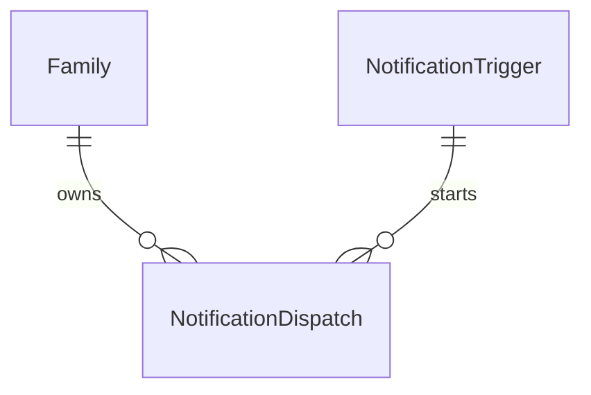

# 機能仕様 — U10 お知らせ

US9.1（`inception/user-stories/stories.md`）を実装するための振る舞いを定めます。送信は配信サービスによる受理までを確認し、端末への到達や既読は保証対象にしません。

## ワークフロー

### F1 起動と家族の選択

1. 信頼する定時処理からC5の種類と日本時間の対象日を受け取る。現在時刻は処理開始時に取得し、送信直前にも有効期限を確認する。
2. 種類・実在日付・月末条件・予定時刻を検証する。日次は16時、月末は21時を予定時刻とし、有効区間を「予定時刻以上、15分後未満」とする。期限外から新たな送信は始めない（BR11.1、Q1=A）。
3. 家族の持ち主が提供する内部列挙の窓口から、対象家族をページ単位で取得する。任意の家族IDを入力から受け付けない。既存C6にこの列挙窓口を追加する必要があり、所有権は家族の部品に残す。
4. 家族ごとのsystem文脈を作り、C6から現在のお知らせ先を読む。未登録は正常な送信省略。読込失敗とは区別する。
5. 家族ごとのF2またはF3を独立して実行する。1家族が失敗しても別の家族を継続し、失敗家族だけを同一キーで再処理する。

### F2 16時のリマインド

1. C8のisMonthConfirmedとlistDutiesOnから対象月の確定状態とその日の担当を取得する。
2. 確定済みまたは担当が空なら送信しない。確定取り消し後の別の日は通常どおり送信対象にする。
3. C6のメンバーとC7の種類から表示名を解決する。担当IDと種類IDで安定的に並べ、同名の子供やお手伝いを勝手にまとめない。
4. 「今日のお手伝い」と対象日、その日の全担当の「お手伝い名・担当者・未／済／×」を1通の本文へまとめる。未の担当だけへの絞り込みはしない。
5. 種類が消えていれば「不明なお手伝い」、名前が取得できない子供は「名前が分からない子供」とする。データ取得が失敗した場合は部分的な一覧を送らない。
6. F4で本文・送信先・再試行キーを固定する。初回の外部送信直前には月の確定状態を再確認する。確定していたら送らない。外部配信と同時の確定を原子的には扱えず、最後の確認後の変更はその通知に反映されない。

### F3 月末21時のまとめ

1. 対象月が対象日の月であることを確認し、C9のgetAllowancesで家族全員分の最新の金額を計算する。確定状態で送信を止めない。
2. 対象の子供が0人なら送信しない（Q2=A）。今いる子供に加え、その月の済の担当などからC9が返す子供を含む。
3. 「N月のお小遣い」と各子供の名前と整数円の合計を1通へまとめる。0円と負の金額をそのまま表示し、C9が返す並びを維持する。
4. U11の加算・減額はC9の計算結果を通して受け取る。U11のデータを直接読まない。U11がなくても動く。
5. F4で保存した本文は再試行中も固定する。金額の修正後も送信済みのまとめを再生成しない。アプリの表示には常に最新の計算結果が使われる。

### F4 配信と二重送信の防止

1. 家族・種類・対象日が一意な送信記録を条件付きで作成する。同じ通知の終端記録があれば終了する。送信記録を読めない・保存できない場合は送信しない。
2. 最初の配信準備で本文と送信先とC4の再試行キーを保存する。個人情報を含む本文をログには書かない。再試行時は保存済みの内容だけを使う。
3. 所有期限つきの排他的な権利を取得する。他の実行が処理中なら重複として扱う。所有者と版が一致する条件付き更新だけを受け付ける。
4. 現在のお知らせ先・期限・対象状態を確認し、sendingへ進め、C4の同じ再試行キーを付けて外部送信する。
5. 配信サービスが受理した場合または同じ要求の受理済みを確認できた場合にsentへ更新する。異なる通知の競合や一般的なエラーを受理済みとして扱わない。
6. 応答不明や送信後の保存失敗では、同じ本文・先・キーを保持する。所有期限後に再試行可能な状態へ戻す。先に配信サービスが受理していた場合の二重受理をC4のキーで防ぐ。
7. 一時的な失敗は回数・待ち時間・有効期限を満たす場合だけ自動再試行する。送信前に必ず期限を確認し、期限に達したらexpiredとする。数値の回数上限・所有期限・通信タイムアウトはNFR設計で決める。
8. 送信先変更を検出した未送信通知はskippedとする。すでに結果不明ならfailedとし作り手へ知らせる。新しいグループへ別キーで送り直さない。

### F5 失敗の知らせ

1. 初回の読込・保存・送信失敗をその場で運用上の失敗として記録する。再試行終了まで検知を遅らせない。
2. 家族へのLINE配信と独立した通知経路で、作り手へ15分以内に知らせる。定時処理が起動しない場合も監視で検知する。
3. 名前・金額・本文・送信先・秘密を運用通知とログへ含めない。処理種類・対象日・失敗分類・運用用識別子を用いる。
4. グループ未登録・担当なし・確定済み・子供なしという正常な省略は配信失敗として通知しない。

## 状態遷移

| 現在 | 条件 | 次 |
|---|---|---|
| 記録なし | 対象外という正常な判定 | skipped |
| 記録なし | 対象で内容の固定に成功 | prepared |
| prepared | 所有権取得・直前確認成功 | sending |
| prepared | 対象外・宛先変更 | skipped |
| prepared / sending | 期限到達 | expired |
| sending | 受理・同一要求受理済み確認 | sent |
| sending | 一時的な失敗・所有期限後の復旧 | prepared |
| prepared / sending | 回復しない失敗・試行上限・宛先不明 | failed |
| sent / skipped / failed / expired | 再起動 | 同じ結果のまま |

## エンティティの関係（派生ビュー）

テキストによる代替: 家族1つは複数の送信記録を持ち、起動1つから内部で列挙した複数の家族の送信記録を処理します。データ形の正本は`entities.md`です。

## 決まりの要約（派生ビュー）

`rules.md`のBR11.1〜BR11.12が正本です。時刻と家族範囲を検証し、リマインドとまとめの対象を判定し、同じ内容とキーによる期限内再試行で二重送信を防ぎます。正常な省略と失敗を分け、失敗だけを作り手へ知らせます。

## 受け入れシナリオ

| ID | 前提・操作 | 結果 |
|---|---|---|
| S1 | 未確定で当日の担当あり・16時 | 状態つきの全担当一覧を1通受理 |
| S2 | 担当なし／確定済み／送信先なし | 外部送信0回、正常な省略 |
| S3 | 確定を取り消した翌日の16時 | 当日の担当があれば送信 |
| S4 | 月末21時、確定・未確定の両方 | 各子供の合計を1通送信 |
| S5 | 対象の子供0人／全員0円 | 前者は省略、後者は0円を表示 |
| S6 | 同じ家族への二重起動と並行実行 | 同じキーと記録で1回だけ受理 |
| S7 | 送信受理後に保存が失敗 | 再試行で同じキーを使い2通目を作らない |
| S8 | 再試行途中で日付変更・15分経過 | 新しい外部送信なし、期限切れ |
| S9 | 予定時刻の直前／15分後ちょうど | どちらも新たな送信なし |
| S10 | 月末・うるう年・年越し | 日本時間の正しい日にだけ処理 |
| S11 | まとめ後に担当や加算減額を変更 | まとめの再送なし、画面は最新 |
| S12 | 一時的・恒久的・記録読込の失敗 | 失敗を検知し15分以内に作り手へ通知 |
| S13 | 1家族が失敗、別の家族は正常 | 正常家族を継続し失敗だけ再処理 |
| S14 | 送信準備後にグループ変更 | 古い先への新規送信なし、新しい先への再送なし |
| S15 | 月31日、毎日担当あり | 家族あたり最大32通。返事や運用通知と区別 |
| S16 | 非月末のまとめ・不正な起動 | 送信なし、失敗を記録 |
| S17 | 読込の一部が失敗・本文上限超過 | 部分的な一覧や金額を送らず運用通知 |

## 後続の設計へ引き継ぐこと

- 信頼する家族列挙の窓口の追加とsystem文脈での既存窓口の利用。
- 配信先の検証と外部送信の間に起こる変更は完全には原子化できないこと。
- 再試行の実行方式、所有期限、通信タイムアウト、監視の遅延予算、配信サービスの受理済み判定。
- 本文の長さと通数、送信記録の保護と保持期間。個人情報を無制限に保存しない。
- 実際の送信と15分以内の運用通知はステージングで測定する。

## Sources

- `inception/units-generation/unit-of-work.md`、`unit-of-work-story-map.md`（U10、US9.1、共有のAC1.2.4）
- `inception/user-stories/stories.md`（AC9.1.1〜AC9.1.10）
- `inception/requirements-analysis/requirements.md`（FR9、FR6.5、NFR1、NFR2、NFR4、NFR11）
- `inception/domain-design/components.md`（所有権）、`inception/contract-design/contract-summary.md`（C4〜C9）
- `functional-design-questions.md`（Q1=A、Q2=A）

## Assumptions & Open Questions

None.
