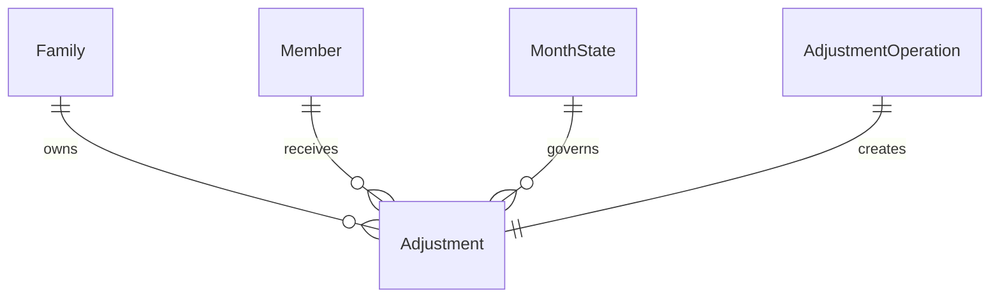

# U11 加算・減額の機能仕様

US8.2の振る舞いと状態遷移の正本です。データ形は`entities.md`、判断条件は`rules.md`を正本とします。画面と月末まとめに反映し、家族・カレンダーの所有境界は変えません。

## Entity Relationships

`entities.md`から導いた関連図です。MermaidのER構文として、識別子・関係演算子・ラベルを確認しています。

テキスト代替: 1家族・1子供・1月状態に複数の加算減額が対応します。作成時は1操作が1件を作ります。削除後も作成操作の履歴は失効まで残り、消えた対象を復活させません。

## Workflows

### 登録

1. 管理者がS5の未確定月で「加算・減額」を開く。S6へ対象月を渡す。既存の子供の一覧を表示し、対象の子供と種類を明示的に選ぶ。
2. 正の金額と理由を入力する。画面はBR12.2・BR12.3で検証し、誤りを欄の下に示す。子供がいない場合は保存できず、家族の設定への案内を出す。
3. 新しい操作キーを生成し、保存中の二重押下を防ぐ。入口は認証・所属・管理者を検証する。家族IDと作成者を本文から受け取らない。
4. お小遣いの窓口は月と入力を検証し、同じキーの成功記録があれば、同じ正規化済み入力に限り元の結果を返す。これは新しい変更ではないため、その後に月が確定・対象が削除されても復活させない。
5. 新規の場合はC6で対象が家族内の子供であることを確認する。C8の月状態と整合する保存境界で、未確定なら行と操作結果を一体で保存する。競合は最新状態を再確認し、確定済みならBR12.4で断る。
6. 成功を返し、S5の同じ月に戻って合計・内訳を再取得する。再取得に失敗しても作成を別キーで送り直さず、表示の再取得を案内する。
7. 通信断などで結果が不明なら同じキー・同じ入力の再送で確認する。入力を変える前には元の操作の結果を確かめる。明確に未保存と分かった場合は修正入力に新しいキーを使う。

### 削除・訂正

1. 管理者がS5の未確定月の加算減額行で「消す」を押す。
2. 対象の子供、符号付き金額、理由を示す小窓で確認する。「やめる」では何も変更しない。
3. 入口と部品の両方で権限と家族の範囲を確認する。保存済み行から対象月を取得し、月の未確定確認と削除を一体で成立させる。
4. 成功後は確認を閉じ、内訳と合計を再取得する。すでに消えていればNOT_FOUNDを表示して再取得する。応答不明後の再試行でNOT_FOUNDなら、最新の内訳を確認して結果を示す。
5. 訂正したい場合はS6から新しい内容を登録する。削除と入れ直しの間に月が確定された場合、新しい登録は断る。勝手に確定を解除しない。

### 読み取りと月末まとめ

1. C9が同じ家族・月の子供一覧と済の担当を既存の公開窓口で読む。
2. お小遣いが所有する加算減額を同じ家族・月で全件読み、子供ごとに符号付きの既存内訳形へ写す。安定した作成時刻・ID順で並べる。
3. BR12.5で全行を合計する。小遣いだけの子供・加算減額だけの子供も返す。0や負の合計も維持する。
4. APIは既存のお小遣い応答へこの内訳を含める。月末まとめも同じC9を使う。U10がすでに作成した送信内容の再送は既存方針どおり固定し、後の加算減額の変更で再送本文を差し替えない。

## State Transitions

| 対象 | 前の状態 | 操作と条件 | 後の状態 |
|---|---|---|---|
| 加算減額 | 未作成 | 管理者・正しい入力・未確定月 | 存在 |
| 加算減額 | 存在 | 同じ作成要求の再送 | 同じ1件が存在 |
| 加算減額 | 存在 | 管理者・未確定月で削除 | 削除済み |
| 加算減額 | 削除済み | 元の作成要求の再送・記録が有効 | 削除済みのまま。元の成功結果だけ返す |
| 加算減額 | 存在 | 確定月で削除 | 変化なし・MONTH_CONFIRMED |
| 月 | 未確定 | 月の確定 | 確定。以後は登録・削除不可 |
| 月 | 確定 | 既存の確定取消操作 | 未確定。再び登録・削除可 |

画面の状態: `editing → saving → saved → S5読取`。検証失敗はeditingのまま、通信結果不明は入力とキーを保持した再試行待ち、確定判明は変更不能の案内です。削除は`confirming → deleting → S5読取`、失敗時は確認内に理由を示します。

## Boundary Contracts

| 境界 | 入力・成功 | 失敗 |
|---|---|---|
| 登録 | `POST /v1/months/{month}/adjustments`、操作キー、childUserId・kind・amount・reason。201、Adjustment | 401未認証、403所属/管理者、404対象なし、409確定/操作キー競合、422入力、500予期せぬ失敗 |
| 削除 | `DELETE /v1/adjustments/{adjustmentId}`。204、本文なし | 401・403・404・409確定・422ID不正・500 |
| 内訳読取 | 既存`getAllowances`のAdjustmentLine: adjustmentId・符号付きamount・reason | 既存の読取失敗を保持。欠落を0としない |
| 対象確認 | C6のisChildOfFamily | falseならNOT_FOUND |
| 月の保護 | C8の月状態と整合する変更境界 | 月が確定ならMONTH_CONFIRMED。単なる事前読取だけにはしない |

種類不正・月不正・ID不正は既存INVALID_INPUT、理由の上限違反は追加のINVALID_REASONを使います。既存理由の意味や既存読取形は変更しません。C9への公開操作は既存契約の追加実装、保存方法の具体化はNFR設計で行います。

## Rules Summary

`rules.md`から導いた要約: BR12.1は管理者と家族、BR12.2は種類と金額、BR12.3は理由、BR12.4は確定月の保護、BR12.5は共通の計算、BR12.6は確認して削除、BR12.7は再送の重複防止、BR12.8は入力と画面応答の扱いです。

## Business Scenarios

| シナリオ | 期待結果・追跡 |
|---|---|
| 減額200・片付けをしなかった | -200と理由が1件。AC8.2.1 |
| 理由空欄・空白のみ | 保存せず文言を表示し入力保持。AC8.2.2 |
| 金額0・負数・小数 | 保存せず整数の文言。AC8.2.3 |
| 子供の登録・削除、他家族のID指定 | APIでも拒否・無変更。AC8.2.4、共通AC1.1.12 |
| 確定月の登録・削除、確定との競合 | 確定に先行しない変更は拒否。AC8.2.5 |
| 800+600-200 | 内訳800・600・-200、合計1200。AC8.2.6 |
| 100-300 | -200のまま。AC8.2.7 |
| 理由100・101文字、結合文字、絵文字 | 正規化とコードポイント基準で上限を一貫して検証。Q1 |
| 同じキーの並行登録・応答喪失・削除後の再送 | 1件だけ。削除した行を復活させない |
| 月変更後に旧月の保存・再取得が完了 | 新しい月の表示を古い応答で上書きしない |
| 月末まとめが生成済みの後に加算減額を変更 | 次のC9読取には反映、送信済み本文・再送本文は変更しない |

実装前にBDDシナリオを書き、認証・入力境界・並行処理・集計・画面・通知の結合を検証します。具体的な計測・性能・運用条件はNFR工程で定めます。

## Sources

- `inception/units-generation/unit-of-work.md` U11、`unit-of-work-story-map.md` US8.2と単位間の受け入れ条件
- `inception/user-stories/stories.md` US8.2、AC8.2.1〜AC8.2.7
- `inception/requirements-analysis/requirements.md` FR6.5・FR8.1〜FR8.3・FR9.3、NFR4・NFR6・NFR9
- `inception/domain-design/components.md` 所有者、`inception/contract-design/contract-summary.md` C1・C6・C8・C9
- `inception/refined-mockups/mockups.md` S5・S6、`functional-design-questions.md` Q1: A

## Assumptions & Open Questions

- [assumption] 月の保護・操作キー・読取の整合性は既存機構を使って実装できる。NFR設計で実現方法と競合試験を具体化する。
- LINE実送信・AWS配備はこの機能設計の完了証拠に含めない。
