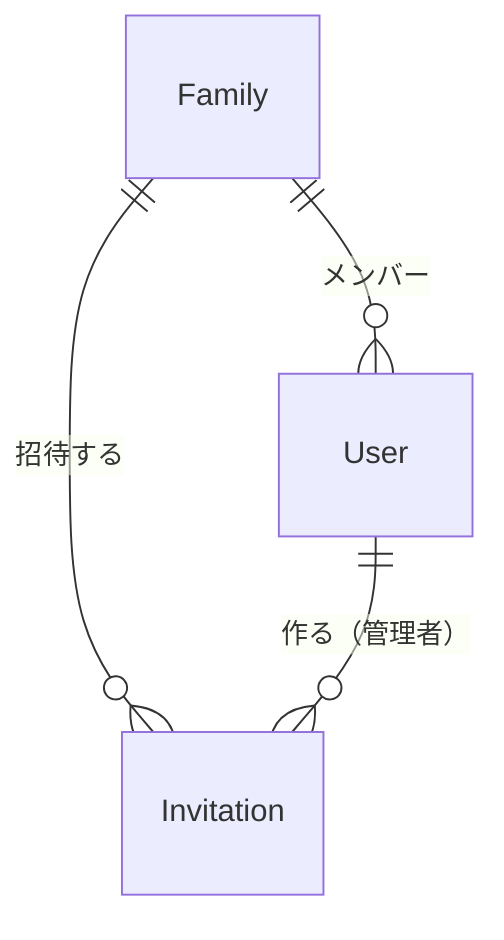

# データの形（Entities）— U2 招待

U2（`u2-invitation`）で扱うデータの形です。持ち主の部品は `inception/domain-design/components.md` の Entity Ownership のとおりで、招待は利用者・家族と同じく「家族とメンバー」が持ちます。U1 の利用者（User）と家族（Family）は `construction/u1-skeleton-family/functional-design/entities.md` のとおりで、ここでは U2 で足すものだけを書きます。使う技術にかかわらない、論理的な形だけを書きます。

## データの一覧（機械で読む形）

```yaml
entities:
  - name: Invitation
    label: 招待
    owner: 家族とメンバー
    description: 管理者が作る招待用のリンクの中身。1 つの家族で使える招待は、いつも最新の 1 つだけ [Q3]
    attributes:
      - name: invitationId
        type: string
        required: true
        unique: true
        constraints: 内部で使う招待の ID
      - name: familyId
        type: string
        required: true
        references: Family.familyId
        constraints: 招待した家族。参加した人が入る家族は、この値だけで決まる（URL や本文で受け取った家族は使わない）
      - name: token
        type: string
        required: true
        unique: true
        constraints: リンクに入れる印。推測できない十分に長いランダムな値（長さは NFR の段階で決める）。招待の ID とは別にする。管理者に再表示するため、取り出せる形で持つ（BR3.12）
      - name: createdByUserId
        type: string
        required: true
        references: User.userId
        constraints: 作った管理者
      - name: createdAt
        type: datetime
        required: true
        constraints: 作った時刻（UTC）
      - name: expiresAt
        type: datetime
        required: true
        constraints: createdAt のちょうど 24 時間後（UTC）。この時刻になったら使えない [Q1]
      - name: status
        type: enum
        required: true
        allowed: [active, replaced]
        default: active
        constraints: 管理者が新しい招待を作ると、前の招待は replaced になる [Q3]。期限切れは状態を変えず、expiresAt で判断する
    constraints:
      - 1 つの家族で status が active の招待は 0 か 1 つ [Q3]
      - 何人が参加しても招待は使い終わりにならない。期限まで何人でも使える [Q2]
      - 招待は消さない（期限が過ぎたものを消してよい時期は NFR の段階で決める）
    relationships:
      - target: Family
        cardinality: many-to-one
        direction: Invitation → Family（招待する家族）
      - target: User
        cardinality: many-to-one
        direction: Invitation → User（作った管理者）

  - name: User
    label: 利用者（U2 で足す項目）
    owner: 家族とメンバー
    description: U1 の利用者に、家族に入った時刻を足す。メンバーの一覧の並び順に使う
    attributes:
      - name: familyJoinedAt
        type: datetime
        required: false
        constraints: >-
          家族に入った時刻（UTC）。家族を作ったとき（U1 の createFamily）と、招待で参加したときに入れる。
          familyId があるときだけ値を持つ。U2 より前に家族を作った人は値がないことがあり、その場合は家族の createdAt と同じとみなす
    relationships: []

  - name: Family
    label: 家族（U2 で足す項目）
    owner: 家族とメンバー
    description: U1 の家族に、いま使える招待を足す。作り直しと参加の条件付きの書き込みに使う（BR3.4、BR3.8）
    attributes:
      - name: currentInvitationId
        type: string
        required: false
        references: Invitation.invitationId
        constraints: いま active の招待。招待を作ったことがなければ空。作り直すと新しい招待に変わる
    relationships: []

values:
  - name: InvitationPreview
    label: 参加する前に見せる招待の中身
    description: 招待のリンクを開いた人に「（家族の名前）に参加しますか？」と見せるための値 [Q5]。保存するデータではない
    attributes:
      - name: familyName
        type: string
        required: true
        constraints: 招待した家族の名前（Family.name）
      - name: expiresAt
        type: datetime
        required: true
        constraints: 招待の期限

  - name: MemberView
    label: メンバーの一覧の 1 行
    description: 家族の設定の画面に出すメンバー（契約 C6 の Member）[Q6]。保存するデータではない
    attributes:
      - name: userId
        type: string
        required: true
      - name: displayName
        type: string
        required: true
      - name: role
        type: enum
        required: true
        allowed: [admin, child]
```

## まとめ

- **招待（Invitation）:** 管理者が作る招待用のリンクの中身です。リンクに入れる推測できない印（token）と、招待した家族、期限（作ってから 24 時間）を持ちます [Q1]。期限までは何人でも使えます [Q2]。管理者が作り直すと前の招待は使えなくなり、使える招待はいつも最新の 1 つだけです [Q3]
- **利用者（User）に足す項目:** 家族に入った時刻（familyJoinedAt）です。メンバーの一覧を、入った順に並べるのに使います
- **参加する前に見せる中身（InvitationPreview）:** 招待のリンクを開いた人に、家族の名前を見せて確かめてもらうための値です [Q5]
- **メンバーの一覧の 1 行（MemberView）:** 家族の設定の画面に出す、表示名と役割です [Q6]

## データのつながり



文字での説明（図が表示されないとき）: 家族には複数のメンバー（利用者）がいます。家族は招待を何回も作れますが、使えるのは最新の 1 つだけです。招待は、作った管理者を覚えています。

## Sources

- `inception/domain-design/components.md`（家族とメンバーの部品、Entity Ownership）
- `inception/contract-design/contract-summary.md`（C1 `/family/invitations`、`/invitations/{token}/accept`、C6 `createInvitation`、`acceptInvitation`、`listMembers`、家族の範囲の決まり）
- `inception/requirements-analysis/requirements.md`（FR1.4、NFR4、Open Questions の「招待用のリンクの有効期限と使える回数」）
- `inception/user-stories/stories.md`（AC1.1.6〜AC1.1.9、AC1.1.13）
- `construction/u1-skeleton-family/functional-design/entities.md`（User、Family）
- `functional-design-questions.md` の回答 [Q1]〜[Q6]

## Assumptions & Open Questions

- token の長さと、期限が過ぎた招待を消す時期は、NFR の段階で決めます。token はハッシュだけにせず取り出せる形で持ちます（`rules.md` の Assumptions、レビュー R-01）
- 家族の currentInvitationId は、作り直しと参加を条件付きの書き込みにするために足しました（レビュー R-03、R-04）
- [assumption] familyJoinedAt は U1 の利用者に足す項目です。U1 の createFamily でも値を入れるように直します。ステージングにある U1 のデータには値がないため、家族の createdAt と同じとみなします
