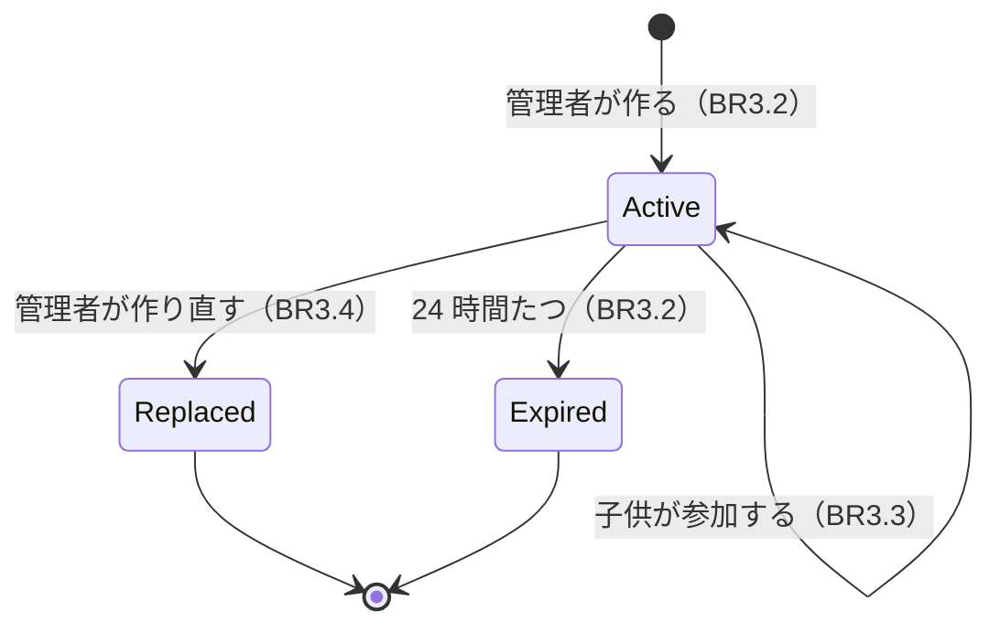

# 機能の仕様（Functional Spec）— U2 招待

U2（`u2-invitation`）では、管理者（お母さん）が招待用のリンクを作って LINE で送り、子供がそのリンクを開いて家族に子供として参加する流れと、家族のメンバーの一覧を作ります。受け持つ受け入れ条件は AC1.1.6〜AC1.1.9 と AC1.1.13 です。データの形は `entities.md`、決まりは `rules.md` にあります。

U2 で決めたこと:

- 招待用のリンクは、作ってから 24 時間使える [Q1]
- 1 つのリンクで、期限まで何人でも参加できる [Q2]
- リンクを作り直すと、前のリンクは使えなくなる [Q3]
- 友だち登録していない人がリンクを開いたら、登録の案内と「友だち登録したら、もう一度このリンクを開いてください」を出す [Q4]
- 参加する前に「（家族の名前）に参加しますか？」と確かめる [Q5]
- 「家族の設定」の画面に、メンバーの一覧と、管理者だけに招待のボタンを出す。カレンダーの枠の画面から進める [Q6]

## 流れ

### F1 家族の設定の画面を開く（BR3.11、BR3.12）

1. カレンダーの枠の画面の「家族の設定」を押す
2. 画面は `GET /v1/family/members` でメンバーの一覧を受け取り、表示名と役割（「管理者」「子供」）を出す（BR3.11）
3. 役割が管理者なら、`GET /v1/family/invitation` でいま使える招待を受け取る。あればリンク・「（日時）まで使えます」・「LINE で送る」・「リンクをコピー」・「招待用のリンクを作り直す」を出し、なければ「招待用のリンクを作る」を出す（BR3.12）
4. 役割が子供なら、メンバーの一覧だけを出す（BR3.1）

### F2 招待用のリンクを作る（AC1.1.6、BR3.1〜BR3.5）

1. 管理者が「招待用のリンクを作る」（または「作り直す」）を押す。作り直すときは「前のリンクは使えなくなります。作り直しますか？」と確かめる
2. 画面は `POST /v1/family/invitations` を `Idempotency-Key` つきで送る（BR3.5）
3. 裏側は requireAdmin で管理者かを確かめ（BR3.1）、前の招待を replaced にして新しい招待を作る（BR3.4）。期限は 24 時間後（BR3.2）
4. 応答のリンクと期限を F1 の 3 と同じ形で出す

### F3 LINE で送る（AC1.1.6、BR3.12）

1. 管理者が「LINE で送る」を押す
2. LINE の送り先を選ぶ画面が開き、次の文を送れる: 「（家族の名前）のお手伝いカレンダーに招待されました。このリンクを開いて参加してください。（日時）まで使えます。（リンク）」
3. 送り先を選ばずに閉じても、何も変わらない
4. 「リンクをコピー」を押すと、リンクをコピーして「コピーしました」と出す

### F4 子供が招待を作ろうとする（AC1.1.13、BR3.1）

1. 子供の家族の設定の画面には、招待のボタンを出さない
2. 子供が画面を通さずに `POST /v1/family/invitations` や `GET /v1/family/invitation` を送っても、403 `ADMIN_ONLY` で断り、招待は作らない

### F5 招待のリンクを開く（AC1.1.7〜AC1.1.9、BR3.6〜BR3.10）

1. 子供がリンクを開く。リンクはアプリの画面の URL に招待の印を付けたもの（`<アプリの URL>?invitation=<印>`）で、LINE の中でアプリの画面が開く
2. 画面はセッションを発行する（U1 の F3）
   - 403 `NOT_FRIEND` のとき: U1 の友だち登録の案内に「友だち登録したら、もう一度このリンクを開いてください」を足して出す。ここで終わる（BR3.10）
3. 画面は `GET /v1/invitations/{印}` を送る。裏側は次の順に確かめる
   1. 招待が使えなければ 409 `INVITATION_INVALID`。画面は「この招待は使えません。管理者に新しい招待を頼んでください」を出す（BR3.6、AC1.1.9）
   2. 開いた人がほかの家族に入っていれば 409 `ALREADY_IN_OTHER_FAMILY`。画面は「すでに別の家族に入っています」を出す（BR3.7、AC1.1.8）
   3. 開いた人が招待と同じ家族に入っていれば 409 `ALREADY_IN_FAMILY`。画面は「すでに家族に入っています」と「カレンダーへ」を出す（BR3.7）
   4. どの家族にも入っていなければ 200 で家族の名前と期限を返す
4. 画面は「（家族の名前）に参加しますか？」と「参加する」を出す（BR3.9）。開いただけでは参加しない

### F6 参加する（AC1.1.7、BR3.5〜BR3.8）

1. 子供が「参加する」を押す
2. 画面は `POST /v1/invitations/{印}/accept` を `Idempotency-Key` つきで送る（BR3.5）
3. 裏側は F5 の 3 の 1〜3 をもう一度確かめ（開いてから押すまでに期限が過ぎた・作り直された・別の家族に入った場合に備える）、招待がいまの招待で期限内であることと、その人がまだ家族に入っていないことの両方を条件にした 1 回の書き込みで、その人をその家族の子供にする（BR3.8）
4. 200 のとき、画面は今月のカレンダーの枠を出す（U1 の BR1.10 と同じ）
5. 409 のとき、F5 の 3 と同じ文言を出す

## U2 で作る画面用 API の操作

| 操作 | だれが使えるか | 流れ | 結果 |
|------|-------------|------|------|
| `GET /v1/family/members` | 家族のメンバー | F1 | 200 メンバーの一覧 / 403 `NOT_FAMILY_MEMBER` |
| `GET /v1/family/invitation` | 管理者 | F1 | 200 いま使える招待、または `null` / 403 `ADMIN_ONLY` |
| `POST /v1/family/invitations` | 管理者 | F2 | 201 作った招待 / 403 `ADMIN_ONLY` / 400 `IDEMPOTENCY_KEY_REQUIRED` |
| `GET /v1/invitations/{token}` | 友だち（家族に入っていなくてよい） | F5 | 200 家族の名前と期限 / 409 `INVITATION_INVALID`・`ALREADY_IN_OTHER_FAMILY`・`ALREADY_IN_FAMILY` |
| `POST /v1/invitations/{token}/accept` | 友だち（家族に入っていなくてよい） | F6 | 200 参加した / 409 同上 / 400 `IDEMPOTENCY_KEY_REQUIRED` |

どの操作も、U1 の共通の確かめ（セッション、ブロック中の 403 `NOT_FRIEND`）を先に通します（U1 の F7）。招待を開く・参加する操作は、家族を決める前に使う C6 の窓口なので、家族のメンバーである必要はありません。

## 契約への追加

契約（`inception/contract-design/contract-summary.md`）の決まりでは、項目・操作・理由の印を足すのは自由です。U2 で足すものは次のとおりです。壊す変更はありません。

| 契約 | 足すもの | 中身 |
|------|---------|------|
| C1 `GET /family/members` | 応答 | `[{ "userId": string, "displayName": string, "role": "admin" \| "child" }]`（並び順は BR3.11） |
| C1 `GET /family/invitation` | 操作 | 新しく足す。管理者だけ。200 `{ "url": string, "expiresAt": string } \| null`、403 `ADMIN_ONLY` |
| C1 `POST /family/invitations` | ヘッダー・応答 | `Idempotency-Key`（必須）。201 `{ "url": string, "expiresAt": string }`、400 `IDEMPOTENCY_KEY_REQUIRED` |
| C1 `GET /invitations/{token}` | 操作 | 新しく足す。200 `{ "familyName": string, "expiresAt": string }`、409 `INVITATION_INVALID`・`ALREADY_IN_OTHER_FAMILY`・`ALREADY_IN_FAMILY` |
| C1 `POST /invitations/{token}/accept` | ヘッダー・応答 | `Idempotency-Key`（必須）。409 に `ALREADY_IN_FAMILY` を足す。400 `IDEMPOTENCY_KEY_REQUIRED` |
| C6 家族とメンバー | 窓口 | `getCurrentInvitation(ctx): Invitation \| null \| ADMIN_ONLY`、`previewInvitation(userId, token): InvitationPreview \| INVITATION_INVALID \| ALREADY_IN_OTHER_FAMILY \| ALREADY_IN_FAMILY`（家族を決める前に使う窓口に足す） |
| C6 家族とメンバー | 結果 | `acceptInvitation(userId, token)` の結果に `ALREADY_IN_FAMILY` を足す |
| C10 理由の印 | 印 | `IDEMPOTENCY_KEY_REUSED`（同じ印で別の操作・対象の要求。422。BR3.5） |
| C10 文言 | 文言 | `INVITATION_NOT_FRIEND_HINT`: 友だち登録したら、もう一度このリンクを開いてください（画面だけで使う文言。理由の印ではない） |

## 招待の状態の変わり方

文字での説明（図が表示されないとき）: 管理者が作った招待は「使える」状態です。子供が参加しても「使える」ままです。管理者が作り直すと前の招待は「作り直された」になり、24 時間たつと「期限切れ」になります。どちらも、もう使えません。「期限切れ」は記録の状態を変えず、期限の時刻で判断します。

| いまの状態 | できごと | 次の状態 |
|-----------|---------|---------|
| （なし） | 管理者が作る | 使える |
| 使える | 子供が参加する | 使える |
| 使える | 管理者が作り直す | 作り直された（使えない） |
| 使える | 24 時間たつ | 期限切れ（使えない） |

## 利用者の状態の変わり方（U1 の図に足すところ）

| いまの状態 | できごと | 次の状態 |
|-----------|---------|---------|
| 友だち（家族に入っていない） | 使える招待で「参加する」 | 家族に入った友だち（子供） |
| 家族に入った友だち | 招待のリンクを開く | 変わらない（別の家族なら ALREADY_IN_OTHER_FAMILY、同じ家族なら ALREADY_IN_FAMILY） |
| 記録なし・ブロック中 | 招待のリンクを開く | 変わらない（友だち登録の案内） |

## 受け入れ条件との対応

| 受け入れ条件 | 流れ | 決まり |
|-------------|------|-------|
| AC1.1.6 管理者が招待用のリンクを作り、LINE で送れる | F1、F2、F3 | BR3.1、BR3.2、BR3.4、BR3.5、BR3.12 |
| AC1.1.7 招待を待っている人がリンクを開いて参加し、子供になる | F5、F6 | BR3.3、BR3.6、BR3.8、BR3.9 |
| AC1.1.8 ほかの家族の人は参加せず「すでに別の家族に入っています」 | F5、F6 | BR3.7 |
| AC1.1.9 無効なリンクでは参加せず「この招待は使えません…」 | F5、F6 | BR3.2、BR3.4、BR3.6 |
| AC1.1.13 子供は招待用のリンクを作れない | F4 | BR3.1 |

AC1.1.1〜AC1.1.5、AC1.1.10〜AC1.1.12 は U1 で作りました。

## Sources

- `inception/requirements-analysis/requirements.md`（FR1.2、FR1.4、FR1.7、NFR4）
- `inception/user-stories/stories.md`（AC1.1.6〜AC1.1.9、AC1.1.13）
- `inception/units-generation/unit-of-work.md`（U2 の受け持つこと）
- `inception/contract-design/contract-summary.md`（C1、C6、C10、契約の変更の決まり）
- `construction/u1-skeleton-family/functional-design/functional-spec.md`（F3、F7、最初の画面の決め方）
- `functional-design-questions.md` の回答 [Q1]〜[Q6]

## Assumptions & Open Questions

- [assumption] LIFF の URL にクエリ（`?invitation=<印>`）を付けて開くと、LIFF の初期化のあとに画面がその値を読める。B2 でステージングで確かめます
- [assumption] 「LINE で送る」に使う LINE の機能（shareTargetPicker か、LINE のシェアの URL）は、NFR・インフラの段階で確かめます
- 招待の作成の回数の上限、token の長さと保存の仕方は、NFR の段階で決めます
- 契約への追加（上の表）は、U1 と同じく契約の変更の一覧（`docs/contract-changes-u1.md` に続けて U2 の分）として残します
