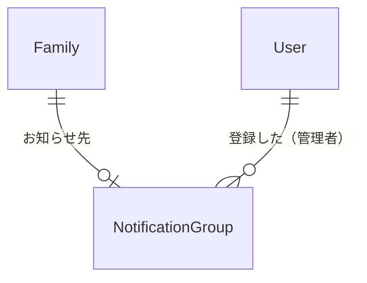

# データの形（Entities）— U3 お知らせ先

U3（`u3-notification-group`）で扱うデータの形です。持ち主の部品は `inception/domain-design/components.md` の Entity Ownership のとおりで、お知らせ先は「家族とメンバー」が持ちます。U1・U2 の利用者（User）、家族（Family）は `construction/u1-skeleton-family/functional-design/entities.md`、`construction/u2-invitation/functional-design/entities.md` のとおりで、ここでは U3 で足すものだけを書きます。使う技術にかかわらない、論理的な形だけを書きます。

## データの一覧（機械で読む形）

```yaml
entities:
  - name: NotificationGroup
    label: お知らせ先のグループ
    owner: 家族とメンバー
    description: >-
      家族のお知らせ先として登録された LINE のグループ。1 つのグループは 1 つの家族だけのお知らせ先になり [Q4]、
      1 つの家族のお知らせ先は 1 つだけ（FR1.5）
    attributes:
      - name: groupId
        type: string
        required: true
        unique: true
        constraints: LINE のグループ ID（Webhook の source.groupId）。同じグループの記録は 1 つだけ
      - name: familyId
        type: string
        required: true
        unique: true
        references: Family.familyId
        constraints: このグループをお知らせ先にした家族。1 つの家族に記録は 1 つだけ
      - name: groupName
        type: string
        required: false
        max: 100
        constraints: 登録したときに LINE から受け取ったグループの名前（家族の設定の画面に出す）[Q6]。受け取れなかったときは空
      - name: registeredByUserId
        type: string
        required: true
        references: User.userId
        constraints: 登録した管理者
      - name: registeredAt
        type: datetime
        required: true
        constraints: 登録した時刻（UTC）
    constraints:
      - groupId と familyId は、どちらも記録の中で一意（1 グループ 1 家族、1 家族 1 グループ）
      - 登録し直すと、その家族の前の記録を消して新しい記録を作る（AC1.2.2）
      - groupId の一意はこの記録のキーで、familyId の一意は家族の notificationGroupId（1 家族に 1 つの項目）で守る。2 つはいつも同じ条件つきのトランザクションで一緒に変える（rules.md の BR4.6、BR4.9。レビュー R-03）
      - 公式アカウントがグループから外されたら、その記録を消す [Q3]
    relationships:
      - target: Family
        cardinality: one-to-one
        direction: NotificationGroup → Family（お知らせ先）

  - name: Family
    label: 家族（U3 で足す項目）
    owner: 家族とメンバー
    description: U1・U2 の家族に、いまのお知らせ先のグループを足す
    attributes:
      - name: notificationGroupId
        type: string
        required: false
        references: NotificationGroup.groupId
        constraints: いまのお知らせ先のグループ。なければ空（AC1.2.4）
    relationships: []

values:
  - name: GroupCommand
    label: グループでの操作
    description: >-
      グループの中で公式アカウントに向けた操作。U3 では「お知らせ先にする」だけ（ボタンの押下、または「登録」と送る）[Q1]。
      U8 で「代わって」などを足す。保存するデータではない
    attributes:
      - name: kind
        type: enum
        required: true
        allowed: [registerNotificationGroup]
      - name: groupId
        type: string
        required: true
      - name: lineUserId
        type: string
        required: false
        constraints: 操作した人。LINE から届かないことがある（そのときは家族の人として扱えない）

  - name: NotificationGroupView
    label: 画面に出すお知らせ先
    description: 家族の設定の画面とカレンダーの枠の画面で使う値 [Q6]。保存するデータではない
    attributes:
      - name: groupName
        type: string
        required: false
      - name: registeredAt
        type: datetime
        required: true
```

## まとめ

- **お知らせ先のグループ（NotificationGroup）:** 家族のお知らせ先として登録した LINE のグループです。グループ ID、家族、グループの名前、登録した管理者、登録した時刻を持ちます。1 つのグループは 1 つの家族だけのお知らせ先になり [Q4]、1 つの家族のお知らせ先も 1 つだけです
- **家族（Family）に足す項目:** いまのお知らせ先のグループ ID です
- **グループでの操作（GroupCommand）:** グループの中での「お知らせ先にする」の操作です。ボタンを押すか「登録」と送ると届きます [Q1]
- **画面に出すお知らせ先（NotificationGroupView）:** グループの名前と登録した時刻です [Q6]

## データのつながり



文字での説明（図が表示されないとき）: 家族は 0 か 1 つのお知らせ先のグループを持ちます。お知らせ先のグループは、登録した管理者を覚えています。

## Sources

- `inception/domain-design/components.md`（家族とメンバーの部品、Entity Ownership）
- `inception/contract-design/contract-summary.md`（C3 join・message・postback、C6 `findFamilyByGroup`、`registerNotificationGroup`、`getNotificationGroup`）
- `inception/requirements-analysis/requirements.md`（FR1.5）
- `inception/user-stories/stories.md`（AC1.2.1〜AC1.2.5）
- `construction/u1-skeleton-family/functional-design/entities.md`、`construction/u2-invitation/functional-design/entities.md`
- `functional-design-questions.md` の回答 [Q1]〜[Q6]

## Assumptions & Open Questions

- [assumption] グループの Webhook のイベント（message、postback）には、操作した人の `source.userId` が入ります。入らないときは、その人を家族の人として扱えないので、BR4.4 のとおり断ります。B3 でステージングで確かめます
- [assumption] グループの名前は、LINE の Messaging API のグループの概要の取得で受け取れます。登録のときに 1 回だけ受け取り、記録に残します
