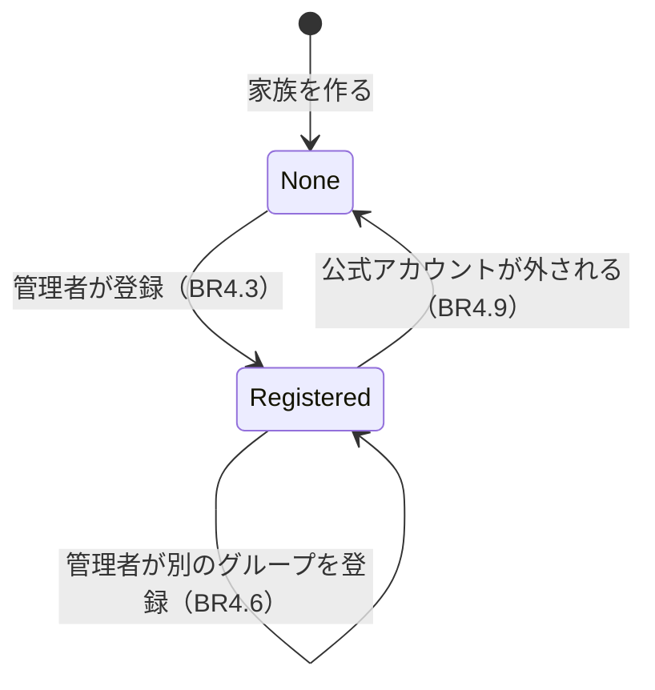

# 機能の仕様（Functional Spec）— U3 お知らせ先

U3（`u3-notification-group`）では、管理者が公式アカウントを家族のグループ LINE に招待し、そのグループをお知らせ先として登録する流れを作ります。受け持つ受け入れ条件は AC1.2.1〜AC1.2.5 です（AC1.2.1 の「お知らせが届く」は U10、「申し出ができる」は U8 が作り、U3 は登録までを作ります。AC1.2.4 の「何も送らない」は U10、AC1.2.5 の申し出は U8 が作り、U3 は断る仕組みを作ります）。データの形は `entities.md`、決まりは `rules.md` にあります。

U3 で決めたこと:

- 公式アカウントがグループに参加したら、ボタンつきの案内を送る。ボタンか「登録」で登録する [Q1]
- 登録できたら、家族の名前と届くお知らせを返事する [Q2]
- 公式アカウントがグループから外されたら、登録を外す [Q3]
- 1 つのグループは 1 つの家族だけのお知らせ先 [Q4]
- 家族でない人の登録の操作は、子供と同じ文言で断る [Q5]
- 登録がないとき管理者の画面に表示と手順を出し、家族の設定にグループの名前を出す [Q6]

## 流れ

### F1 公式アカウントがグループに参加する（BR4.1）

1. 管理者が公式アカウントを家族のグループ LINE に招待する
2. LINE から join イベントが届く（署名の確かめと、同じイベントを二度処理しない仕組みは U1 のとおり）
3. グループ（source.type が group）なら、reply で案内とボタン「このグループをお知らせ先にする」を送る。複数人のトーク（room）なら何もしない

### F2 お知らせ先にする（AC1.2.1、AC1.2.2、AC1.2.3、BR4.2〜BR4.8）

1. 管理者がボタンを押す（postback `action=group.register`）か、グループで「登録」と送る。1 対 1 のトークで「登録」と送られたら、「お知らせ先の登録は、家族のグループ LINE の中で行ってください」と返事して終わる。room では何もしない（BR4.13）
2. LINE 用の受け口は、source.userId から利用者を探す
   - 記録がない・ブロック中・家族に入っていない・source.userId がない・子供なら、「お知らせ先を登録できるのは管理者だけです」と返事して終わる（BR4.3、BR4.4）
3. そのグループがすでに登録されているかを確かめる
   - 別の家族のお知らせ先なら、「このグループはほかの家族のお知らせ先になっています」と返事して終わる（BR4.5）
   - 同じ家族のお知らせ先なら、何も変えずに 5 の返事をする
4. LINE からグループの名前を受け取る（2 秒で打ち切り、受け取れなくても続ける。BR4.8）。前のお知らせ先があれば消し、新しいお知らせ先を作り、家族のお知らせ先を変える（条件つきの 1 回のトランザクション。BR4.6）
5. reply で「このグループを（家族の名前）のお知らせ先にしました。毎日 16 時のリマインドと、月末のまとめがここに届きます」と返す（BR4.7）

### F3 公式アカウントがグループから外される（BR4.9）

1. LINE から leave イベントが届く
2. そのグループがある家族のお知らせ先なら、お知らせ先の記録を消し、家族のお知らせ先を空にする（1 つの操作）
3. 返事はしない

### F4 登録されていないグループでのアプリの操作（AC1.2.5、BR4.10）

1. グループでアプリの操作（U8 の「代わって」など）が届く
2. 操作の前に `findFamilyByGroup(groupId)` で家族を決める
3. 登録されていなければ、何もせず「このグループは家族のお知らせ先として登録されていません」と返事する
   - 登録されていても、操作した人がそのグループの家族のメンバーでなければ（別の家族の人、家族に入っていない人、友だちでない人）、何もせず「このアプリは家族のメンバーだけが使えます」と返事する。グループの家族の情報は返さない（BR4.10）
   - 確かめが通れば、ctx を `{ familyId: グループの家族, userId, role }` にして操作を呼ぶ
4. U3 では、この確かめの仕組み（グループの操作の入口）と筋書きを作る。U3 の時点で登録の操作以外にアプリの操作はないため、筋書きではテスト用の操作で確かめる

### F5 画面でお知らせ先を見る（AC1.2.4、BR4.11、BR4.12）

1. 管理者がカレンダーの枠の画面を開くと、画面は `GET /v1/family/notification-group` を呼ぶ（裏側は C6 の `getNotificationGroupView(ctx)`。グループ ID は画面に返さない）
2. お知らせ先がなければ（`null`）、画面の上に「お知らせ先のグループが登録されていません」と手順を出す。子供には出さない（子供は呼ばない）
3. 家族の設定の画面を開くと、管理者も子供も同じ操作を呼び、「お知らせ先: （グループの名前）」または「お知らせ先: 登録されていません」を出す

## U3 で作る操作

| 入口 | 操作 | だれが | 流れ | 結果 |
|------|------|-------|------|------|
| LINE 用の受け口 | join（グループ） | — | F1 | reply で案内とボタン |
| LINE 用の受け口 | postback `action=group.register`、message「登録」（グループ） | 家族の管理者 | F2 | reply で登録した・断った文言 |
| LINE 用の受け口 | leave（グループ） | — | F3 | 返事なし |
| 画面用 API | `GET /v1/family/notification-group` | 家族のメンバー | F5 | 200 `{ groupName, registeredAt }` か `null` / 403 `NOT_FAMILY_MEMBER` |

LINE 用の受け口の入口の確かめ（署名、同じイベントを二度処理しない、思いがけない失敗は 500）は U1 のとおりです。

## 契約への追加

契約（`inception/contract-design/contract-summary.md`）の決まりでは、項目・操作・理由の印を足すのは自由です。U3 で足すものは次のとおりです。壊す変更はありません。

| 契約 | 足すもの | 中身 |
|------|---------|------|
| C1 | 操作 | `GET /v1/family/notification-group`（家族のメンバー）。200 `{ "groupName": string \| null, "registeredAt": string } \| null`、403 `NOT_FAMILY_MEMBER` |
| C3 join | 扱い | source.type が group のときだけ、ボタンつきの案内を reply。room は何もしない |
| C3 leave | イベント | 新しく扱う。`家族とメンバー.unregisterNotificationGroupByGroup` |
| C3 postback | data | `action=group.register`（グループのボタン） |
| C3 message | 言葉 | グループで「登録」（前後の空白を除いてちょうど同じ） |
| C4 | 使う API | グループの概要の取得（グループの名前。登録のときに 1 回）。グループでの reply |
| C6 家族とメンバー | 窓口 | `registerNotificationGroup(ctx, groupId, groupName): { familyName } \| ADMIN_ONLY \| GROUP_USED_BY_OTHER_FAMILY`、`getNotificationGroupView(ctx): NotificationGroupView \| NOTIFICATION_GROUP_NOT_REGISTERED`（画面用。新しく足す） |
| C6 家族とメンバー | 窓口（家族を決める前に使う窓口に足す） | `unregisterNotificationGroupByGroup(groupId): void`（leave で使う。家族はグループの記録から決まる）。`findUserByLineId` は U1 で足したもの（`docs/contract-changes-u1.md`）を使う |
| C6 家族とメンバー | 変えない | `getNotificationGroup(ctx): groupId \| NOTIFICATION_GROUP_NOT_REGISTERED` は契約のまま（U10 が push の宛先に使う。レビュー R-01） |
| C10 理由の印 | 印と文言 | `GROUP_USED_BY_OTHER_FAMILY`（「このグループはほかの家族のお知らせ先になっています」）。子供を断る印は U1 の `ADMIN_ONLY` を使う（新しい印は足さない。レビュー R-04） |
| C10 文言 | 文言 | `NOTIFICATION_GROUP_ADMIN_ONLY`（LINE の返事の文言。「お知らせ先を登録できるのは管理者だけです」）、`GROUP_JOIN_GUIDE`（参加のあいさつ）、`GROUP_REGISTER_BUTTON`（「このグループをお知らせ先にする」）、`NOTIFICATION_GROUP_REGISTERED`（家族の名前を入れる）、`NOTIFICATION_GROUP_HOWTO`（画面の手順）、`GROUP_REGISTER_IN_GROUP_ONLY`（「お知らせ先の登録は、家族のグループ LINE の中で行ってください」） |

## お知らせ先の状態の変わり方

文字での説明（図が表示されないとき）: 家族を作ったときはお知らせ先がありません。管理者がグループで登録するとお知らせ先ができます。別のグループで登録すると、新しいグループに置き換わります。公式アカウントがお知らせ先のグループから外されると、お知らせ先がない状態に戻ります。

| いまの状態 | できごと | 次の状態 |
|-----------|---------|---------|
| お知らせ先なし | 管理者がグループで登録 | お知らせ先あり |
| お知らせ先あり | 管理者が同じグループで登録し直す | 変わらない |
| お知らせ先あり | 管理者が別のグループで登録 | お知らせ先あり（新しいグループ） |
| お知らせ先あり | 公式アカウントがお知らせ先のグループから外される | お知らせ先なし |
| お知らせ先あり | 公式アカウントが別のグループから外される | 変わらない |

## 受け入れ条件との対応

| 受け入れ条件 | 流れ | 決まり | U3 で作る範囲 |
|-------------|------|-------|-------------|
| AC1.2.1 グループを登録すると、お知らせが届き申し出ができる | F1、F2 | BR4.1〜BR4.8 | 登録まで（お知らせは U10、申し出は U8） |
| AC1.2.2 別のグループを登録すると置き換わる | F2 | BR4.6 | すべて |
| AC1.2.3 子供は登録できず「お知らせ先を登録できるのは管理者だけです」 | F2 | BR4.3 | すべて |
| AC1.2.4 お知らせ先がないとき、管理者の画面に表示 | F5 | BR4.11 | 画面の表示（送らないことは U10） |
| AC1.2.5 登録されていないグループの申し出を断る | F4 | BR4.10 | 断る仕組み（申し出は U8） |

## Sources

- `inception/requirements-analysis/requirements.md`（FR1.5）
- `inception/user-stories/stories.md`（AC1.2.1〜AC1.2.5）
- `inception/units-generation/unit-of-work.md`（U3 の受け持つこと）
- `inception/contract-design/contract-summary.md`（C1、C3、C4、C6、C10）
- `construction/u1-skeleton-family/functional-design/functional-spec.md`、`construction/u2-invitation/functional-design/functional-spec.md`
- `functional-design-questions.md` の回答 [Q1]〜[Q6]

## Assumptions & Open Questions

- [assumption] グループの message・postback のイベントに source.userId が入ります。B3 でステージングで確かめます
- [assumption] 公式アカウントがグループに参加できるよう、LINE Developers の管理画面で「グループトーク・複数人トークへの参加を許可する」を有効にします。手順はインフラの段階で README に書きます
- 契約への追加は、U1・U2 と同じく `docs/contract-changes-u3.md` に一覧として残します
- `registerNotificationGroup` は、契約の `(ctx, groupId): void | ADMIN_ONLY` から引数（groupName）と結果（familyName、GROUP_USED_BY_OTHER_FAMILY）を足した形に変えます。部品の窓口は同じコードの中なので、契約の変更の決まり（呼ぶ側を同じ変更の中で直す）に従います。U3 より前にこの窓口を呼ぶ単位はなく、U3 の LINE 用の受け口だけが呼びます。この変更も `docs/contract-changes-u3.md` に「形を変える変更」として載せます（レビュー R-09）
