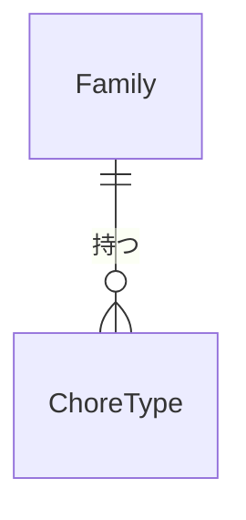

# データの形（Entities）— U4 お手伝いの種類

U4（`u4-chore-types`）で扱うデータの形です。持ち主の部品は `inception/domain-design/components.md` の Entity Ownership のとおりで、お手伝いの種類は「お手伝いの種類」の部品が持ちます。この部品はカレンダーに頼りません（頼り方は一方向。ADR-001）。使う技術にかかわらない、論理的な形だけを書きます。

## データの一覧（機械で読む形）

```yaml
entities:
  - name: ChoreType
    label: お手伝いの種類
    owner: お手伝いの種類
    description: 家族ごとのお手伝いの種類。名前・単価・説明と、使う／使わないを持つ（FR2.1、FR2.3）
    attributes:
      - name: choreTypeId
        type: string
        required: true
        unique: true
        constraints: 内部で使う種類の ID
      - name: familyId
        type: string
        required: true
        references: Family.familyId
        constraints: この種類を持つ家族。読み書きはいつも familyId を含む条件で行う（契約の家族の範囲の決まり）
      - name: name
        type: string
        required: true
        min: 1
        max: 20
        constraints: >-
          前後の空白（全角の空白を含む）を除いて 1〜20 文字。文字数は Unicode のコードポイントで数える。改行などの制御文字は断る。
          同じ家族の中で、前後の空白を除いた名前がちょうど同じ種類は 1 つだけ（「使わない」の種類も含む）[Q1]（レビュー R-03）
      - name: unitPrice
        type: integer
        required: true
        min: 0
        constraints: 円の整数。0 円以上。上限は決めない [Q2]（扱える整数の範囲を超える値は断る）
      - name: description
        type: string
        required: false
        max: 100
        constraints: 入れなくてもよい。入れるなら 100 文字まで [Q3]
      - name: active
        type: boolean
        required: true
        default: true
        constraints: false は「使わない」。管理者は true に戻せる [Q4]
      - name: createdAt
        type: datetime
        required: true
        constraints: 登録した時刻（UTC）。一覧の並び順に使う [Q5]
      - name: updatedAt
        type: datetime
        required: true
        constraints: 最後に変えた時刻（UTC）
    constraints:
      - 1 家族に登録できる数の上限は決めない [Q6]
      - 消すと記録は残らない（完全に消す。FR2.4）。消せるのは割り当てに一度も使われていない種類だけ
      - 単価を変えても、すでに付いた記録の金額は変わらない。記録のときに、その時点の単価をカレンダーが書き写す（ADR-003）
    relationships:
      - target: Family
        cardinality: many-to-one
        direction: ChoreType → Family

values:
  - name: ChoreTypeInput
    label: 種類の入力
    description: 登録・変更のときに画面から受け取る値。保存するデータではない
    attributes:
      - name: name
        type: string
        required: true
      - name: unitPrice
        type: integer
        required: true
      - name: description
        type: string
        required: false
      - name: active
        type: boolean
        required: false
        constraints: 変更のときだけ。登録のときは必ず true
```

## まとめ

- **お手伝いの種類（ChoreType）:** 家族ごとのお手伝いの種類です。名前（1〜20 文字、家族の中で重ならない）、単価（0 円以上の整数、上限なし）、説明（入れなくてもよい、100 文字まで）、使う／使わない、を持ちます [Q1]〜[Q4]。数の上限はありません [Q6]
- **種類の入力（ChoreTypeInput）:** 画面から受け取る名前・単価・説明・使う／使わないです

## データのつながり



文字での説明（図が表示されないとき）: 家族は 0 個以上のお手伝いの種類を持ちます。

## Sources

- `inception/domain-design/components.md`（お手伝いの種類の部品、Entity Ownership、ADR-001、ADR-003）
- `inception/contract-design/contract-summary.md`（C1 の `ChoreType`、`/chore-types`、C7）
- `inception/requirements-analysis/requirements.md`（FR2.1〜FR2.4）
- `inception/user-stories/stories.md`（AC2.1.1〜AC2.1.7）
- `functional-design-questions.md` の回答 [Q1]〜[Q6]

## Assumptions & Open Questions

- [assumption] 単価の上限は決めませんが、計算で扱える整数（JavaScript の安全な整数、約 9000 兆）を超える値は「単価は 0 円以上の整数で入力してください」で断ります [Q2]
- 名前が重なるかの比べ方は、前後の空白を除いた文字がちょうど同じかどうかです。全角と半角、ひらがなとカタカナの違いは別の名前として扱います
