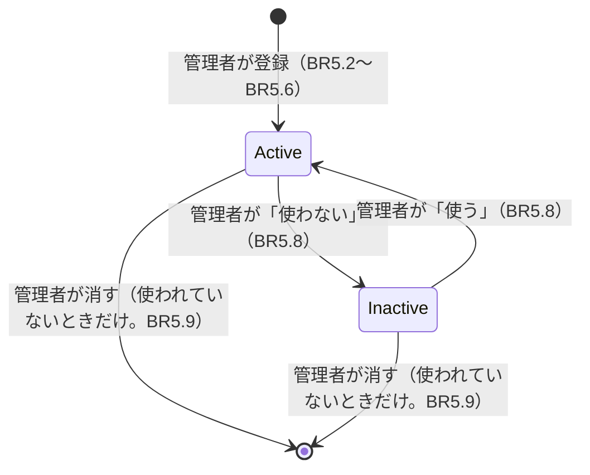

# 機能の仕様（Functional Spec）— U4 お手伝いの種類

U4（`u4-chore-types`）では、管理者がお手伝いの種類（名前・単価・説明）を登録・変更し、「使わない」「使う」を切り替え、割り当てに使われていない種類を消せるようにします。受け持つ受け入れ条件は AC2.1.1〜AC2.1.7 です（AC2.1.4 の金額は U9、AC2.1.5 の割り当てで選べないことは U5 が確かめます。U4 は今の単価の窓口と「使わない」の印を作ります）。データの形は `entities.md`、決まりは `rules.md` にあります。

U4 で決めたこと:

- 名前は 1〜20 文字で、同じ家族の中で重ならない。1 日に何回もあるお手伝いは「皿洗い（追加分）」のように分けて登録するよう案内する [Q1]
- 単価は 0 円以上の整数で、上限はない [Q2]
- 説明は入れなくてもよく、100 文字まで [Q3]
- 「使わない」にした種類は「使う」に戻せる [Q4]
- 「家族の設定」から「お手伝いの種類」の画面に進む。子供は見るだけ [Q5]
- 登録できる数の上限はない [Q6]

## 流れ

### F1 お手伝いの種類の画面を開く（BR5.11）

1. 「家族の設定」の画面の「お手伝いの種類」を押す
2. 画面は `GET /v1/chore-types` で一覧を受け取り、「使う」の種類を登録した順に、そのあとに「使わない」の種類を「使わない」の印つきで出す。それぞれ「名前　単価（例: 100 円）」と説明を出す
3. 管理者には「追加」と、それぞれの種類に「変更」「使わない（または使う）」「消す」を出す。子供にはボタンを出さない（BR5.1）

### F2 種類を登録する（AC2.1.1、AC2.1.2、BR5.2〜BR5.6、BR5.12）

1. 管理者が「追加」を押すと、名前・単価・説明の入力欄が出る。名前の欄の下に「1 日に 2 回以上あるお手伝いは『皿洗い（追加分）』のように分けて登録します」と出す（BR5.4）
2. 「保存」を押すと、画面は `POST /v1/chore-types` を `Idempotency-Key` つきで送る
3. 裏側は requireAdmin で管理者かを確かめ（BR5.1）、名前・単価・説明を確かめる（BR5.2、BR5.5、BR5.6）。同じ家族に同じ名前があれば断る（BR5.3）
4. 201 のとき、一覧に「皿洗い　100 円」のように出る（AC2.1.1）
5. 422・409 のとき、入力欄は入力した内容のまま残し、欄の下に文言を出す（AC2.1.2）

### F3 種類を変える（BR5.2〜BR5.7）

1. 管理者が「変更」を押すと、今の名前・単価・説明が入った入力欄が出る
2. 「保存」で `PUT /v1/chore-types/{choreTypeId}` を送る。確かめは F2 の 3 と同じ（名前の重なりは自分以外の種類と比べる）
3. 単価を変えても、すでに付いた記録の金額は変わらない。画面の入力欄の下に「単価を変えると、このあとに付く記録から新しい単価になります」と出す（BR5.7）

### F4 「使わない」「使う」を切り替える（AC2.1.5、BR5.8）

1. 管理者が「使わない」を押すと、「使わないにすると、新しい割り当てで選べなくなります。過去の記録とお小遣いはそのまま残ります」と確かめる
2. 「使わないにする」を押すと、`PATCH /v1/chore-types/{choreTypeId}` で `{ "active": false }` だけを送る（名前・単価の変更とは別の操作。BR5.8）。一覧の下の「使わない」のまとまりに移る
3. 「使わない」の種類の「使う」を押すと、`{ "active": true }` を送り、上の「使う」のまとまりに戻る（確かめはしない）

### F5 種類を消す（AC2.1.6、AC2.1.7、BR5.9）

1. 管理者が「消す」を押すと、「この種類を消しますか？ 消すと元に戻せません」と確かめる
2. 「消す」を押すと、`DELETE /v1/chore-types/{choreTypeId}` を送る
3. 裏側は、まずその種類を「使わない」にし、そのあとで入口が C8 `isChoreTypeAssigned` で使われたかを確かめる（BR5.9。U5 ができるまでは、仮の窓口がいつも使われていないを返す。テストでは差し替えて「使われている」も確かめる）
   - 使われたことがあれば 409 `CHORE_TYPE_IN_USE`。種類は「使わない」のまま残る。画面は「割り当てに使われたことがあるので消せません。『使わない』にしました」と出し、一覧を読み直す（AC2.1.6）
   - 使われていなければ 204。一覧から消える（AC2.1.7）
   - 送り直しなどで種類がもうなければ 404。画面は「すでに消えています」と出し、一覧を読み直す

### F6 子供が操作しようとする（AC2.1.3、BR5.1）

1. 子供の画面にはボタンを出さない
2. 子供が画面を通さずに POST・PUT・DELETE を送っても、403 `ADMIN_ONLY` で断り、何も変えない

## U4 で作る画面用 API の操作

| 操作 | だれが | 流れ | 結果 |
|------|-------|------|------|
| `GET /v1/chore-types` | 家族のメンバー | F1 | 200 種類の一覧（BR5.11 の並び） / 403 `NOT_FAMILY_MEMBER` |
| `POST /v1/chore-types` | 管理者 | F2 | 201 作った種類 / 422 `INVALID_CHORE_TYPE_NAME`・`INVALID_UNIT_PRICE`・`INVALID_DESCRIPTION` / 409 `CHORE_TYPE_NAME_TAKEN` / 403 `ADMIN_ONLY` / 400 `IDEMPOTENCY_KEY_REQUIRED` |
| `PUT /v1/chore-types/{choreTypeId}` | 管理者 | F3 | 200 変えた種類 / 422、409（同上） / 404 `NOT_FOUND` / 403 `ADMIN_ONLY` |
| `PATCH /v1/chore-types/{choreTypeId}` | 管理者 | F4 | 200 変えた種類 / 404 `NOT_FOUND` / 403 `ADMIN_ONLY` |
| `DELETE /v1/chore-types/{choreTypeId}` | 管理者 | F5 | 204 / 409 `CHORE_TYPE_IN_USE` / 404 `NOT_FOUND` / 403 `ADMIN_ONLY` |

どの操作も U1 の共通の確かめ（セッション、ブロック中の 403 `NOT_FRIEND`、家族のメンバー）を先に通します。

## 契約への追加

契約（`inception/contract-design/contract-summary.md`）の決まりでは、項目・操作・理由の印を足すのは自由です。U4 で足すものは次のとおりです。壊す変更はありません。

| 契約 | 足すもの | 中身 |
|------|---------|------|
| C1 `POST /chore-types` | 本文・ヘッダー・応答 | 本文 `{ "name": string, "unitPrice": integer, "description"?: string }`。`Idempotency-Key`（必須）。201 `ChoreType`、422 `INVALID_CHORE_TYPE_NAME`・`INVALID_UNIT_PRICE`・`INVALID_DESCRIPTION`、409 `CHORE_TYPE_NAME_TAKEN` |
| C1 `PUT /chore-types/{choreTypeId}` | 本文・応答 | 本文 `{ "name": string, "unitPrice": integer, "description"?: string }`（名前・単価・説明を送り直す。`active` は含めない）。200 `ChoreType`、422・409（同上）、404 `NOT_FOUND` |
| C1 `PATCH /chore-types/{choreTypeId}` | 操作 | 新しく足す。本文 `{ "active": boolean }` だけ。200 `ChoreType`、404 `NOT_FOUND`、403 `ADMIN_ONLY`（契約の「使う／使わないを変える」を、名前・単価の変更と分けた。レビュー R-04） |
| C7 お手伝いの種類 | 結果の決まり | `list(ctx)` は「使わない」の種類も `active` つきで返す。`getCurrentUnitPrice(ctx, choreTypeId)` は「使わない」の種類にも単価を返し、NOT_FOUND は種類がないかほかの家族のときだけ。`setActive(ctx, choreTypeId, active): ChoreType \| NOT_FOUND`（新しく足す）。`delete(ctx, choreTypeId): void \| NOT_FOUND`（呼ぶ前に入口が `setActive(false)` と C8 の確かめをする）（レビュー R-02） |
| C1 `GET /chore-types` | 応答 | 200 `ChoreType[]`（BR5.11 の並び） |
| C1 `DELETE /chore-types/{choreTypeId}` | 応答 | 404 `NOT_FOUND` を足す |
| C7 お手伝いの種類 | 結果 | `create(ctx, input): ChoreType \| INVALID_CHORE_TYPE_NAME \| INVALID_UNIT_PRICE \| INVALID_DESCRIPTION \| CHORE_TYPE_NAME_TAKEN`、`update(ctx, choreTypeId, input): ChoreType \| 同上 \| NOT_FOUND` |
| C8 カレンダー | 窓口（仮） | `isChoreTypeAssigned(ctx, choreTypeId): boolean` を U4 で仮に置き、false を返す。テストで差し替えられる作りにする。U5 で本物にする |
| C8 カレンダー | U5 への引き継ぎ | `saveAssignment` は、種類が「使う」であることを保存と同じ書き込みの条件にする（消す操作との競合を防ぐ。レビュー R-01） |
| C10 理由の印 | 印と文言 | `INVALID_CHORE_TYPE_NAME`（「名前を 1〜20 文字で入力してください」）、`CHORE_TYPE_NAME_TAKEN`（「同じ名前の種類があります。1 日に 2 回以上あるお手伝いは『皿洗い（追加分）』のように、別の名前で登録してください」）、`INVALID_DESCRIPTION`（「説明は 100 文字までで入力してください」）、`CHORE_TYPE_IN_USE` の文言（「割り当てに使われたことがあるので消せません。『使わない』にしてください」） |
| C10 文言 | 文言 | `CHORE_TYPE_NAME_HINT`（名前の欄の案内）、`CHORE_TYPE_PRICE_CHANGE_NOTE`、`CHORE_TYPE_DEACTIVATE_CONFIRM`、`CHORE_TYPE_DELETE_CONFIRM` |

## 種類の状態の変わり方

文字での説明（図が表示されないとき）: 管理者が登録した種類は「使う」です。「使わない」にでき、「使う」に戻せます。割り当てに一度も使われていなければ、どちらの状態からでも消せます。

| いまの状態 | できごと | 次の状態 |
|-----------|---------|---------|
| （なし） | 管理者が登録 | 使う |
| 使う | 管理者が「使わない」 | 使わない |
| 使わない | 管理者が「使う」 | 使う |
| 使う・使わない | 管理者が消す（使われていない） | （なし） |
| 使う・使わない | 管理者が消す（使われたことがある） | 変わらない（409） |

## 受け入れ条件との対応

| 受け入れ条件 | 流れ | 決まり | U4 で作る範囲 |
|-------------|------|-------|-------------|
| AC2.1.1 登録すると一覧に「皿洗い 100 円」 | F1、F2 | BR5.2〜BR5.6 | すべて |
| AC2.1.2 -1・小数・空欄は保存せず文言、入力は残る | F2、F3 | BR5.5 | すべて |
| AC2.1.3 子供は登録・変更できない | F6 | BR5.1 | すべて |
| AC2.1.4 単価を変えると、そのあとの記録から新しい単価 | F3 | BR5.7 | 今の単価の窓口（金額の計算は U9、書き写しは U6） |
| AC2.1.5 「使わない」は割り当てで選べず、過去は残る | F4 | BR5.8 | 「使わない」の印（選べないことは U5） |
| AC2.1.6 使われたことがある種類は消せず、「使わない」を案内 | F5 | BR5.9 | 断る流れ（使われたかの確かめは U5 でつなぐ） |
| AC2.1.7 使われていない種類は消せる | F5 | BR5.9 | すべて |

## Sources

- `inception/requirements-analysis/requirements.md`（FR2.1〜FR2.4）
- `inception/user-stories/stories.md`（AC2.1.1〜AC2.1.7）
- `inception/units-generation/unit-of-work.md`（U4 の受け持つことと実装の注意）
- `inception/contract-design/contract-summary.md`（C1、C7、C8、C10）
- `inception/domain-design/components.md`（ADR-001、ADR-003）
- `construction/u2-invitation/functional-design/functional-spec.md`（家族の設定の画面）
- `functional-design-questions.md` の回答 [Q1]〜[Q6]

## Assumptions & Open Questions

- 契約への追加は、U1〜U3 と同じく `docs/contract-changes-u4.md` に一覧として残します
- 種類の数に上限がないため、一覧は 1 回で全部を返します（家族の量では数十件ほど）。多くなったときの分け方は、必要になったら後の版で決めます
