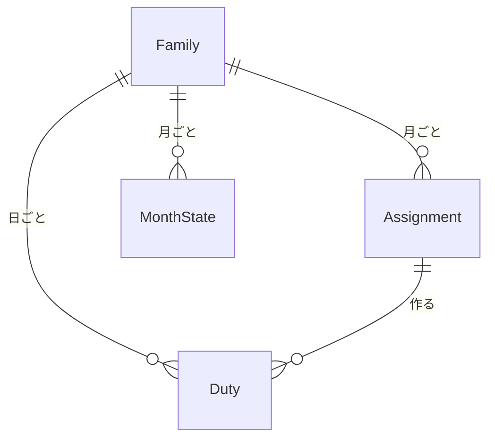

# データの形（Entities）— U5 割り当てとカレンダー

U5（`u5-assignment-calendar`）で扱うデータの形です。持ち主の部品は `inception/domain-design/components.md` の Entity Ownership のとおりで、割り当て・担当・月の状態は「カレンダー（担当と記録）」の部品が持ちます。カレンダーはお手伝いの種類を C7、家族と子供を C6 の窓口を通して使います（頼り方は一方向。ADR-001）。U6〜U8 が状態・記録・申し出を足せるよう、担当に「どこから来た担当か」と、記録の項目を最初から持たせます。使う技術にかかわらない、論理的な形だけを書きます。

## データの一覧（機械で読む形）

```yaml
entities:
  - name: Assignment
    label: 月の割り当て
    owner: カレンダー（担当と記録）
    description: 家族と月ごとの割り当て。お手伝いの種類ごとに、担当の子供と曜日の組を持つ（FR3.1）
    attributes:
      - name: familyId
        type: string
        required: true
        references: Family.familyId
      - name: month
        type: string
        required: true
        constraints: 日本時間の年月（例 2027-01）。familyId と month の組で 1 つ
      - name: rules
        type: array
        required: true
        constraints: >-
          AssignmentRule（choreTypeId、childUserId、weekdays）の並び。同じ種類と子供の組は 1 つにまとめる。
          weekdays は 0（日）〜6（土）の重ならない 1〜7 個
      - name: updatedAt
        type: datetime
        required: true
      - name: updatedByUserId
        type: string
        required: true
        references: User.userId
    constraints:
      - 同じ種類で同じ曜日に、2 人以上の子供の組があってはいけない（FR3.4）
      - 保存できるのは今月と来月だけ（日本時間）[Q1]
    relationships:
      - target: Family
        cardinality: many-to-one
        direction: Assignment → Family

  - name: Duty
    label: 日ごとの担当
    owner: カレンダー（担当と記録）
    description: ある日のあるお手伝いの担当（契約 C1 の Duty）。割り当ての保存で作られ、日ごとの変更・記録・申し出で変わる
    attributes:
      - name: dutyId
        type: string
        required: true
        unique: true
      - name: familyId
        type: string
        required: true
        references: Family.familyId
      - name: date
        type: date
        required: true
        constraints: 日本時間の日付
      - name: choreTypeId
        type: string
        required: true
        references: ChoreType.choreTypeId
      - name: childUserId
        type: string
        required: true
        references: User.userId
        constraints: その家族の子供
      - name: status
        type: enum
        required: true
        allowed: [todo, done, skipped]
        default: todo
        constraints: 未・済・×。U5 では todo だけを作る。done と skipped は U6・U7 が付ける（U5 のテストでは前提データ）
      - name: origin
        type: enum
        required: true
        allowed: [rule, manual, swap]
        default: rule
        constraints: >-
          rule は割り当てから作られた担当、manual は管理者が日ごとに子供を変えた担当、swap は代わりにやるで引き受けた担当（U8 が付ける）。
          保存し直すときの確認の一覧（FR3.3）に使う
      - name: recordedAt
        type: datetime
        required: false
        constraints: 記録した時刻（UTC）。U6・U7 が付ける
      - name: recordedBy
        type: string
        required: false
        constraints: 記録した人の userId（契約 C1 の Duty の名前に合わせる。レビュー R-05）。U6・U7 が付ける
      - name: version
        type: integer
        required: true
        default: 1
        constraints: 担当が変わるたびに 1 増える（子供の変更、記録、状態の変更、申し出の引き受け）。保存し直しの確かめの印と、書き込みの条件に使う（レビュー R-02）
      - name: unitPrice
        type: integer
        required: false
        constraints: 記録のときに書き写した単価（ADR-003）。U6・U7 が付ける
    constraints:
      - 同じ家族・日付・種類の担当は 1 つだけ
      - 子供を変えられるのは status が todo のときだけ（FR3.2）
      - 確定した月の担当は変えられない（FR3.5）
    relationships:
      - target: Assignment
        cardinality: many-to-one
        direction: Duty → Assignment（同じ家族と月）

  - name: MonthState
    label: 月の状態
    owner: カレンダー（担当と記録）
    description: 家族と月ごとの確定の状態。確定の操作は U7。U5 は読むだけ（U5 のテストでは前提データ）
    attributes:
      - name: familyId
        type: string
        required: true
      - name: month
        type: string
        required: true
      - name: confirmed
        type: boolean
        required: true
        default: false
        constraints: 記録がない月は確定していない（false）として扱う（レビュー R-06）
    relationships: []

values:
  - name: AssignmentRule
    label: 割り当ての 1 行
    description: 種類・子供・曜日の組（契約 C1）
  - name: OverwriteChange
    label: 上書きされる担当の変化
    description: 保存し直すときに確かめる 1 行（例「1月22日 皿洗い: 太郎 → 花子」）。保存するデータではない
    attributes:
      - name: date
        type: date
      - name: choreTypeId
        type: string
      - name: fromChildUserId
        type: string
      - name: toChildUserId
        type: string
        required: false
        constraints: 作り直したあとにその日のその種類の担当がなければ空（「なし」と出す）
  - name: OverlapItem
    label: 重なり
    description: 同じ日の同じ種類に 2 人以上入る組（例「1月4日(月) の皿洗いに担当が 2 人います」）。保存するデータではない
```

## まとめ

- **月の割り当て（Assignment）:** 家族と月ごとに、種類・子供・曜日の組を持ちます。保存できるのは今月と来月だけです [Q1]
- **日ごとの担当（Duty）:** ある日のあるお手伝いの担当です。状態（未・済・×）と、どこから来た担当か（割り当て、日ごとの変更、代わりにやる）を持ちます。記録の時刻・記録した人・単価は U6・U7 が付けます
- **月の状態（MonthState）:** 確定したかどうかです。確定の操作は U7 で、U5 は読むだけです
- **上書きされる担当の変化・重なり:** 保存のときに画面に出す一覧です

## データのつながり



文字での説明（図が表示されないとき）: 家族は月ごとに割り当てと月の状態を持ち、日ごとの担当を持ちます。割り当てを保存すると、その月の日ごとの担当ができます。

## Sources

- `inception/domain-design/components.md`（カレンダーの部品、Entity Ownership、ADR-001、ADR-003）
- `inception/contract-design/contract-summary.md`（C1 の `AssignmentRule`、`Duty`、`MonthCalendar`、C8）
- `inception/requirements-analysis/requirements.md`（FR3.1〜FR3.5、FR4.1〜FR4.5）
- `inception/user-stories/stories.md`（AC3.1.1〜AC3.1.8、AC4.1.1〜AC4.1.7）
- `inception/units-generation/unit-of-work.md`（U5 の実装の注意）
- `functional-design-questions.md` の回答 [Q1]〜[Q5]

## Assumptions & Open Questions

- 担当の `origin` の `swap` は U8 が付けます。U5 は値を用意し、確認の一覧で扱います（U5 のテストでは前提データ）
- 子供が家族から抜ける操作は最初の版にないので、割り当ての子供がいなくなることは考えません
