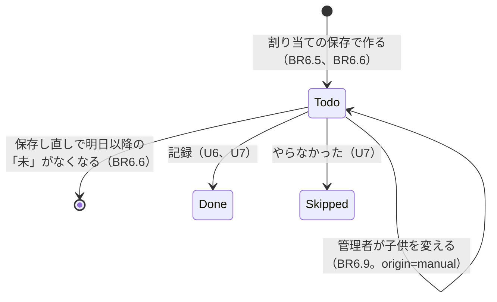

# 機能の仕様（Functional Spec）— U5 割り当てとカレンダー

U5（`u5-assignment-calendar`）では、管理者が月の割り当てを入力して日ごとの担当を作り、家族全員がカレンダーで担当と状態を見られるようにします。受け持つ受け入れ条件は AC3.1.1〜AC3.1.8 と AC4.1.1〜AC4.1.7 です（AC4.1.3 のお小遣いは U9。「済」「×」の状態と確定は U6・U7 が作り、U5 のテストでは前提データで用意します）。データの形は `entities.md`、決まりは `rules.md` にあります。

U5 で決めたこと:

- 割り当てを入力できるのは今月と来月だけ [Q1]
- 月の途中で初めて保存したときは、今日から月末までの担当を作る [Q2]
- カレンダーは日ごとの縦の一覧。今月を開くと今日の位置を見せる [Q3]
- 前の月・次の月のボタンで、どの月でも見られる [Q4]
- 割り当ての画面に「先月と同じにする」ボタン [Q5]

## 流れ

### F1 カレンダーを開く（AC4.1.1、AC4.1.3〜AC4.1.6、BR6.11〜BR6.16）

1. アプリを開くと、画面は今月の `GET /v1/months/{month}/calendar` を呼ぶ（U1 のカレンダーの枠を、この画面に置き換える）
2. 月の名前と「前の月」「次の月」、確定した月なら「確定済み」を出す
3. 1 日から月末までの日を上から並べ、それぞれに「皿洗い=太郎(済)」のように担当を全部出す。担当のない日は「担当なし」。今月なら今日の位置を見せる
4. 割り当ての記録がない月（`hasAssignment` が false）は「この月の割り当てはまだありません」。管理者で今月か来月なら「割り当てを入力する」も出す
5. 管理者で今月か来月なら、割り当てがある月にも「割り当てを変える」を出す
6. 失敗したら「表示できませんでした。もう一度お試しください」と「読み込み直す」
7. U2・U3 の「家族の設定」への入口と、U3 のお知らせ先がないときの表示は、この画面の上に残す

### F2 日の詳細を見る（AC4.1.2、BR6.13）

1. 日付を押すと、その日の担当ごとに、種類・子供・状態と、記録した時刻（日本時間の時:分）・記録した人を出す（例「皿洗い　太郎　済 16:42 太郎が記録」）
2. 管理者には、「未」の担当に「担当を変える」を出す（F4）

### F3 割り当てを入力して保存する（AC3.1.1、AC3.1.4〜AC3.1.8、BR6.1〜BR6.8、BR6.17）

1. 管理者が「割り当てを入力する」（または「割り当てを変える」）を押すと、`GET /v1/months/{month}/assignment` で今の割り当てを読み、種類ごとの入力欄を出す（「使う」の種類だけ。今の割り当てに「使わない」の種類があれば「使わない」の印つきで出し、外すよう案内する）
2. 種類ごとに、子供を選び、曜日（日〜土）を選ぶ。1 つの種類に、子供ごとの行を足せる
3. 「先月と同じにする」を押すと、先月の割り当てを入力欄に入れる（BR6.17）
4. 「保存」を押すと、`PUT /v1/months/{month}/assignment` を `{ rules }` で送る
5. 裏側は次の順に確かめる
   1. 管理者か（BR6.1）
   2. 確定していないか、今月か来月か（BR6.2）
   3. 行の形・種類・子供（BR6.3）
   4. 重なり（BR6.4）→ 422 `ASSIGNMENT_OVERLAP` と一覧
   5. 作る担当と作り直す担当を決める（BR6.5、BR6.6）
   6. 上書きされる日ごとの変更・引き受けがあり、確かめの印が今の一覧と合わなければ 409 `OVERWRITE_CONFIRMATION_REQUIRED` と変化の一覧と `changesHash`（BR6.7）
   7. 担当をまとまりに分けて書き（種類が「使う」で、担当が「未」で version が変わっていないことを条件に）、最後に割り当ての記録を書く（BR6.6、BR6.8）
6. 409 `OVERWRITE_CONFIRMATION_REQUIRED` のとき、画面は「次の担当が上書きされます」と「1月22日 皿洗い: 太郎 → 花子」の一覧、「この内容で保存する」と「やめる」を出す。「この内容で保存する」で、受け取った `changesHash` を `confirmedChangesHash` に入れて送り直す。そのあいだに担当が変わっていれば、新しい一覧がもう一度出る
7. 200 のとき、カレンダーに戻り、作った担当が出る
8. 422・409 のときは入力欄を残し、文言（重なりの一覧、「この月は確定済みです」など）を出す

### F4 日ごとの担当の子供を変える（AC3.1.2、AC3.1.3、AC3.1.7、BR6.9）

1. 管理者が日の詳細で「担当を変える」を押し、子供を選ぶ
2. 画面は `PATCH /v1/duties/{dutyId}` を `{ childUserId }` で送る
3. 裏側は管理者か・担当があるか・確定していないか・「未」か・子供か、の順に確かめ、子供を変える（origin は manual）
4. 409 `DUTY_NOT_TODO` は「記録を取り消してから変更してください」、409 `MONTH_CONFIRMED` は「この月は確定済みです」

### F5 種類が使われたかを答える（U4 の C8、BR6.10）

1. U4 の種類を消す操作は、U4 の仮の窓口ではなく、カレンダーの `isChoreTypeAssigned(ctx, choreTypeId)` を呼ぶ
2. その家族のどの月の割り当てか、どの担当にその種類があれば true

## U5 で作る画面用 API の操作

| 操作 | だれが | 流れ | 結果 |
|------|-------|------|------|
| `GET /v1/months/{month}/calendar` | 家族のメンバー | F1、F2 | 200 `MonthCalendar` / 403 / 422 `INVALID_MONTH`（月の形が違う） |
| `GET /v1/months/{month}/assignment` | 家族のメンバー | F3 | 200 `{ month, rules, exists }` / 403 / 422 `INVALID_MONTH` |
| `PUT /v1/months/{month}/assignment` | 管理者 | F3 | 200 `MonthCalendar` / 422 `ASSIGNMENT_OVERLAP`・`INVALID_ASSIGNMENT`・`CHORE_TYPE_INACTIVE`・`MONTH_NOT_EDITABLE`・`INVALID_MONTH` / 409 `MONTH_CONFIRMED`・`OVERWRITE_CONFIRMATION_REQUIRED` / 404 / 403 |
| `PATCH /v1/duties/{dutyId}` | 管理者 | F4 | 200 `Duty` / 409 `DUTY_NOT_TODO`・`MONTH_CONFIRMED` / 404 / 403 / 422 `INVALID_REQUEST` |

どの操作も U1 の共通の確かめ（セッション、ブロック中の 403 `NOT_FRIEND`、家族のメンバー）を先に通します。

## 契約への追加

契約（`inception/contract-design/contract-summary.md`）の決まりでは、項目・操作・理由の印を足すのは自由です。U5 で足すものは次のとおりです。壊す変更はありません。

| 契約 | 足すもの | 中身 |
|------|---------|------|
| C1 `Duty` | 項目 | `origin`（`rule`・`manual`・`swap`）、`recordedByName`（記録した人の表示名。画面で「太郎が記録」と出すため） |
| C1 `MonthCalendar` | 項目 | `children`（その家族の子供の userId と表示名。担当の子供の名前を出し、選ぶため）、`choreTypes`（担当に出てくる種類の ID・名前・使う／使わない）、`today`（裏側の日本時間の今日。レビュー R-04）。`hasAssignment` は「割り当ての記録が保存されているか」（行が 0 行でも true）。true で担当がない日は「担当なし」を出し、「この月の割り当てはまだありません」は false のときだけ出す（レビュー R-06） |
| C1 `Duty` | 項目 | `version`（整数。担当が変わるたびに増える） |
| C1 `PUT /months/{month}/assignment` | 本文 | `confirmOverwrite`（真偽値）を `confirmedChangesHash`（文字列、任意）に置き換える。409 `OVERWRITE_CONFIRMATION_REQUIRED` の `details` に `changesHash` を足す。まだどの単位もこの項目を使っていないので、壊す変更にはならない（レビュー R-02） |
| C8 カレンダー | 窓口の形 | `saveAssignment(ctx, month, rules, confirmedChangesHash, today): MonthCalendar \| ASSIGNMENT_OVERLAP \| OVERWRITE_CONFIRMATION_REQUIRED \| MONTH_CONFIRMED \| MONTH_NOT_EDITABLE \| CHORE_TYPE_INACTIVE \| INVALID_ASSIGNMENT \| NOT_FOUND`、`changeDutyChild(ctx, dutyId, childUserId)` の結果に `NOT_FOUND`。担当が変わった・消えたことを伝える仕組み（`onDutyReassigned`）を C8 の中に用意し、U8 が申し出の取り下げに使う（レビュー R-03、R-05） |
| C1 `GET /months/{month}/assignment` | 応答 | 200 `{ "month": string, "rules": AssignmentRule[], "exists": boolean }` |
| C1 `PUT /months/{month}/assignment` | 応答 | 200 `MonthCalendar`。422 `ASSIGNMENT_OVERLAP` の `details.overlaps`（`date`、`weekday`、`choreTypeId`、`childUserIds`）。409 `OVERWRITE_CONFIRMATION_REQUIRED` の `details.changes`（`date`、`choreTypeId`、`fromChildUserId`、`toChildUserId`）。422 `MONTH_NOT_EDITABLE`、`INVALID_ASSIGNMENT`、`INVALID_MONTH` |
| C1 `PATCH /duties/{dutyId}` | 本文・応答 | 本文 `{ "childUserId": string }`。200 `Duty`、404、422 `INVALID_REQUEST` |
| C8 カレンダー | 窓口 | `getAssignment(ctx, month)` を足す。`isChoreTypeAssigned` を本物にする（U4 の仮の窓口を置き換える） |
| C10 理由の印 | 印と文言 | `MONTH_NOT_EDITABLE`（「割り当てを入力できるのは今月と来月だけです」）、`INVALID_ASSIGNMENT`（「割り当ての入力に誤りがあります」）、`INVALID_MONTH`。`ASSIGNMENT_OVERLAP` の文言（値を入れる:「{月}月{日}日({曜}) の{種類}に担当が 2 人います」）、`OVERWRITE_CONFIRMATION_REQUIRED` の文言（「{月}月{日}日 {種類}: {前} → {後}」） |
| C10 文言 | 文言 | 「この月の割り当てはまだありません」（`NO_ASSIGNMENT`）、「担当なし」、「確定済み」、「先月と同じにする」の結果の文言 2 つ、「次の担当が上書きされます」 |

## 担当の状態の変わり方（U5 の分）

文字での説明（図が表示されないとき）: 割り当てを保存すると「未」の担当ができます。「未」の担当は、管理者が子供を変えられ、保存し直しで明日以降なら作り直されます（なくなることもあります）。「済」と「×」は U6・U7 が付け、U5 の保存し直しでは変わりません。

## 受け入れ条件との対応

| 受け入れ条件 | 流れ | 決まり | U5 で作る範囲 |
|-------------|------|-------|-------------|
| AC3.1.1 月曜・木曜に担当ができる | F3 | BR6.3、BR6.5 | すべて |
| AC3.1.2 「未」の担当の子供を変える | F4 | BR6.9 | すべて |
| AC3.1.3 「済」は変えられない | F4 | BR6.9 | すべて（「済」は前提データ） |
| AC3.1.4 保存し直しで過ぎた日と今日と「済」は変わらない | F3 | BR6.6 | すべて |
| AC3.1.5 引き受けた担当の上書きを確かめる | F3 | BR6.7 | すべて（引き受けた担当は前提データ） |
| AC3.1.6 重なりをすべて出す | F3 | BR6.4 | すべて |
| AC3.1.7 確定した月は変えられない | F3、F4 | BR6.2、BR6.9 | すべて（確定は前提データ） |
| AC3.1.8 子供は保存・変更できない | F3、F4 | BR6.1 | すべて |
| AC4.1.1 今月のカレンダー、文字で状態、確定済み | F1 | BR6.11 | すべて（「済」と確定は前提データ） |
| AC4.1.2 日の詳細に時刻と記録した人 | F2 | BR6.13 | すべて（記録は前提データ） |
| AC4.1.3 全員の担当とお小遣いが見られる | F1 | BR6.15 | 担当まで（お小遣いは U9） |
| AC4.1.4 割り当てがない月の表示と管理者のボタン | F1 | BR6.14 | すべて |
| AC4.1.5 失敗の表示と読み込み直し | F1 | BR6.16 | すべて |
| AC4.1.6 20 回中 19 回が 3 秒以内 | F1 | — | NFR の段階で決め、ステージングで測る |
| AC4.1.7 色の差・押す場所・文字の状態（すべての画面） | F1〜F4 | BR6.11 | U5 の画面と、それまでの画面の確かめ |

## Sources

- `inception/requirements-analysis/requirements.md`（FR3.1〜FR3.5、FR4.1〜FR4.5）
- `inception/user-stories/stories.md`（AC3.1.1〜AC3.1.8、AC4.1.1〜AC4.1.7）
- `inception/units-generation/unit-of-work.md`（U5 の受け持つことと実装の注意）
- `inception/contract-design/contract-summary.md`（C1、C6、C7、C8、C10）
- `construction/u4-chore-types/functional-design/functional-spec.md`（C8 の引き継ぎ）
- `construction/u3-notification-group/functional-design/functional-spec.md`（カレンダーの枠の上のお知らせ先の表示）
- `functional-design-questions.md` の回答 [Q1]〜[Q5]

## Assumptions & Open Questions

- 契約への追加は、U1〜U4 と同じく `docs/contract-changes-u5.md` に一覧として残します
- AC4.1.7 の「アプリのすべての画面」のうち、U6 以降の画面（お小遣い、加算・減額など）は、それぞれの単位で確かめます
