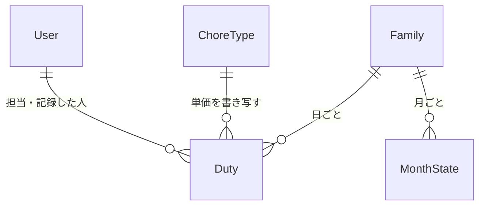

# データの形（Entities）— U6 記録

U6（`u6-recording`）で扱うデータの形です。U6 は新しい保存先を作りません。U5 が作った「日ごとの担当（Duty）」の記録の項目（記録した時刻・記録した人・単価）に値を書き込み、状態を「未」から「済」に変えるだけです。担当を作ることも消すことも、`origin` を変えることもしません（U5 からの引き継ぎ）。持ち主の部品は `inception/domain-design/components.md` の Entity Ownership のとおりで、担当と月の状態は「カレンダー（担当と記録）」、単価はC7「お手伝いの種類」が持ちます。カレンダーは単価を C7 の窓口 `getCurrentUnitPrice` で読み、家族と子供の確かめは C6 の窓口を通します（頼り方は一方向。ADR-001）。使う技術にかかわらない、論理的な形だけを書きます。

## データの一覧（機械で読む形）

```yaml
entities:
  - name: Duty
    label: 日ごとの担当（U6 が記録の項目を書く）
    owner: カレンダー（担当と記録）
    description: ある日のあるお手伝いの担当。U5 が作り、U6 は「未」の担当を「済」にして、記録の項目に値を書き込む（FR5.1、FR5.5、FR2.2）
    attributes:
      - name: dutyId
        type: string
        required: true
        unique: true
        constraints: 書き込みの条件に使う。U6 は変えない
      - name: childUserId
        type: string
        required: true
        references: User.userId
        constraints: 記録できるのは、この子供本人だけ（FR5.7）
      - name: date
        type: date
        required: true
        constraints: 日本時間の日付。記録できるのは今日まで（FR5.5）。LINE の「やった」は今日の担当だけ（FR5.1）
      - name: status
        type: enum
        required: true
        allowed: [todo, done, skipped]
        constraints: >-
          U6 が変えるのは todo → done だけ。skipped（×）は子供が記録も変更もできない（FR5.6）。
          done → todo と、skipped への変更は U7（管理者）の操作で、U6 には作らない [Q5]
      - name: recordedAt
        type: datetime
        required: false
        constraints: 記録した時刻（UTC）。todo → done のとき、裏側の時計の「今」を 1 回だけ取って書く。一度書いたら U6 は変えない。画面には日本時間の時と分で出す
      - name: recordedBy
        type: string
        required: false
        references: User.userId
        constraints: 記録した人の userId。U6 では、いつも記録した子供本人（ctx.userId）
      - name: unitPrice
        type: integer
        required: false
        constraints: >-
          記録のときに書き写す単価（円。0 以上の整数）。U4 の getCurrentUnitPrice が返した値を、記録と同じ書き込みで書く。
          一度書いたら U6 は変えない。あとから種類の単価を変えても、この値は変わらない（FR2.2、ADR-003）
      - name: updatedAt
        type: datetime
        required: true
        constraints: 担当を書き換えるたびに更新する時刻（UTC。U5 の担当の更新と同じ）。U6 は記録の書き込みで recordedAt と同じ「今」を書く
      - name: version
        type: integer
        required: true
        constraints: 記録のたびに 1 増える。書き込みの条件（dutyId と version と status=todo）に使う。LINE の選択肢と画面の要求には、見せた時点の version を持たせる
      - name: origin
        type: enum
        required: true
        constraints: U6 は読むだけで変えない（U5 の引き継ぎ）
    constraints:
      - 「済」になった担当の recordedAt・recordedBy・unitPrice は、3 つ同時に書かれる。どれか 1 つだけが空の「済」は、U6 では作らない
      - 状態を「済」にする書き込みは、担当が「未」で version と dutyId が読んだときと同じこと、その月が確定していないこと、単価が書き写した値のままであることを、同じ取引で確かめる
      - 同じ担当が 2 回「済」になることはない（FR5.3）。2 回目以降の要求は、書き込まずに最初の結果を返す
    relationships:
      - target: ChoreType
        cardinality: many-to-one
        direction: Duty → ChoreType（単価を読むだけ）
      - target: MonthState
        cardinality: many-to-one
        direction: Duty → MonthState（確定を読むだけ）

  - name: ChoreType
    label: お手伝いの種類（U4 の持ち物。U6 は読むだけ）
    owner: お手伝いの種類
    description: 名前・単価・使う／使わない。U6 は C7 の窓口で今の単価と名前を読む
    attributes:
      - name: unitPrice
        type: integer
        required: true
        constraints: 「使わない」の種類にも今の単価がある（U4 の getCurrentUnitPrice の決まり）。「使わない」の種類の担当も記録できる（FR2.3）
    relationships: []

  - name: MonthState
    label: 月の状態（U7 の持ち物。U6 は読むだけ）
    owner: カレンダー（担当と記録）
    description: 家族と月ごとの確定の状態。記録の書き込みは、その担当の月が確定していないことを条件にする
    attributes:
      - name: confirmed
        type: boolean
        required: true
        default: false
        constraints: 記録がない月は確定していない（false）として扱う
    relationships: []

values:
  - name: RecordPostback
    label: 記録の選択肢に持たせる値（LINE の postback の data）
    description: >-
      リッチメニューの「やった」は action=record.list。担当の選択肢のボタンは action=record.do と dutyId と v（見せた時点の version）。
      受け口だけが読み解く。保存するデータではない。秘密の情報は入れない
    attributes:
      - name: action
        type: enum
        allowed: [record.list, record.do]
      - name: dutyId
        type: string
        required: false
        constraints: record.do のときだけ
      - name: v
        type: integer
        required: false
        constraints: record.do のときだけ。見せた時点の担当の version
  - name: TodayRecordableList
    label: 今日の担当の一覧（LINE の選択肢の元）
    description: >-
      自分の今日の担当を、記録できるもの（selectable）と、できないもの（「済」「×」。状態の文字を添えて見せるだけ）に分けた並び。保存しない。
      結果の形は、月が確定していれば理由の印 MONTH_CONFIRMED だけ、それ以外はいつも成功の形 { selectable, notSelectable } とする。
      NO_RECORDABLE_DUTY は理由の印として返さず、selectable が 0 件の成功を受けた呼び出し側が「今日記録できる担当はありません」の文を選び、notSelectable を添える
    attributes:
      - name: selectable
        type: array
        constraints: 状態が todo の担当。dutyId・種類の名前・version を持つ。1 件以上あるときだけ選択肢を出す
      - name: notSelectable
        type: array
        constraints: 状態が done か skipped の担当。種類の名前と状態の文字（「済 16:42」「×」）。selectable が 0 件でも返す（NO_RECORDABLE_DUTY の返事に添える。AC5.1.3）
  - name: RecordResult
    label: 記録の結果
    description: >-
      recordDuty の成功の結果。duty（記録後の担当）と alreadyRecorded（すでに自分が記録していて、書き込まなかったとき true）。
      LINE の返事と画面の更新に使う。保存しない
```

## まとめ

- **新しい保存先はありません。** U6 が書くのは、U5 の「日ごとの担当」の `status`、`recordedAt`、`recordedBy`、`unitPrice`、`updatedAt`、`version` の 6 項目だけです（`updatedAt` は U5 の更新と同じく、書き換えのたびに更新します）
- **単価は担当に書き写して持ちます。** 記録の書き込みと同じ取引で、U4 の `getCurrentUnitPrice` が返した値を `unitPrice` に書きます。あとから単価を変えても、書き写した値は変わりません（FR2.2）。U9 は「済」の担当の `unitPrice` を足し合わせて額を出します
- **選択肢の値（RecordPostback）・一覧（TodayRecordableList）・結果（RecordResult）** は、保存しない値です

## データのつながり



文字での説明（図が表示されないとき）: 家族は日ごとの担当と月の状態を持ちます。担当は、お手伝いの種類の単価を記録のときに書き写し、担当の子供と記録した人（子供本人）を持ちます。

## Sources

- `inception/domain-design/components.md`（カレンダーの部品、Entity Ownership、ADR-001、ADR-003）
- `inception/contract-design/contract-summary.md`（C1 の `Duty`、`POST /duties/{dutyId}/record`、C3 の postback、C7 `getCurrentUnitPrice`、C8 `listTodayRecordableDuties`・`recordDuty`）
- `inception/requirements-analysis/requirements.md`（FR2.2、FR5.1〜FR5.8、NFR11）
- `construction/u5-assignment-calendar/functional-design/entities.md`、`docs/contract-changes-u5.md`（担当の書き換えの条件、`origin`、`version`）
- `docs/contract-changes-u4.md`（`getCurrentUnitPrice` の決まり）
- `functional-design-questions.md` の回答 [Q1]〜[Q5]

## Assumptions & Open Questions

- [assumption] 「済」の担当の `unitPrice` が空になることはありません。U5 のテストで前提データとして作る「済」の担当にも、3 つの記録の項目を同時に入れます
- U7 が「済」を取り消すときに記録の項目を消すか残すかは、U7 の機能設計で決めます。U6 は取り消し後の「未」の担当に、もう一度記録できる前提で作ります
