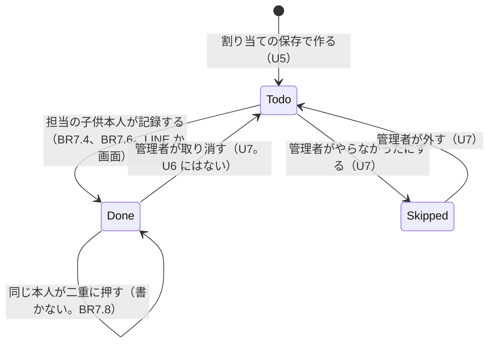

# 機能の仕様（Functional Spec）— U6 記録

U6（`u6-recording`）では、子供が、やったお手伝いを、LINE のリッチメニューの「やった」と、アプリの画面から記録できるようにします。受け持つ受け入れ条件は US5.1 の AC5.1.1〜AC5.1.15 です（AC5.1.13 のお小遣いの額の表示は U9。U6 では、担当に書き写した中身で確かめます）。データの形は `entities.md`、決まりは `rules.md` にあります。「済」の取り消し、「×」にすること、月の確定は、管理者の画面（U7）で作ります。

U6 で決めたこと:

- 「やった」を押したときは、担当が 1 つだけのときも選択肢を出し、選んだものを記録する [Q1]
- 管理者には「お手伝いの記録は子供のメニューです。記録の修正は画面からできます」、家族に入っていない人には「先に家族に参加してください」と、それぞれ本人にだけ返す。記録はしない [Q2]
- 選んだ担当が選ぶ前に変わっていたら、「この担当は先に変更されました」と伝え、いまの選択肢を出し直す [Q3]
- 画面では、記録できる担当に「やった」を付け、「1/5 皿洗いを記録しますか」と確認してから記録する。記録できない担当には、理由を文字で出す [Q4]
- 子供が自分で取り消す仕組みは作らない。間違えたときは管理者が U7 で取り消す [Q5]
- 記録の単価は、書き込みの直前に U4 の `getCurrentUnitPrice` で読み、同じ書き込みで担当に書き写す。読んだ単価のままであることも同じ取引で確かめる（BR7.7）
- 担当を書き換えるときは、`dutyId` と `version` と「未」を条件にし、月が確定していないことも同じ取引で確かめる。担当を作らない・消さない・`origin` を変えない（U5 からの約束）

## 流れ

### F1 LINE のリッチメニュー「やった」を押す（AC5.1.1、AC5.1.3、AC5.1.5、AC5.1.6、BR7.1〜BR7.3、BR7.15）

1. 子供が 1 対 1 のトークのリッチメニューで「やった」を押す。LINE の受け口に postback（`action=record.list`）が届く
2. 受け口は、署名の確かめと二度処理しない記録（U1 の BR2.7）を通したあと、`source.type` が user の postback を、記録の操作として受け付ける（今はグループの操作だけを受け付けているので、入口の `accepts` に足す）
3. 1 対 1 用の入口が、`source.userId` の利用者を探す（BR7.1）
   - 管理者 → 「お手伝いの記録は子供のメニューです。記録の修正は画面からできます」を本人に返して終わり [Q2]
   - 家族に入っていない人・記録がない人・ブロック中の人 → 「先に家族に参加してください」を返して終わり [Q2]
   - 家族に入っている子供 → 次へ
4. `listTodayRecordableDuties(ctx, today)` を呼ぶ（BR7.2）
   - 今日の月が確定している → 「この月は確定済みです」
   - 「未」の担当が 0 件 → 「今日記録できる担当はありません」。「済」「×」の担当があれば、続けて「皿洗い（済 16:42）」のような選べない文字の並びを同じ返事に付ける（AC5.1.3、AC5.1.5）。今日の担当が 1 件もなければ、最初の文だけ
   - 1 件以上 → 選択肢を返す [Q1]
5. 選択肢は 1 回の reply で、見出しの文「どのお手伝いを記録しますか」、Flex Message の carousel（「未」の担当ごとに 1 つのバブルとボタン。最大 12 個）、選べない文字の並び（「済」「×」の担当。あれば）の順。「未」が 13 件以上のときは先頭の 12 件だけをバブルにし、並びの末尾に「ほかの担当はアプリから記録してください」を添える（BR7.2）。ボタンの値は次の形（BR7.3）

```text
action=record.do&dutyId=<担当の ID>&v=<見せた時点の version>
```

### F2 LINE で担当を選んで記録する（AC5.1.1、AC5.1.2、AC5.1.4、BR7.4〜BR7.9、BR7.11）

1. 子供が選択肢のボタンを押す。postback（`action=record.do`）が届く。F1 の 2.〜3. と同じ入口を通る（子供でなければ F1 の案内）
2. `recordDuty(ctx, dutyId, v, { todayOnly: true, now })` を呼ぶ。裏側は BR7.4 の順に確かめる

```text
1 探す → 2 本人の担当か → 3 すでに済か（本人なら最初の結果）
→ 4 月が確定か → 5 × か → 6 明日以降か → 7 今日の担当か（LINE のみ）
→ 8 version が同じか → 9 単価を読む → 取引で書く
```

3. 成功したら、押した本人の 1 対 1 のトークに「皿洗いを記録しました（16:42）」と reply で返す。時刻は `recordedAt` を日本時間の時と分にしたもの。家族のグループには何も送らない（BR7.9）
4. 二重に押したとき（AC5.1.4）: 2 回目は担当がすでに「済」で、記録した人が本人なので、何も書かずに最初と同じ返事（最初の時刻）を返す。記録は 1 件のまま（BR7.8）
5. 成功しなかったときの返事は、下の「記録の結果の印と返事の対応」の表の LINE の列のとおり。担当が変わっていたとき（DUTY_CHANGED、NOT_OWN_DUTY、DUTY_SKIPPED_BY_ADMIN、NOT_TODAY_DUTY、NOT_FOUND）は「この担当は先に変更されました」と、今の選択肢（F1 の 4.）を 1 回の返事にして返す [Q3]。記録できる担当がなくなっていれば F1 の 4. の「今日記録できる担当はありません」の返事。月が確定していれば「この月は確定済みです」だけ（BR7.5）

### F3 画面から記録する（AC5.1.7〜AC5.1.12、BR7.4、BR7.10）

1. 子供がカレンダー（U5 の日ごとの縦の一覧）か、日付を選んだ詳しい内容を開く
2. 自分の担当のうち、状態が「未」で、日付が今日まで（`MonthCalendar.today` で決める）で、その月が確定していないものに「やった」ボタンを出す。確定していない月なら、前の月の担当にも出す（月をまたいでよい）
3. ボタンを出さない担当には、理由を文字で出す [Q4]

| 担当の状況 | 画面に出すもの |
|-----------|---------------|
| 明日以降 | 「まだ来ていない日の担当は記録できません」 |
| 「×」 | 「お母さんが『やらなかった』にしています」 |
| 確定した月 | 「この月は確定済みです」 |
| 「済」 | 状態の文字（「済 16:42 太郎が記録」）だけ |
| ほかの子供の担当 | ボタンも理由も出さない |
| 管理者が見ているとき | ボタンを出さない（修正は U7） |

4. 「やった」を押すと、「1/5 皿洗いを記録しますか」と「記録する」「やめる」を出す [Q4]
5. 「記録する」を押すと、ボタンを押せなくして `POST /v1/duties/{dutyId}/record` を `{ version }` で送る。裏側は F2 の 2. と同じ確かめ（7. の「今日の担当か」は行わない）で書く
6. 200 応答の Duty を使って即「済」に切り替え、続けてカレンダーを読み直す（AC5.1.7）。すでに自分が記録していた場合も 200（同じ結果）
7. 失敗のときの文言と読み直しは、下の「記録の結果の印と返事の対応」の表の画面の列のとおり（403 `NOT_OWN_DUTY` と 409 `DUTY_CHANGED` を含め、担当の状態が原因の失敗は読み直す）

### F4 記録がお小遣いの回数に数えられる（AC5.1.13、BR7.7、BR7.12）

1. 記録の書き込みで、`status=done`、`recordedAt`、`recordedBy`、`unitPrice` が同時に入る
2. U6 は金額や回数を別に保存しない。U9 が、読むたびに「済」の担当の `unitPrice` を種類ごとに足して額を出す
3. U6 の確かめでは、100 円の皿洗いが 3 回「済」の月に 1 回記録すると、「済」が 4 件になり、`unitPrice` の合計が 400 円になることを見る（表示は U9）

### F5 日付をまたぐ記録（AC5.1.14、BR7.11）

1. 「今日」は日本時間の日付で、要求の入口で 1 回決める
2. 日本時間の 1 月 7 日 23:59 に今日の担当を記録すれば、1 月 7 日の担当が「済」になる。1 月 8 日 0:00 に今日の担当を記録すれば、1 月 8 日の担当が「済」になる
3. 1 月 7 日 23:59 に開いた選択肢を 0:00 を過ぎて押すと、その担当は今日の担当ではないので、F2 の 5. の出し直しになる

## 担当の状態の変わり方（U6 の分）



文字での説明（図が表示されないとき）: 「未」の担当を、担当の子供本人が記録すると「済」になります。「済」の担当に同じ本人がもう一度記録しても、何も変わりません。「済」を取り消す、「×」にする、「×」を外すのは管理者の操作（U7）で、U6 には作りません。「×」の担当は、子供は記録できません。

## 画面用 API と LINE の操作

| 操作 | だれが | 流れ | 結果 |
|------|-------|------|------|
| LINE postback `action=record.list` | 子供（家族に入っている友だち） | F1 | 選択肢の返事 / `MONTH_CONFIRMED` / `NO_RECORDABLE_DUTY` / 管理者・家族外への案内 |
| LINE postback `action=record.do` | 子供 | F2 | 「記録しました（時:分）」/ 出し直し / `MONTH_CONFIRMED` / `INTERNAL` |
| `POST /v1/duties/{dutyId}/record` | 子供 | F3 | 200 `Duty` / 403 `NOT_OWN_DUTY` / 404 `NOT_FOUND` / 409 `MONTH_CONFIRMED`・`DUTY_SKIPPED_BY_ADMIN`・`DUTY_CHANGED`・`DUTY_ALREADY_DONE` / 422 `FUTURE_DUTY`・`INVALID_REQUEST` / 500 `INTERNAL` |

## 記録の結果の印と返事の対応

`recordDuty` が返しうる印ごとの、LINE と画面の返事です（BR7.4、BR7.5）。「出し直し」は今の選択肢（F1 の 4.）を同じ返事に付けること、「読み直す」はカレンダーを読み直すことです。`NOT_OWN_DUTY` は、選択肢とボタンが自分の担当にしか出ないので、押した時点で自分の担当でなければ「見せたあとに担当が変更された」として扱い、画面でも「変更されました」の文言にします（API の応答は 403 のまま）。

| 印 | LINE の返事 | LINE の出し直し | 画面の応答と文言 | 画面の読み直し |
|----|------------|----------------|----------------|--------------|
| 成功（`alreadyRecorded` を含む） | 「{お手伝い}を記録しました（{時:分}）」 | なし | 200。「済」の表示 | する |
| `NOT_FOUND` | 「この担当は先に変更されました」 | する | 404。「この担当は先に変更されました」 | する |
| `NOT_OWN_DUTY` | 「この担当は先に変更されました」 | する | 403。「この担当は先に変更されました」 | する |
| `DUTY_CHANGED` | 「この担当は先に変更されました」 | する | 409。「この担当は先に変更されました」 | する |
| `NOT_TODAY_DUTY`（LINE のみ） | 「この担当は先に変更されました」 | する | （起きない） | － |
| `DUTY_SKIPPED_BY_ADMIN` | 「この担当は先に変更されました」 | する | 409。「お母さんが『やらなかった』にしています」 | する |
| `DUTY_ALREADY_DONE` | 「この担当はすでに『済』になっています」 | する | 409。「この担当はすでに『済』になっています」 | する |
| `FUTURE_DUTY` | 「まだ来ていない日の担当は記録できません」 | する | 422。「まだ来ていない日の担当は記録できません」 | する |
| `MONTH_CONFIRMED` | 「この月は確定済みです」 | なし（この文だけ） | 409。「この月は確定済みです」 | する |
| `INVALID_REQUEST` | 何もしない（`LINE_EVENT_IGNORED`） | なし | 422。「うまく記録できませんでした。もう一度お試しください」 | しない |
| `INTERNAL`（取引の読み直しが 2 回続けて断られたときだけ。そのほかの予期しない例外は印にせず、reply せず 500 で再送。BR7.17、改訂 2026-11-09 NFR レビュー） | 「うまく記録できませんでした。もう一度お試しください」 | なし | 500。同じ文言と「読み込み直す」 | しない（押したときだけ） |

出し直しで記録できる担当がなくなっていれば、F1 の 4. の「今日記録できる担当はありません」の返事（BR7.2）にします。「変更されました」以外の文言は、LINE と画面で同じ C10 の文言を使います。

画面用の操作は、U1 の共通の確かめ（セッション、ブロック中の 403 `NOT_FRIEND`、家族のメンバー）を先に通します。管理者の要求は `NOT_OWN_DUTY` になります。

## 契約への追加

契約（`inception/contract-design/contract-summary.md`）の決まりでは、項目・操作・理由の印を足すのは自由です。U6 の変更は 2 つに分けて、`docs/contract-changes-u6.md` に一覧として残します（U5 の `contract-changes-u5.md` が「置き換え」を明記したのと同じ扱い）。

- **形（変更）:** C8 の `recordDuty` の引数 `at` を `options.now` に置き換える。`listTodayRecordableDuties` の結果の形（選べない担当の並びを足す）と、`recordDuty` の成功の結果の形（`Duty` から `Duty` と `alreadyRecorded` へ）を変える。これらを呼ぶのは U6 だけなので、ほかの単位への影響はない
- **足したもの:** 下の表の、上記以外のすべて（本文・応答、postback の data、窓口、理由の印、文言）

| 契約 | 区分 | 中身 |
|------|------|------|
| C1 `POST /duties/{dutyId}/record` | 足したもの（本文・応答） | 本文 `{ "version": integer }`。200 `Duty`（すでに自分が記録していても 200）。理由の印と状態の対応は上の表 |
| C3 postback | 足したもの（data の形） | `action=record.list`（リッチメニュー）、`action=record.do&dutyId=<ID>&v=<version>`。1 対 1（`source.type` が user）の postback を、記録の操作として受け付ける |
| C8 カレンダー | 形（変更） | `listTodayRecordableDuties(ctx, today)` の結果の形を、`MONTH_CONFIRMED`（理由の印）か、成功の形 `{ selectable, notSelectable }` のどちらかにする。契約の `Duty[] \| NO_RECORDABLE_DUTY` は、`selectable` が 0 件の成功に置き換え、「今日記録できる担当はありません」の文は呼び出し側（LINE の返事）が選ぶ。`recordDuty` の引数 `at` を `options.now` に置き換える。成功の結果を `Duty` から `Duty` と `alreadyRecorded` に変える |
| C8 カレンダー | 足したもの（窓口） | `recordDuty(ctx, dutyId, version, options)` に `version` と `options`（`todayOnly`、`now`）を足し、結果に `DUTY_CHANGED`・`DUTY_ALREADY_DONE`・`NOT_TODAY_DUTY` を足す。`onDutyRecorded(hook)` を足す（U8 向け） |
| C6 | 足したもの（窓口） | 1 対 1 の入口（`source.userId` から、友だちで家族に入っている利用者の `ctx` を作る。家族に入っていない人・管理者を区別して返す）。グループの入口 `groupCommandGate.runGroupOperation` と同じ決まりで作る |
| C10 理由の印 | 足したもの（印） | `DUTY_CHANGED`、`DUTY_ALREADY_DONE`、`NOT_TODAY_DUTY`（LINE の中だけで使う） |
| C10 文言 | 足したもの（文言） | 「この担当は先に変更されました」（`DUTY_CHANGED`）、「この担当はすでに『済』になっています」（`DUTY_ALREADY_DONE`）、「お手伝いの記録は子供のメニューです。記録の修正は画面からできます」（`ADMIN_RECORD_GUIDE`）、「先に家族に参加してください」（`JOIN_FAMILY_FIRST`）、「どのお手伝いを記録しますか」、「{お手伝い}を記録しました（{時:分}）」、「{月}/{日} {お手伝い}を記録しますか」、「記録する」、「うまく記録できませんでした。もう一度お試しください」 |

既存の印と文言 `MONTH_CONFIRMED`、`NO_RECORDABLE_DUTY`、`FUTURE_DUTY`、`DUTY_SKIPPED_BY_ADMIN`、`NOT_OWN_DUTY` は、そのまま使います。

## 次の単位への引き継ぎ

- **U7:** 「済」を取り消すとき、記録の項目（`recordedAt`、`recordedBy`、`unitPrice`）を消すかは U7 が決める。担当を書き換えるときの条件（`dutyId` と `version`、月の確定の確かめ）は U6 と同じにする。管理者が「済にする」とき、単価はその時点の `getCurrentUnitPrice` を使う（FR6.3）
- **U8:** `onDutyRecorded` で、「済」になった担当の申し出を取り下げる（FR7.5）。`DUTY_ALREADY_DONE` と同じく、引き受けで担当が変わったら、U6 の選択肢の `version` が古くなり、BR7.5 の出し直しになる
- **U9:** 「済」の担当の `unitPrice` を種類ごとに足して額を出す。`recordedAt` の日付ではなく、担当の `date` の月で数える
- **配備:** `line` の Lambda に、環境変数 `CALENDAR_TABLE` と `CHORE_TYPES_TABLE`、次の最小限の権限を U6 で足す（U5 の引き継ぎ）。リッチメニューを公式アカウントに設定する手順を用意する（BR7.15）。権限は CDK のテスト（`infrastructure` のテスト）の期待に入れ、Scan・BatchGetItem・BatchWriteItem・PutItem・DeleteItem は足さないことも確かめる
  - お手伝いの名前の読み方は、`choreTypeService.list`（`ChoreTypes` の Query 1 回）に決める。既存の `getMonthCalendar` と同じ読み方で、担当の種類ごとの `GetItem` を繰り返さない
  - `Calendar`: `GetItem`・`Query`・`UpdateItem`・`ConditionCheckItem`（記録の取引は、担当の更新と月の状態の確かめを 1 つの `TransactWriteItems` で行う。取引は項目ごとの許可で確かめられるので、`TransactWriteItems` 自体の許可はない）
  - `ChoreTypes`: `GetItem`（`getCurrentUnitPrice`）・`Query`（名前の一覧）・`ConditionCheckItem`（記録の取引で単価が読んだ値のままであることを確かめる）
  - すでに `line` が持つもの（`infrastructure/lib/app-stack.ts` を読んで確かめた）: `Users` の `GetItem`・`PutItem`・`UpdateItem` と `lineUserId-index` の `Query`（`source.userId` から利用者を探す）、`Families` の `GetItem`・`UpdateItem`（家族の確かめ）、`ProcessedLineEvents`、`NotificationGroups`、SSM の `line/*`・`cloudfront/*`。U6 では足りるので、これらは増やさない（`Users` の `familyId-index` の Query は `line` に要らない）

## 受け入れ条件との対応

| 受け入れ条件 | 流れ | 決まり | U6 で作る範囲 |
|-------------|------|-------|-------------|
| AC5.1.1 リッチメニューから選んで記録、時刻を保存 | F1、F2 | BR7.1〜BR7.4、BR7.6 | すべて |
| AC5.1.2 本人にだけ返事、グループには何も届かない | F2 | BR7.9 | すべて |
| AC5.1.3 「済」は選べない状態で表示 | F1 | BR7.2 | すべて。確かめ: 皿洗いが「済」の 1 件だけの日に押すと、「今日記録できる担当はありません」に続けて「皿洗い（済 …）」が同じ返事に出る |
| AC5.1.4 二重に押しても記録は 1 件 | F2 | BR7.8、BR7.6 | すべて |
| AC5.1.5 記録できる担当がない | F1 | BR7.2 | すべて。確かめ: 今日の担当が 0 件の日に押すと、「今日記録できる担当はありません」だけが出て、選べない文字の並びはない（AC5.1.3 とは別のシナリオ） |
| AC5.1.6 確定している月は「確定済み」 | F1 | BR7.2 | すべて（確定は前提データ） |
| AC5.1.7 画面から記録、時刻は記録した日、LINE に知らせない | F3 | BR7.4、BR7.9、BR7.10 | すべて |
| AC5.1.8 月をまたいで記録できる | F3 | BR7.4、BR7.10 | すべて |
| AC5.1.9 確定した月は画面から記録できない | F3 | BR7.4、BR7.10 | すべて（確定は前提データ） |
| AC5.1.10 明日以降は記録できない | F3 | BR7.4、BR7.10 | すべて |
| AC5.1.11 「×」は記録できない | F3 | BR7.4、BR7.10 | すべて（「×」は前提データ） |
| AC5.1.12 ほかの子供の担当は記録できない | F3 | BR7.4 | すべて |
| AC5.1.13 記録がすぐ回数に数えられる | F4 | BR7.7、BR7.12 | 担当に書き写した中身まで。額の表示は U9 に渡す（traceability.json の OK は、この U6 の範囲だけを指す） |
| AC5.1.14 日本時間で日付を区切る | F5 | BR7.11 | すべて |
| AC5.1.15 20 回中 19 回が 3 秒以内 | F2 | BR7.17 | 読み書きを最小に絞るところまで（BR7.17）。測る目標と方法は nfr-requirements（u6-recording）に渡す（Deferred） |

## Sources

- `inception/requirements-analysis/requirements.md`（FR2.2、FR5.1〜FR5.8、NFR7、NFR11）
- `inception/user-stories/stories.md`（US5.1、AC5.1.1〜AC5.1.15）
- `inception/units-generation/unit-of-work.md`、`unit-of-work-story-map.md`（U6 の受け持つこと）
- `inception/contract-design/contract-summary.md`（C1、C3、C6、C7、C8、C10）
- `construction/u5-assignment-calendar/functional-design/`、`docs/contract-changes-u5.md`（担当の書き換えの条件、月の確定の確かめ、`line` の権限、`onDutyReassigned`）
- `docs/contract-changes-u3.md`（グループの入口 `groupCommandGate`）、`docs/contract-changes-u4.md`（`getCurrentUnitPrice`）
- 既存コード（読むだけ）: `calendarService.ts`、`calendarRepository.ts`、`groupCommandGate.ts`、`entries/line.ts`、`lineApiService.ts`
- `functional-design-questions.md` の回答 [Q1]〜[Q5]

## Assumptions & Open Questions

- [assumption] 選択肢の返事の形は、1 回の reply の中に、見出しの文・Flex Message の carousel・選べない文字の並びを入れる形に決めました（F1 の 5.、BR7.2）。carousel は最大 12 個のバブルと仮定しています。LINE の公式の上限はこの段階では確かめられていないので、コード生成で確かめ、違えば定数 `MAX_RECORD_CHOICES` とテスト（上限+1 件のとき先頭の上限件数と案内文）を直します
- [assumption] `ChoreTypes` の名前の読み方は `list` の Query に決めました。件数が少ない（家族のお手伝いの種類）ので、1 回の Query で足ります
- [assumption] リッチメニューの画像と設定の手順は、コード生成の段階で作ります。ここでは「『やった』ボタン 1 つ、全員に同じメニュー」だけを決めます
- 画面の「やった」ボタンの置き場所（カレンダーの日の中と日付を選んだ詳しい内容の両方）の見た目は、U5 の画面に合わせてコード生成で決めます
- 1 対 1 の入口を `groupCommandGate` に足すか、別の小さな入口として作るかは、コード生成で決めます（決まりは BR7.1 のとおり）
