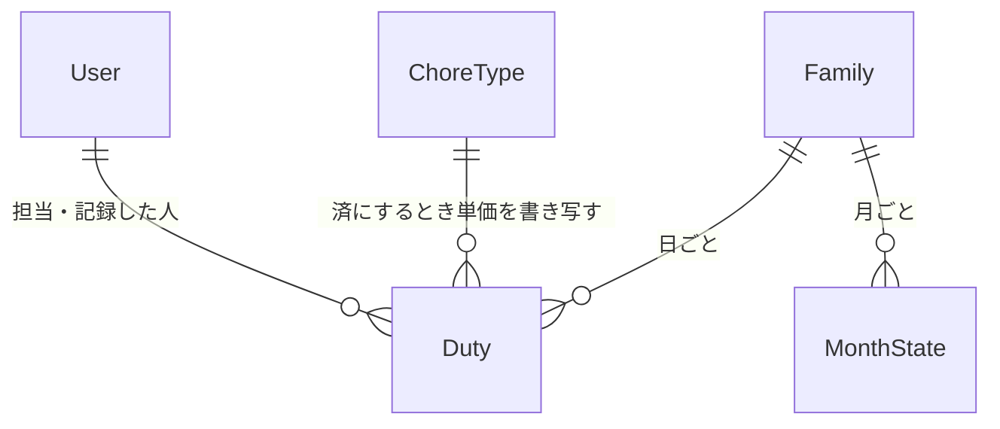

# データの形（Entities）— U7 確認・修正と確定

U7（`u7-review-confirm`）で扱うデータの形です。U7 は新しい保存先を作りません。U5 が作り、U6 が記録した「日ごとの担当（Duty）」の状態と記録の項目（記録した時刻・記録した人・書き写した単価）を、FR6.1 の表のとおりに書き換え、U5 が持つ「月の状態（MonthState）」の確定を切り替えるだけです。担当を作ることも消すことも、`origin` を変えることもしません（U5・U6 からの引き継ぎ）。持ち主の部品は `inception/domain-design/components.md` の Entity Ownership のとおりで、担当と月の状態は「カレンダー（担当と記録）」、単価は C7「お手伝いの種類」が持ちます。カレンダーは「済にする」のときに単価を C7 の窓口 `getCurrentUnitPrice` で読み、家族と管理者の確かめは C6 の窓口を通します（頼り方は一方向。ADR-001）。使う技術にかかわらない、論理的な形だけを書きます。

## データの一覧（機械で読む形）

```yaml
entities:
  - name: Duty
    label: 日ごとの担当（U7 が状態と記録の項目を書く）
    owner: カレンダー（担当と記録）
    description: >-
      ある日のあるお手伝いの担当。U5 が作り、U6 が子供の記録で「済」にする。
      U7 は、管理者の操作で状態を FR6.1 の表のとおりに変え、記録の項目を書く・消す（FR6.1〜FR6.4）
    attributes:
      - name: dutyId
        type: string
        required: true
        unique: true
        constraints: 書き込みの条件に使う。U7 は変えない
      - name: familyId
        type: string
        required: true
        references: Family.familyId
      - name: date
        type: date
        required: true
        constraints: 日本時間の日付。U7 は変えない
      - name: choreTypeId
        type: string
        required: true
        references: ChoreType.choreTypeId
        constraints: 「済にする」のとき、この種類の今の単価を C7 から読んで書き写す。U7 は変えない
      - name: childUserId
        type: string
        required: true
        references: User.userId
        constraints: >-
          U7 は担当の子供を変えない（子供を変えるのは U5 の PATCH /duties/{dutyId}、「未」のときだけ）。
          記録した人（recordedBy）とは別。U7 の「済にする」では recordedBy は管理者で、childUserId は担当の子供のまま
      - name: status
        type: enum
        required: true
        allowed: [todo, done, skipped]
        constraints: >-
          未・済・×。U7 が変えるのは FR6.1 の表の 5 とおりだけ（未→済、未→×、済→未、済→×、×→未、×→済）。
          表にない変わり方はしない（INVALID_TRANSITION。BR8.2）
      - name: recordedAt
        type: datetime
        required: false
        constraints: >-
          記録した時刻（UTC）。「済にする」のとき操作した時刻（今）を書く（FR6.3）。
          「未」「×」に戻すとき（cancel・markSkipped）は空にする [Q1]（BR8.5）。画面には日本時間の時と分で出す
      - name: recordedBy
        type: string
        required: false
        references: User.userId
        constraints: >-
          記録した人の userId。「済にする」では管理者（ctx.userId）を書く（FR6.3）。
          画面は、この userId が管理者なら「お母さんが記録」のように表示名で出す（U5 の BR6.13）。
          「未」「×」に戻すときは空にする [Q1]
      - name: unitPrice
        type: integer
        required: false
        constraints: >-
          書き写した単価（円。0 以上の整数）。「済にする」のとき、C7 の getCurrentUnitPrice が返した今の単価を、状態の変更と同じ取引で書く（FR6.3、FR2.2、ADR-003）。
          「未」「×」に戻すときは空にする [Q1]。一度書いた値は、あとから種類の単価を変えても変わらない。お小遣い（U9）は「済」の担当のこの値だけを数える（ADR-005）
      - name: updatedAt
        type: datetime
        required: true
        constraints: 担当を書き換えるたびに更新する時刻（UTC。U5・U6 の更新と同じ）。U7 は状態の変更のとき「今」を書く
      - name: version
        type: integer
        required: true
        constraints: >-
          状態を変えるたびに 1 増える。書き込みの条件（dutyId と version と今の status）に使う（U5・U6 からの引き継ぎ）。
          画面の状態変更の要求には、見せた時点の version を持たせる
      - name: origin
        type: enum
        required: true
        allowed: [rule, manual, swap]
        constraints: U7 は読むだけで変えない（U5・U6 の引き継ぎ）
    constraints:
      - >-
        状態を変える書き込みは、担当が今の状態（表の「いまの状態」）で、version と dutyId が読んだときと同じこと、
        その月が確定していないことを、同じ取引で確かめる（BR8.4）
      - >-
        「済」にする書き込み（markDone、未→済・×→済）は、上に加えて、単価が C7 から読んだ値のままであることを同じ取引で確かめ、
        recordedAt・recordedBy・unitPrice の 3 つを同時に書く。どれか 1 つだけが空の「済」は作らない（U6 と同じ不変条件。BR8.6）
      - >-
        「未」「×」に戻す書き込み（cancel 済→未、markSkipped 済→×、markSkipped 未→×、unmarkSkipped ×→未）は、
        recordedAt・recordedBy・unitPrice の 3 つを同時に空にする。どれか 1 つだけが残る状態は作らない [Q1]（BR8.5）
      - 担当を作らない・消さない・origin を変えない（U5・U6 からの引き継ぎ）
    relationships:
      - target: ChoreType
        cardinality: many-to-one
        direction: Duty → ChoreType（「済にする」のとき単価を読むだけ）
      - target: MonthState
        cardinality: many-to-one
        direction: Duty → MonthState（確定を読むだけ。状態の変更は確定していない月でだけ）

  - name: MonthState
    label: 月の状態（U7 が確定を切り替える）
    owner: カレンダー（担当と記録）
    description: >-
      家族と月ごとの確定の状態。U5 が形を作り、U5・U6 は読むだけ。U7 が確定・確定の取り消しを書く（FR6.5）。
      確定している月は、担当・記録・状態・割り当て・加算・減額のすべてを、誰も変えられない（各単位の月の確かめが MONTH_CONFIRMED で断る）
    attributes:
      - name: familyId
        type: string
        required: true
        references: Family.familyId
      - name: month
        type: string
        required: true
        constraints: 日本時間の年月（例 2027-01）。familyId と month の組で 1 つ
      - name: confirmed
        type: boolean
        required: true
        default: false
        constraints: >-
          記録がない月は確定していない（false）として扱う（U5 のレビュー R-06）。MonthState の行がまだ無い月がこれにあたる。
          確定するとき true、取り消すとき false にする。行がまだ無い月への確定は、行が無いことを条件（attribute_not_exists）にした Put で version=1 の確定行を作る（BR8.11）。
          行がまだ無い月への取り消しは、行を作らず何もしない（既に false と同じ。BR8.12）。
          いつでも確定でき、いつでも取り消せる（FR6.5）
      - name: confirmedAt
        type: datetime
        required: false
        constraints: >-
          確定した時刻（UTC）。確定するとき操作した時刻（今）を書く。取り消すときは空にする。
          確定の表示や記録に使う。確定していない月では空
      - name: confirmedByUserId
        type: string
        required: false
        references: User.userId
        constraints: 確定した管理者の userId。確定するとき書き、取り消すとき空にする
      - name: version
        type: integer
        required: true
        default: 0
        constraints: >-
          確定・確定の取り消しのたびに 1 増える。確定と取り消しを続けて押したときの取り違えを防ぐ、書き込みの条件に使う。
          記録のない月（MonthState がまだない）は version 0 として扱う
    relationships: []

  - name: ChoreType
    label: お手伝いの種類（U4 の持ち物。U7 は「済にする」のとき今の単価を読むだけ）
    owner: お手伝いの種類
    description: 名前・単価・使う／使わない。U7 は C7 の窓口 getCurrentUnitPrice で今の単価を読み、担当に書き写す
    attributes:
      - name: unitPrice
        type: integer
        required: true
        constraints: >-
          「使わない」の種類にも今の単価がある（U4 の getCurrentUnitPrice の決まり）。
          「使わない」の種類の担当も「済にする」で記録できる（FR2.3 と同じ考え）
    relationships: []

values:
  - name: StatusChangeAction
    label: 状態を変える操作（C8 changeDutyStatus の action）
    description: >-
      管理者が選ぶ 4 つの操作。FR6.1 の表の「操作」に対応する。今の状態に応じて許される操作だけを画面が出す（Q5、BR8.9）。
      保存するデータではない
    attributes:
      - name: action
        type: enum
        allowed: [cancel, markDone, markSkipped, unmarkSkipped]
        constraints: >-
          cancel=取り消す（済→未）、markDone=済にする（未→済・×→済）、
          markSkipped=やらなかったにする（未→×・済→×）、unmarkSkipped=やらなかったを外す（×→未）。
          今の状態とこの操作の組が FR6.1 の表になければ INVALID_TRANSITION（BR8.2）
  - name: StatusChangePreview
    label: 状態を変える前の確認の中身（Q2・Q3）
    description: >-
      取り消し・やらなかった・やらなかったを外す・済にするの前に画面が出す確認の中身。1 行の変化と、必要な注意。保存しない（BR8.3）
    attributes:
      - name: date
        type: date
        constraints: 担当の日付（例 1/5）
      - name: choreName
        type: string
        constraints: お手伝いの名前（例 皿洗い）
      - name: childName
        type: string
        constraints: 担当の子供の表示名（例 太郎）
      - name: fromStatus
        type: enum
        allowed: [todo, done, skipped]
        constraints: 今の状態
      - name: toStatus
        type: enum
        allowed: [todo, done, skipped]
        constraints: 操作後の状態
      - name: countNote
        type: string
        required: false
        constraints: >-
          「済」を取り消す・「やらなかった」にするときは「お小遣いの回数から外れます」を添える。
          「済にする」ときは「{単価} 円で数えます」を添える（Q2、Q3）。それ以外は空
  - name: MonthConfirmPreview
    label: 月の確定・確定の取り消しの前の確認の中身（Q4）
    description: 確定・確定の取り消しの前に画面が出す確認の中身。保存しない（BR8.11、BR8.12）
    attributes:
      - name: month
        type: string
        constraints: 対象の月（例 2027-01）
      - name: action
        type: enum
        allowed: [confirm, unconfirm]
      - name: todoCount
        type: integer
        required: false
        constraints: >-
          confirm のとき、その月に残っている「未」の担当の件数。1 件以上なら「未の担当が N 件あります。確定すると、これらは記録もやらなかったにもできなくなります」を添える [Q4]（BR8.10）
```

## まとめ

- **新しい保存先はありません。** U7 が書くのは、U5 が作り U6 が記録した「日ごとの担当」の `status`・`recordedAt`・`recordedBy`・`unitPrice`・`updatedAt`・`version` と、U5 が持つ「月の状態」の `confirmed`・`confirmedAt`・`confirmedByUserId`・`version` だけです
- **「済にする」は単価を書き写します。** 状態の変更と同じ取引で、C7 の `getCurrentUnitPrice` が返した今の単価を `unitPrice` に書き、同じ取引で「単価がその値のまま」を確かめます（U6 の記録と同じ作り。BR8.6）
- **「未」「×」に戻すときは記録の 3 項目を空にします [Q1]。** 状態と中身が食い違わず、画面の表示も U9 の計算も「済」だけを見れば済みます。もう一度「済にする」ときは、その時点の単価を新しく書き写します
- **確定は月ごとです。** 確定している月は、担当・記録・状態・割り当て・加算・減額のすべてを、各単位の「月が確定していないこと」の確かめ（`buildMonthGuard`）が `MONTH_CONFIRMED` で断ります。確定はいつでもでき、いつでも取り消せます（FR6.5）
- **確認の中身（StatusChangePreview・MonthConfirmPreview）** は、画面が操作の前に出すための値で、保存しません

## データのつながり



文字での説明（図が表示されないとき）: 家族は日ごとの担当と月の状態を持ちます。担当は、「済にする」のときにお手伝いの種類の今の単価を書き写し、担当の子供と記録した人（U7 の済にするでは管理者）を持ちます。月の状態は、U7 が確定・確定の取り消しを書きます。

## Sources

- `inception/domain-design/components.md`（カレンダーの部品、Entity Ownership、ADR-001、ADR-003、ADR-005）
- `inception/contract-design/contract-summary.md`（C1 の `Duty`・`MonthCalendar`、`POST /duties/{dutyId}/status`、`PUT`・`DELETE /months/{month}/confirmation`、C7 `getCurrentUnitPrice`、C8 `changeDutyStatus`・`confirmMonth`・`unconfirmMonth`）
- `inception/requirements-analysis/requirements.md`（FR6.1 の状態遷移表、FR6.2〜FR6.6、NFR6、NFR11）
- `construction/u5-assignment-calendar/functional-design/entities.md`、`docs/contract-changes-u5.md`（担当の書き換えの条件、`origin`、`version`、月の状態、`onDutyReassigned`）
- `construction/u6-recording/functional-design/entities.md`、`docs/contract-changes-u6.md`（記録の 3 項目の不変条件、`getCurrentUnitPrice` の書き写し、`onDutyRecorded`）
- 既存コード（読むだけ）: `repositories/calendarRepository.ts`（`findDuty`・`buildMonthGuard`・`buildUnitPriceGuard`・`buildRecordItems`・`CHECK_DUTY_UNCHANGED`）、`services/calendarService.ts`
- `functional-design-questions.md` の回答 [Q1]〜[Q6]

## Assumptions & Open Questions

- [assumption] 「済」を取り消す・「やらなかった」にするときに記録の 3 項目を空にするのは [Q1] の答え（A）のとおりです。U9 のお小遣いの計算は「済」の担当の `unitPrice` だけを数える（ADR-005）ので、残しても消しても金額の結果は同じですが、状態と中身を食い違わせないために空にします
- [assumption] 月の状態に `version`・`confirmedAt`・`confirmedByUserId` を足すのは、U5 の `MonthState`（`confirmed` だけ）への追加です。契約への追加として `docs/contract-changes-u7.md` に残します。U5・U6 は `confirmed` だけを読むので、追加は壊す変更になりません
- [assumption] U8（代わりにやる）は、`onDutyReassigned`（U5）と `onDutyRecorded`（U6）で申し出を取り下げます。U7 の状態の変更（担当が「未」でなくなる）と確定で申し出が自動でなくなる決まり（FR7.5）は、U7 が状態の変更のあとに同じ `onDutyReassigned` を呼ぶことで U8 につなぎます（U8 まではなにもしない）。詳しくは `functional-spec.md` の引き継ぎに書きます
