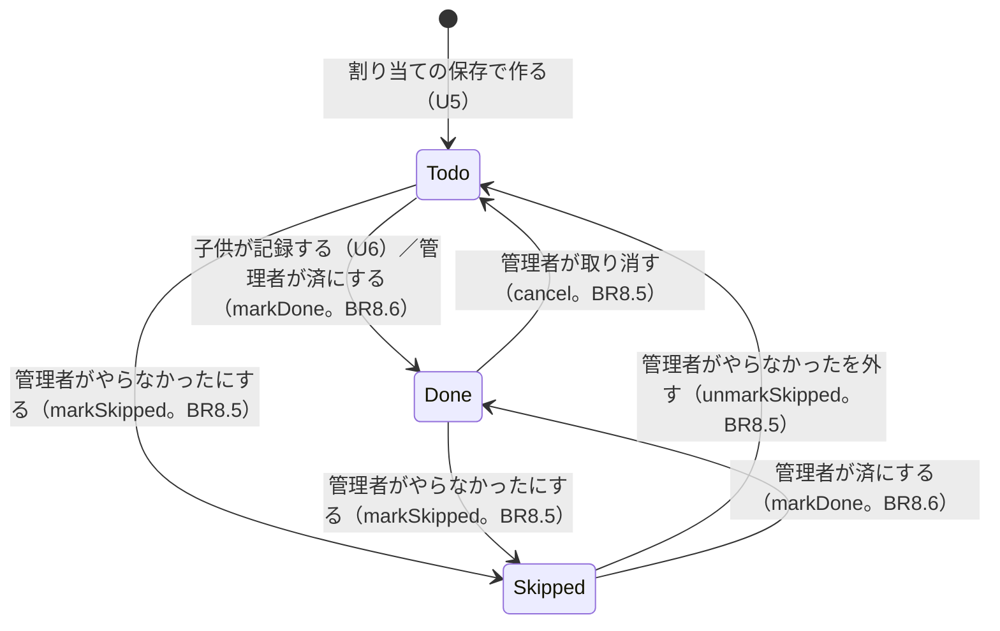
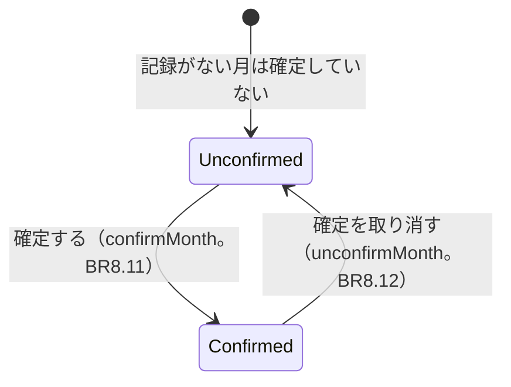

# 機能の仕様（Functional Spec）— U7 確認・修正と確定

U7（`u7-review-confirm`）では、管理者（お母さん）が子供の記録を確認し、間違いを画面から直し（取り消し・済にする・やらなかったにする・外す）、月を確定・確定の取り消しをします。受け持つのは US6.1 の AC6.1.1〜AC6.1.11 です。データの形は `entities.md`、決まりは `rules.md` にあります。担当の子供を変える（「未」のときだけ）は U5 の `PATCH /duties/{dutyId}` のままで、U7 では状態の変更と月の確定だけを足します。

U7 で決めたこと:

- 「済」を取り消す・「やらなかった」にするときは、記録の 3 項目（`recordedAt`・`recordedBy`・`unitPrice`）を同時に空にする。もう一度「済にする」ときは、その時点の単価を新しく書き写す [Q1]（BR8.5、BR8.6）
- 取り消し・やらなかった・やらなかったを外すの確認は、「1/5 皿洗い 太郎: 済 → 未 に戻します」の 1 行に、取り消し・済→×のときは「お小遣いの回数から外れます」を添える [Q2]（BR8.3）
- 「済にする」も確認を出す。「1/5 皿洗い 太郎 を『済』にします（120 円で数えます）」[Q3]（BR8.3）
- 月を確定する確認では、「未」の担当が N 件残っていれば件数の注意を添える。残っていても確定はできる [Q4]（BR8.10）
- 修正の入口は、日の詳細で、担当ごとに今の状態からできる操作だけをボタンで出す [Q5]（BR8.9）
- 確定・確定の取り消しの入口は、カレンダーの月の見出しの近くに、管理者にだけ出す [Q6]（BR8.13）
- 担当を書き換えるときは、`dutyId` と `version` と今の状態を条件にし、月が確定していないことも同じ取引で確かめる。担当を作らない・消さない・`origin` を変えない（U5・U6 からの約束。BR8.4）

## 流れ

### F1 日の詳細で修正の入口を見る（AC6.1.11、BR8.1、BR8.8、BR8.9）

1. 管理者が、カレンダー（U5 の日ごとの縦の一覧）で日付を選び、日の詳細を開く
2. 日の詳細は、担当ごとに、状態・記録した時刻・記録した人を出す（U5 の BR6.13。「済」は「済 16:42 太郎が記録」、管理者が記録した担当は「お母さんが記録」のように表示名で出す）
3. 管理者には、担当ごとに、今の状態からできる操作だけをボタンで出す [Q5]（BR8.9）

| 今の状態 | 出すボタン |
|----------|-----------|
| 未 | 「済にする」「やらなかったにする」 |
| 済 | 「取り消す」「やらなかったにする」 |
| × | 「やらなかったを外す」「済にする」 |

4. 子供にはボタンを出さない（見るだけ。BR8.1）。各ボタンの要求には、見せた時点の `version` を持たせる

### F2 状態を変える（AC6.1.1〜AC6.1.5、AC6.1.9、BR8.2〜BR8.7）

1. 管理者がボタンを押すと、画面は BR8.3 の確認を出す

| 操作（action） | 変化 | 確認の 1 行 | 添える注意 |
|----------------|------|-------------|-----------|
| cancel（取り消す） | 済 → 未 | 「1/5 皿洗い 太郎: 済 → 未 に戻します」 | 「お小遣いの回数から外れます」 |
| markSkipped（やらなかった） | 済 → × | 「1/5 皿洗い 太郎: 済 → × にします」 | 「お小遣いの回数から外れます」 |
| markSkipped（やらなかった） | 未 → × | 「1/5 皿洗い 太郎: 未 → × にします」 | なし |
| unmarkSkipped（やらなかったを外す） | × → 未 | 「1/5 皿洗い 太郎: × → 未 に戻します」 | なし |
| markDone（済にする） | 未 → 済、× → 済 | 「1/5 皿洗い 太郎 を『済』にします」 | 「120 円で数えます」[Q3] |

2. 「はい」を押すと、`POST /v1/duties/{dutyId}/status` を `{ action, version }` で送る。裏側は `changeDutyStatus(ctx, dutyId, action, { now, version })` を呼び、BR8.4 の順に確かめる

```text
0 本文の形を確かめる（探す前）。action が cancel/markDone/markSkipped/unmarkSkipped の 4 つのどれでもない、または version がない → 422 INVALID_REQUEST（BR8.2 の順: 本文の形の確かめ → 表の確かめ）
1 探す（家族の中だけ。DID# → 担当 → 月の状態の GetItem 3 回）→ なければ NOT_FOUND
2 月が確定していれば MONTH_CONFIRMED
3 いまの状態 + action が FR6.1 の表になければ INVALID_TRANSITION
4 action が markDone → 単価を C7 から読み、取引で書く（BR8.6）
  それ以外 → 記録の 3 項目を空にして書く（BR8.5）
  条件: dutyId・version・今の状態、月が確定していない（＋ markDone は単価が読んだ値のまま）
```

3. 成功したら 200 で更新後の `Duty` を返す。画面はカレンダー（または日の詳細）を読み直し、新しい状態とボタンにそろえる（AC6.1.1〜AC6.1.5）
4. 「済にする」で、`recordedBy` は管理者、`recordedAt` は操作した時刻、`unitPrice` は操作した時点の単価になる。日の詳細に「済 1/7 20:00 お母さんが記録」と出て、その単価で数えられる（AC6.1.2、AC6.1.3）
5. 応答の `Duty` の「記録した人の表示名（recordedByName）」は、子供だけでなく家族のメンバー全員（管理者を含む）から `recordedBy` の userId で引く。管理者が「済にする」をした担当は、応答でも「お母さんが記録」のように管理者の表示名で出る（U5 の BR6.13 と同じ引き方。応答の表示をそのまま使ってもよいが、確実さのため画面は 3. のとおりカレンダーまたは日の詳細を読み直す）
6. 失敗のときの文言と読み直しは、下の「状態の変更の印と返事の対応」の表のとおり

### F3 月を確定する（AC6.1.6、AC6.1.9、BR8.10、BR8.11、BR8.13）

1. 管理者が、カレンダーの月の見出しの近くの「この月を確定する」を押す [Q6]（確定していない月に出る。BR8.13）
2. 画面は、カレンダー（getMonthCalendar）の担当から「未」の件数 N を数え、BR8.10 の確認を出す
   - N ≥ 1 → 「{月}を確定しますか？ 確定すると変更できなくなります。未の担当が N 件あります。確定すると、これらは記録もやらなかったにもできなくなります」[Q4]
   - N = 0 → 「{月}を確定しますか？ 確定すると変更できなくなります」
3. 「はい」を押すと、`PUT /v1/months/{month}/confirmation` を送る。裏側は `confirmMonth(ctx, month, { now })` を呼び、管理者か（BR8.1）を確かめ、月の状態を `confirmed=true`・`confirmedAt=今`・`confirmedByUserId=ctx.userId` にする。行がまだ無い月（記録のない月）は `attribute_not_exists` を条件にした Put で `version=1` の確定行を作り、行がある月は Update で `version+1` にする（BR8.11）
4. 「未」が残っていても確定できる（断らない。FR6.5） [Q4]
5. 成功したら、カレンダーに「確定済み」が出て、それ以降の 1 月の記録・取り消し・状態の変更・割り当ての変更・加算・減額が、各単位の月の確かめで `MONTH_CONFIRMED` に断られる（AC6.1.6。加算・減額が断られることは U11 の AC8.2.5 で確かめる）

### F4 確定を取り消す（AC6.1.7、AC6.1.9、BR8.12、BR8.13）

1. 管理者が、確定済みの月の見出しの近くの「確定を取り消す」を押す [Q6]（BR8.13）
2. 画面は「{月}の確定を取り消しますか？ 取り消すと、また変更できるようになります」を出す（AC6.1.9）
3. 「はい」を押すと、`DELETE /v1/months/{month}/confirmation` を送る。裏側は `unconfirmMonth(ctx, month)` を呼び、行がある月は `confirmed=false` にし、`confirmedAt`・`confirmedByUserId` を空にして `version+1`。行がまだ無い月（記録のない月）は行を作らず何もしない（既に未確定と同じ結果）（BR8.12）
4. 成功したら「確定済み」の表示が消え、また 1 月の記録と修正ができる（AC6.1.7）

### F5 確定していない月は期限なく変更できる（AC6.1.8、BR8.14）

1. 確定していない月は、月をまたいだあとでも、担当の記録（U6）と状態の変更（U7）ができる
2. 例: 2026 年 12 月を確定しないまま 2027 年 3 月になっても、太郎は 12 月 28 日の自分の「未」の担当を記録でき（U6 の AC5.1.8）、管理者は 12 月の記録を直せる（AC6.1.8）
3. いつでも確定でき、いつでも取り消せる（時期の制限なし。FR6.5）

### F6 状態の変更がすぐ額・回数に反映される（AC6.1.1、AC6.1.2、AC6.1.4、BR8.7）

1. 「済にする」で `status=done` と `unitPrice` を同じ書き込みで書くと、強い整合性で読めばすぐ「済」として数えられる
2. 「取り消す」「やらなかったにする」で `status` を変え `unitPrice` を空にすると、すぐ回数から外れる
3. U7 は回数や金額を別に保存しない。額の表示は U9 が、読むたびに「済」の担当の `unitPrice` を足して出す（ADR-005）

## 担当の状態の変わり方（U7 の分 = FR6.1 の表の全体）



文字での説明（図が表示されないとき）: 「未」は、子供の記録か管理者の「済にする」で「済」に、管理者の「やらなかったにする」で「×」になります。「済」は、管理者の「取り消す」で「未」に、「やらなかったにする」で「×」になります。「×」は、管理者の「やらなかったを外す」で「未」に、「済にする」で「済」になります。「未」に cancel、「×」に markSkipped、「済」に markDone など、表にない変わり方はしません（INVALID_TRANSITION）。

## 月の状態の変わり方



文字での説明（図が表示されないとき）: 月は、確定していない状態と確定した状態を、いつでも行き来できます。確定している月は、担当・記録・状態・割り当て・加算・減額のすべてを変えられません。確定していない月は、期限なく変更できます。

## U7 で作る画面用 API と LINE の操作

| 操作 | だれが | 流れ | 結果 |
|------|-------|------|------|
| `POST /v1/duties/{dutyId}/status` | 管理者 | F2 | 200 `Duty` / 403 `ADMIN_ONLY`・`NOT_FAMILY_MEMBER` / 404 `NOT_FOUND` / 409 `MONTH_CONFIRMED`・`INVALID_TRANSITION` / 422 `INVALID_REQUEST` / 500 `INTERNAL` |
| `PUT /v1/months/{month}/confirmation` | 管理者 | F3 | 200（確定した）/ 403 `ADMIN_ONLY`・`NOT_FAMILY_MEMBER` / 422 `INVALID_MONTH` / 500 `INTERNAL` |
| `DELETE /v1/months/{month}/confirmation` | 管理者 | F4 | 200（取り消した）/ 403 `ADMIN_ONLY`・`NOT_FAMILY_MEMBER` / 422 `INVALID_MONTH` / 500 `INTERNAL` |

どの操作も U1 の共通の確かめ（セッション、ブロック中の 403 `NOT_FRIEND`、家族のメンバー、管理者）を先に通します。LINE からの操作はありません（U7 は画面だけ）。

`POST /v1/duties/{dutyId}/status` の 200 応答の `Duty` に含める「記録した人の表示名（recordedByName）」は、`recordedBy` の userId を子供だけでなく家族のメンバー全員（管理者を含む）から引きます（管理者が「済にする」をした担当なら管理者の表示名で出る。F2 の 5. と U5 の BR6.13 と同じ）。画面は確実さのため、応答の表示をそのまま使わず、必ずカレンダーまたは日の詳細を読み直します。

## 状態の変更の印と返事の対応

`changeDutyStatus` が返しうる印ごとの、画面の応答と文言です（BR8.4）。「読み直す」はカレンダー（または日の詳細）を読み直すことです。

| 印 | 画面の応答と文言 | 読み直し |
|----|----------------|---------|
| 成功 | 200。新しい状態の表示（「済 … お母さんが記録」など） | する |
| `NOT_FOUND` | 404。「この担当は先に変更されました」 | する |
| `MONTH_CONFIRMED` | 409。「この月は確定済みです」 | する |
| `INVALID_TRANSITION` | 409。「この担当は先に変更されました」（見せたあとに状態が変わり、その操作ができなくなった） | する |
| `INVALID_REQUEST` | 422。「操作の内容が正しくありません。もう一度お試しください」 | しない |
| `ADMIN_ONLY` | 403。（画面は管理者にしかボタンを出さないので、直接 API を呼んだときだけ） | － |
| `INTERNAL` | 500。「表示できませんでした。もう一度お試しください」と「読み込み直す」 | しない（押したときだけ） |

`MONTH_CONFIRMED`・`INVALID_TRANSITION`・`INTERNAL` の文言は、C10 の既存の文言を使います。「この担当は先に変更されました」は U6 で足した `DUTY_CHANGED` の文言を使います。

## 契約への追加

契約（`inception/contract-design/contract-summary.md`）の決まりでは、項目・操作・理由の印を足すのは自由です。U7 の変更は `docs/contract-changes-u7.md` に一覧として残します。壊す変更はありません（月の状態への項目の追加は、`confirmed` だけを読む U5・U6 に影響しません）。

| 契約 | 区分 | 中身 |
|------|------|------|
| C1 `POST /duties/{dutyId}/status` | 足したもの（本文・応答） | 本文 `{ "action": "cancel"\|"markDone"\|"markSkipped"\|"unmarkSkipped", "version": integer }`。200 `Duty`（更新後の担当）。失敗は上の表 |
| C1 `PUT /months/{month}/confirmation` | 足したもの（応答） | 管理者。本文なし。200（確定した。すでに確定済みでも 200）。422 `INVALID_MONTH`、403 `ADMIN_ONLY`、500 `INTERNAL` |
| C1 `DELETE /months/{month}/confirmation` | 足したもの（応答） | 管理者。200（取り消した。確定していなくても 200）。422 `INVALID_MONTH`、403 `ADMIN_ONLY`、500 `INTERNAL` |
| C8 `changeDutyStatus(ctx, dutyId, action, options)` | 足したもの（窓口） | 契約の `(ctx, dutyId, action, at)` を `(ctx, dutyId, action, options)` にし、`options` に `now` と `version`（見せた時点の版）を入れる。結果は `Duty` / `NOT_FOUND` / `MONTH_CONFIRMED` / `INVALID_TRANSITION` / `INTERNAL`。取引は担当の `UpdateItem` ＋ 月の状態の `ConditionCheck`（＋ markDone は単価の `ConditionCheck`）。断られたら 1 回だけ読み直してやり直す |
| C8 `confirmMonth(ctx, month, options)` | 足したもの（窓口） | 契約の `(ctx, month, at)` を `(ctx, month, options)` にし、`options.now` を入れる。月の状態を `confirmed=true`・`confirmedAt`・`confirmedByUserId` にする。行がある月は Update で `version+1`、行がまだ無い月は `attribute_not_exists` 条件つきの Put で `version=1` の確定行を作る。すでに確定済みでも同じ結果 |
| C8 `unconfirmMonth(ctx, month)` | 足したもの（窓口） | 行がある月は `confirmed=false` にし、`confirmedAt`・`confirmedByUserId` を REMOVE、`version+1`。行がまだ無い月は行を作らず何もしない。確定していなくても同じ結果 |
| C8 `onDutyReassigned` | 足したもの（イベントの種類） | U5 の仕組みに `kind: 'status-changed'` だけを足す（NFR 設計 ADR-U7-01 の R-01 の決定。`'month-confirmed'` という月単位の種類は作らず、月の確定も「その月で『未』でなくなった担当ごとに `status-changed` の 1 件」に展開して、既存の「1 つの担当」の形〈`dutyId`・`date`・`choreTypeId`・`fromChildUserId` が必須〉を崩さない）。U7 が状態の変更・確定のあとに、実行側の `notifyDutyReassigned(events)` を 1 回呼び、U8 が申し出の取り下げに使う（BR8.15。U8 まではなにもしない） |
| C1 `MonthCalendar` / 月の状態 | 足したもの（項目） | 月の状態（`M#<month>#S`）に `confirmedAt`・`confirmedByUserId`・`version` を足す。`confirmed` は U5 のまま。`MonthCalendar.confirmed` の意味は変えない |
| C10 文言 | 足したもの（文言） | 状態の変更の確認（「{月}/{日} {お手伝い} {子供}: {前} → {後}」）、注意（「お小遣いの回数から外れます」「{単価} 円で数えます」）、「済にする」の確認（「{月}/{日} {お手伝い} {子供} を『済』にします」）、確定の確認（「{月}を確定しますか？ 確定すると変更できなくなります」）、未の件数の注意（「未の担当が {N} 件あります。確定すると、これらは記録もやらなかったにもできなくなります」）、確定の取り消しの確認（「{月}の確定を取り消しますか？ 取り消すと、また変更できるようになります」） |

既存の印と文言 `MONTH_CONFIRMED`・`INVALID_TRANSITION`・`ADMIN_ONLY`・`NOT_FOUND`・`NOT_FAMILY_MEMBER`・`INVALID_MONTH`・`INTERNAL`・`DUTY_CHANGED`・`MONTH_CONFIRMED_LABEL`（「確定済み」）は、そのまま使います。

## 受け入れ条件との対応

| 受け入れ条件 | 流れ | 決まり | U7 で作る範囲 |
|-------------|------|-------|-------------|
| AC6.1.1 「済」を取り消すと「未」になり回数から外れる | F2、F6 | BR8.2、BR8.4、BR8.5、BR8.7 | すべて |
| AC6.1.2 「済にする」で時刻・管理者・単価、金額に入る | F2、F6 | BR8.6、BR8.7 | すべて |
| AC6.1.3 「×」を「済にする」と回数に入る | F2、F6 | BR8.6、BR8.7 | すべて |
| AC6.1.4 「済」を「やらなかった」にすると記録が消え回数から外れる | F2、F6 | BR8.5、BR8.7 | すべて |
| AC6.1.5 「×」を外すと「未」に戻る | F2 | BR8.5 | すべて |
| AC6.1.6 確定すると、それ以降の変更が断られる | F3 | BR8.10、BR8.11 | 記録・取り消し・状態の変更・割り当てまで（加算・減額は U11 の AC8.2.5 で確かめる） |
| AC6.1.7 確定を取り消すと、また変更できる | F4 | BR8.12 | すべて |
| AC6.1.8 確定しないまま月をまたいでも記録・修正できる | F5 | BR8.14 | 状態の変更まで（記録は U6） |
| AC6.1.9 取り消し・やらなかった・確定・取り消しの前に確認 | F2、F3、F4 | BR8.3、BR8.10、BR8.12 | すべて |
| AC6.1.10 子供は U7 のどの操作もできない | F1、F2、F3、F4 | BR8.1 | すべて |
| AC6.1.11 データを直接書き換えず画面からすべて直せる | F1、F2、F3、F4 | BR8.8、BR8.9 | すべて |

## 次の単位への引き継ぎ

- **U8（代わりにやる）:** `onDutyReassigned` は登録の口、`notifyDutyReassigned(events)` が成功後に一覧で 1 回呼ぶ実行側（U5・U6・U7 が呼ぶ）。`kind: 'status-changed'`（担当が「未」でなくなった）のときに、その担当の申し出を取り下げる（FR7.5）。月の確定も「その月で『未』でなくなった担当ごとに `status-changed` の 1 件」に展開して一覧で渡す（`'month-confirmed'` という月単位の種類は作らない。NFR 設計 R-01）。U7 は呼ぶ口だけを用意し、今は何も登録しない
- **U9（お小遣い）:** 「済」の担当の `unitPrice` を種類ごとに足して額を出す。U7 の取り消し・やらなかったで「済」でなくなった担当は、`unitPrice` が空になり数から外れる。確定済みかは月の状態で見る（`isMonthConfirmed`）
- **U10（お知らせ）:** 月末のまとめ（FR9.2）は確定していてもいなくても送る。16 時のリマインドは確定している月には送らない（`isMonthConfirmed` で見る）。確定を取り消した月は、また 16 時のリマインドを送る（FR9.1 の例）
- **U11（加算・減額）:** 確定している月の加算・減額を、月の確かめ（`buildMonthGuard`）で `MONTH_CONFIRMED` に断る（AC8.2.5）
- **配備:** `api` の Lambda に、`POST /v1/duties/{dutyId}/status`・`PUT`・`DELETE /v1/months/{month}/confirmation` の入口を足す。環境変数は U5 で足した `CALENDAR_TABLE`、単価の読みに U4 で足した `CHORE_TYPES_TABLE` を使う（`api` には U4・U5 で両方ある）。`api` のロールは `Calendar` に `GetItem`・`Query`・`UpdateItem`・`PutItem`・`ConditionCheckItem`（U5 で `DeleteItem` も含めて足し済み。U7 は担当を消さないので `DeleteItem` は使わない）、`ChoreTypes` に `GetItem`・`ConditionCheckItem`（U4・U5 で足し済み）が要る。足りているかはコード生成で `infrastructure/lib/app-stack.ts` を読んで確かめ、足りなければ U7 で足す（CDK のテストの期待にも入れる）

## Sources

- `inception/requirements-analysis/requirements.md`（FR6.1 の状態遷移表、FR6.2〜FR6.6、FR2.2、FR3.5、FR4.5、FR7.5、NFR2、NFR4、NFR6、NFR7、NFR11）
- `inception/user-stories/stories.md`（US6.1、AC6.1.1〜AC6.1.11）
- `inception/units-generation/unit-of-work.md`、`unit-of-work-story-map.md`（U7 の受け持つこと、US6.1 の割り当て）
- `inception/contract-design/contract-summary.md`（C1、C6、C7、C8、C10）
- `construction/u5-assignment-calendar/functional-design/`、`docs/contract-changes-u5.md`（担当の書き換えの条件、月の状態、`onDutyReassigned`、`origin`、`version`、`api` の権限）
- `construction/u6-recording/functional-design/`、`docs/contract-changes-u6.md`（記録の 3 項目、単価の書き写しと ConditionCheck、取引の読み直し、`DUTY_CHANGED` の文言）
- 既存コード（読むだけ）: `calendarService.ts`（`recordDuty`・`changeDutyChild` の形）、`calendarRepository.ts`（`findDuty`・`buildMonthGuard`・`buildUnitPriceGuard`・`buildRecordItems`・`writeTransaction`）、`recordingService.ts`
- `functional-design-questions.md` の回答 [Q1]〜[Q6]

## Assumptions & Open Questions

- [assumption] 契約への追加は、U1〜U6 と同じく `docs/contract-changes-u7.md` に一覧として残します
- [assumption] 月の確定・確定の取り消しの窓口（`confirmMonth`・`unconfirmMonth`）は、担当の書き換えと違い version を条件にしません（BR8.14）。二度押しや確定↔取り消しの連打でも最後の操作の結果にそろいます
- [assumption] 「済にする」の確認に出す単価（F2 の「120 円で数えます」）は、確認を出す時点の `getCurrentUnitPrice` を画面が読んで出します。書き込み時の単価が違えば、書き込み時の単価で数え、画面はカレンダーを読み直して正しい値を出します
- AC6.1.6 の「加算・減額が断られる」ことは、U11 の AC8.2.5 で確かめます。U7 では、記録・取り消し・状態の変更・割り当ての変更が断られることまでを確かめます
