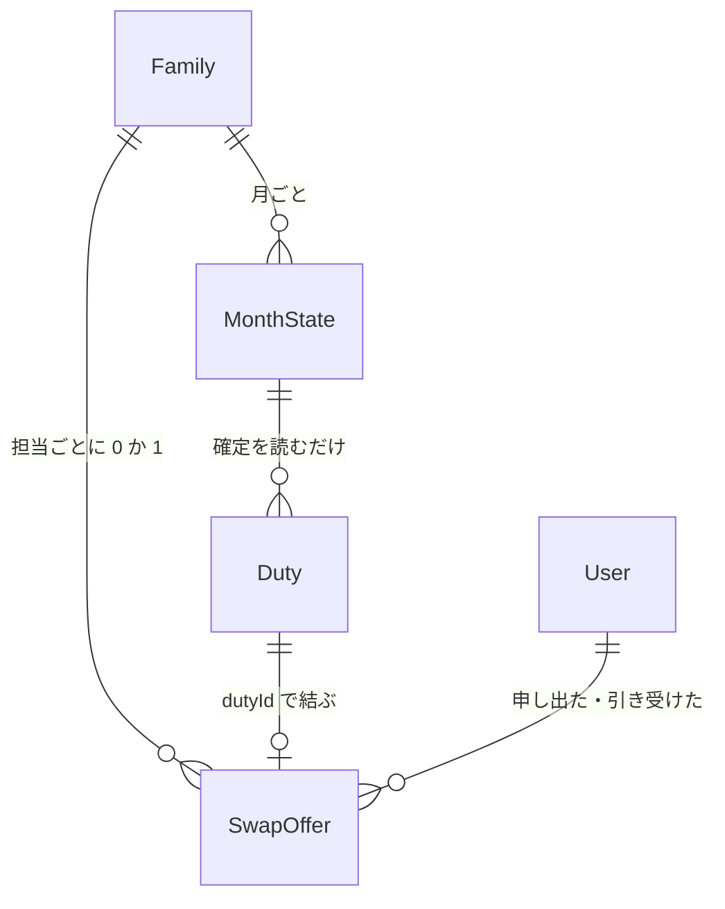

# データの形（Entities）— U8 代わりにやる

U8（`u8-swap`）で扱うデータの形です。U8 が新しく持つのは「代わりにやるの申し出（SwapOffer）」だけで、U5 が作った `Calendar` テーブルの中に 1 種類の項目として置きます（新しいテーブルも索引も足しません。理由は下の「保存先の決め方」）。担当（Duty）は U5・U6・U7 が持つものを使い、U8 が書き換えるのは引き受けるときの `childUserId`・`origin`・`version`・`updatedAt` の 4 項目だけです。担当を作ることも消すことも、状態や記録の項目を変えることもしません（U5〜U7 からの引き継ぎ）。持ち主の部品は `inception/domain-design/components.md` の Entity Ownership のとおりで、申し出も「カレンダー（担当と記録）」の持ち物です。名前（子供の表示名、お手伝いの名前）は、グループの入口が決めた利用者の記録と C7 の窓口から読み、LINE のプロフィール取得は呼びません。使う技術にかかわらない、論理的な形だけを書きます。

画面には何も出しません [Q5]。引き受けた担当は、担当の子供の名前が変わるだけで、「代わりにやる」の印も元の子供の名前も出ません。元の子供を担当の項目として残すことも、引き受けのやり取りの履歴を別に保存することもしません [Q5]。

## データの一覧（機械で読む形）

```yaml
entities:
  - name: SwapOffer
    label: 代わりにやるの申し出（U8 が持つ。Calendar テーブルの 1 種類の項目）
    owner: カレンダー（担当と記録）
    description: >-
      ある担当について、担当の子供が「代わってほしい」と出した申し出。1 つの担当に出せる申し出は 1 つだけ（FR7.5）。
      引き受けられる前なら申し出た子供が取り下げられ（FR7.4）、担当の日が過ぎる・担当の状態が「未」でなくなる・担当の子供が変わる・
      月が確定される、のどれかで自動でなくなる（FR7.5）。引き受けた・取り下げた・自動でなくなったあとも項目は残し、
      「もう引き受けられています」と「もうありません」を言い分けるために状態だけを変える（Calendar テーブルには TTL がない）
    attributes:
      - name: familyId
        type: string
        required: true
        references: Family.familyId
        constraints: Calendar テーブルの PK。読み書きはいつも呼び出した家族の familyId で行う（ほかの家族の申し出には届かない）
      - name: dutyId
        type: string
        required: true
        unique: true
        references: Duty.dutyId
        constraints: >-
          sk は `SWAP#<dutyId>`。1 つの担当に項目は 1 つなので、sk が同じ項目を条件つきで書き換えることが
          「1 つの担当に出せる申し出は 1 つ」（FR7.5）の保証になる。小文字の UUID
      - name: offerId
        type: string
        required: true
        constraints: >-
          申し出ごとの ID（小文字の UUID。裏側が作る）。ボタンの値に入れ、古い申し出のボタンが、同じ担当への新しい申し出に当たらないようにする。
          取り下げたあとや引き受けられたあとに同じ担当が申し出し直されると、新しい offerId で項目を上書きする
      - name: offererUserId
        type: string
        required: true
        references: User.userId
        constraints: 申し出た子供。申し出た時点の担当の子供（Duty.childUserId）と同じ。管理者は申し出られない
      - name: dutyVersion
        type: integer
        required: true
        constraints: >-
          申し出た時点の担当の version。担当は子供が変わる・状態が変わる・記録されるたびに version が増えるので、
          「担当の version が dutyVersion のまま」は「申し出た時点から担当が変わっていない」と同じ意味になる（BR9.8）。
          引き受けの取引でも、この担当の version を条件にする
      - name: status
        type: enum
        required: true
        allowed: [open, accepted, withdrawn, cancelled]
        constraints: >-
          open=受け付け中、accepted=引き受けられた、withdrawn=申し出た本人が取り下げた、cancelled=自動でなくなった（掃除の印。BR9.11）。
          open から accepted・withdrawn・cancelled への変わり方だけで、戻らない。同じ担当が申し出し直されるときは項目全体を新しい open で上書きする
      - name: acceptedByUserId
        type: string
        required: false
        references: User.userId
        constraints: status が accepted のときだけ。引き受けた子供
      - name: acceptedAt
        type: datetime
        required: false
        constraints: status が accepted のときだけ（UTC）。引き受けた時刻
      - name: createdAt
        type: datetime
        required: true
        constraints: 申し出た時刻（UTC。要求の入口で 1 回だけ取った時刻）
      - name: updatedAt
        type: datetime
        required: true
        constraints: status を変えるたびに更新する時刻（UTC）
    constraints:
      - >-
        「open の申し出」と「有効な申し出」は同じではない。status が open でも、担当の version が dutyVersion と違う・担当の状態が「未」でない・
        担当の子供が offererUserId と違う・担当の日が今日より前・担当の月が確定している、のどれかなら、有効ではない（なくなったものとして扱う。BR9.8）。
        フックが失敗して status が open のまま残っていても、引き受けも申し出し直しも正しく判定できる
      - 申し出の項目は、担当を作らない・消さない。担当が消えても（U5 の保存し直し）申し出の項目は残り得るが、担当が見つからないので有効ではない
      - 「担当の日が過ぎた」ことで申し出の項目は書き換えない（読んだときに今日と比べて判定する。BR9.8）。過ぎた日の項目は、そのまま残る
      - 申し出の項目の数は、申し出られた担当の数を超えない（1 つの担当に 1 項目）。家族の 1 か月の担当は多くて数百なので、TTL なしで残しても費用と読み取りに影響しない
    relationships:
      - target: Duty
        cardinality: one-to-one
        direction: SwapOffer → Duty（dutyId で結ぶ。担当 1 つに申し出は 0 か 1）
      - target: User
        cardinality: many-to-one
        direction: SwapOffer → User（申し出た子供、引き受けた子供）

  - name: Duty
    label: 日ごとの担当（U8 が引き受けるときに子供と origin だけを書く）
    owner: カレンダー（担当と記録）
    description: >-
      U5 が作り、U6・U7 が状態と記録を書く担当。U8 は、引き受けの取引で担当の子供を引き受けた子供に変え、origin を swap にするだけ（FR7.3）
    attributes:
      - name: dutyId
        type: string
        required: true
        unique: true
        constraints: 書き込みの条件に使う。U8 は変えない
      - name: childUserId
        type: string
        required: true
        references: User.userId
        constraints: >-
          引き受けの取引で、申し出た子供（offererUserId）から引き受けた子供に変える。取引の条件は
          「childUserId が offererUserId のまま」。引き受けた子供の「自分の担当」には触れない（FR7.3。同じ日の同じ種類には 1 家族 1 担当なので、重なりは起きない）
      - name: origin
        type: enum
        required: true
        allowed: [rule, manual, swap]
        constraints: >-
          引き受けの取引で swap にする（U5 が値を用意し、U8 が書く持ち主）。すでに swap の担当を引き受けても swap のまま（BR9.12）。
          U5 は管理者の保存し直しの確認で、origin が manual か swap の「未」の担当を「手で変えた担当」として扱う（U5 の BR6.7。そのまま使う）。
          画面は origin を表示に使わない [Q5]
      - name: status
        type: enum
        required: true
        allowed: [todo, done, skipped]
        constraints: 申し出られるのは「未」の担当だけ。U8 は状態を変えない。引き受けの取引の条件は「status が todo のまま」
      - name: date
        type: date
        required: true
        constraints: 日本時間の日付。申し出られるのは今日以降（今日を含む）。U8 は変えない
      - name: version
        type: integer
        required: true
        constraints: 引き受けで 1 増える（U5・U6・U7 と同じ。書き込みの条件は dutyId・version・status・childUserId）
      - name: updatedAt
        type: datetime
        required: true
        constraints: 引き受けのとき「今」を書く
    constraints:
      - 引き受けの書き込みは、担当の dutyId・version（申し出の dutyVersion）・status=todo・childUserId=offererUserId を同じ取引で確かめ、月が確定していないことと、申し出が open であることも同じ取引で確かめる（BR9.9）
      - 担当を作らない・消さない・状態や記録の項目を変えない（U5〜U7 からの引き継ぎ）
      - 元の子供を残す項目、「代わりにやる」の印の項目は足さない [Q5]
    relationships:
      - target: MonthState
        cardinality: many-to-one
        direction: Duty → MonthState（確定を読むだけ。確定している月は申し出られず、引き受けられない）

  - name: MonthState
    label: 月の状態（U8 は確定を読むだけ）
    owner: カレンダー（担当と記録）
    description: U7 が確定を書く。U8 は、申し出る・引き受けるときに、その担当の月が確定していないことを読んで確かめ、取引でも同じ確かめ（buildMonthGuard）を入れる
    attributes:
      - name: confirmed
        type: boolean
        required: true
        default: false
        constraints: 項目がない月は確定していない扱い。確定している月の担当は、ボタンに出さず、申し出られず、引き受けられない
    relationships: []

  - name: ChoreType
    label: お手伝いの種類（U8 は名前と並び順を読むだけ）
    owner: お手伝いの種類
    description: ボタンと返事に出す名前、同じ日のボタンの並び順（C7 の一覧の順）に使う。「使わない」の種類の担当も申し出られる（担当は割り当てから作られたもので、種類の状態では止めない）
    attributes:
      - name: name
        type: string
        required: true
        constraints: 返事の文言に入れる。見つからなければ「お手伝い」と言い換える（書いたあとの返事を止めない。BR9.14）
    relationships: []

  - name: User
    label: 利用者（U8 は表示名と役割を読むだけ）
    owner: 家族とメンバー
    description: >-
      グループの入口（U3 の groupCommandGate.runGroupOperation）が、LINE の source.userId から利用者を 1 回だけ読む。
      役割（子供か管理者か）と表示名は、その結果から取り、追加の読み取りはしない（BR9.2）
    attributes:
      - name: displayName
        type: string
        required: true
        constraints: 「太郎が 1月8日 の皿洗いを引き受けました」の名前に使う。LINE のプロフィール取得は呼ばない
      - name: role
        type: enum
        required: true
        allowed: [admin, child]
        constraints: 管理者は申し出られず、引き受けられない（BR9.3）
    relationships: []

values:
  - name: SwappableDuty
    label: 申し出られる担当 1 件（C8 listSwappableDuties の結果の 1 件）
    description: ボタン 1 つ分。保存しない
    attributes:
      - name: dutyId
        type: string
        constraints: ボタンの値に入れる
      - name: date
        type: date
        constraints: ボタンの文字「1/8 皿洗い」の「1/8」
      - name: choreTypeId
        type: string
      - name: choreName
        type: string
        constraints: ボタンの文字「1/8 皿洗い」の「皿洗い」
  - name: SwapButtonData
    label: ボタンの値（postback の data）
    description: >-
      受け口だけが読み解く。生の文字列に対する正規表現 1 つで厳密に読む（U6 の recordCommand と同じ作り。BR9.16）。
      source.type が group で、replyToken があり、300 文字以内のときだけ読む
    attributes:
      - name: swap.offer
        type: string
        constraints: 'action=swap.offer&dutyId=<UUID> — 「代わって」の返事の担当のボタン'
      - name: swap.accept
        type: string
        constraints: 'action=swap.accept&dutyId=<UUID>&offerId=<UUID> — 「引き受ける」'
      - name: swap.withdraw
        type: string
        constraints: 'action=swap.withdraw&dutyId=<UUID>&offerId=<UUID> — 「申し出をやめる」'
  - name: SwapListResult
    label: 申し出られる担当の一覧の結果（C8 listSwappableDuties）
    description: 成功は SwappableDuty の並び（日付の近い順、同じ日は種類の順）。空のときは理由の印。保存しない
    attributes:
      - name: result
        type: enum
        allowed: [SwappableDutyList, NO_SWAPPABLE_DUTY, MONTH_CONFIRMED]
        constraints: 並べ替えと 10 件への絞りは、一覧の窓口は全件を返し、LINE の受け口が先頭 10 件を取る（U6 の 12 件と同じ分け方。BR9.6）
```

## まとめ

- **新しい保存先は作りません。** 申し出は `Calendar` テーブルに `SWAP#<dutyId>` という並べ替えキーの項目として置きます。`Calendar` は U5 が作った単一テーブル（PK `familyId`、SK `sk`、索引なし、TTL なし）で、担当（`M#<month>#D#…`）・割り当て（`M#<month>#A`）・月の状態（`M#<month>#S`）・担当の引き当て（`DID#<dutyId>`）と同じ置き方です。`SWAP#` は `M#` と重ならないので、U5 の月の Query（`begins_with M#<month>#`）にも、種類の使用の確かめ（`begins_with M#`）にも入りません
- **キーを担当の ID にした理由:** 「1 つの担当に出せる申し出は 1 つ」が、項目の条件つきの書き込みだけで守れること。引き受け・取り下げ・フックの取り下げが、ボタンの値やイベントの `dutyId` から 1 回の読み取りで申し出を引けること。申し出の ID だけをキーにすると、担当の側から申し出を探す索引か Scan が要り、費用 0 円と「Scan は使わない」の決まりに合わない
- **新しいテーブル・索引・TTL は足しません。** 費用の面でも、`line` と `api` のロール（`Calendar` に `GetItem`・`Query`・`UpdateItem`・`ConditionCheckItem`）で足りるように、申し出の作成も取り下げも `UpdateItem` の条件つき書き込み（項目がなければ作られる形）で行い、`PutItem`・`DeleteItem` は使いません。U6 が `line` に `PutItem`・`DeleteItem` を足さなかった決まり（担当を作る・消すのは `api` の U5 だけ）も保てます
- **引き受けた担当は、担当の子供が変わり `origin` が `swap` になるだけです** [Q5]。元の子供を残す項目も、「代わりにやる」の印も、引き受けの履歴の保存も作りません。管理者が割り当てを保存し直すときの上書きの確認（U5）は、いまの担当の子供と作り直したあとの子供の一覧（例「1月22日 皿洗い: 太郎 → 花子」）で出すので、元の子供の項目がなくても成り立ちます
- **申し出の有効さは、読んだときの担当と月の状態から決めます。** フックで `cancelled` にするのは掃除で、正しさは取引の条件が守ります（BR9.8、BR9.11）

## データのつながり



文字での説明（図が表示されないとき）: 家族は、担当ごとに 0 か 1 の申し出を持ちます。申し出は担当の ID で担当に結び付き、申し出た子供と引き受けた子供（どちらも利用者）を持ちます。月の状態は確定かどうかを持ち、U8 は読むだけです。

## Sources

- `inception/domain-design/components.md`（カレンダーの部品、Entity Ownership「代わりにやるの申し出」、ADR-001）
- `inception/contract-design/contract-summary.md`（C3 postback の `swap.offer`・`swap.accept`・`swap.withdraw`、C8 の `listSwappableDuties`・`offerSwap`・`acceptSwap`・`withdrawSwap`、C10 の `NO_SWAPPABLE_DUTY`・`ALREADY_OFFERED`・`OFFER_ALREADY_ACCEPTED`・`OFFER_GONE`・`CANNOT_ACCEPT_OWN_OFFER`）
- `inception/requirements-analysis/requirements.md`（FR7.1〜FR7.5、FR3.3、NFR1、NFR4、NFR7、NFR11）
- `construction/u5-assignment-calendar/functional-design/`、`docs/contract-changes-u5.md`（担当の書き換えの条件、`origin` の持ち主、`onDutyReassigned`、`Calendar` のキーの形）
- `construction/u6-recording/functional-design/`、`docs/contract-changes-u6.md`（`line` の権限、`onDutyRecorded`、1 対 1 の入口）
- `construction/u7-review-confirm/functional-design/`、`docs/contract-changes-u7.md`（`status-changed` の展開、月の確定）
- 既存コード（読むだけ）: `repositories/calendarRepository.ts`（キーの形、`findDuty`、`buildMonthGuard`、`buildChangeChildItem`、`writeTransaction`）、`services/dutyReassignedHook.ts`、`services/dutyRecordedHook.ts`、`services/groupCommandGate.ts`、`services/oneToOneGate.ts`、`services/recordingService.ts`、`handlers/line/`、`entries/line.ts`
- `functional-design-questions.md` の回答 [Q1]〜[Q5]

## Assumptions & Open Questions

- [assumption] 申し出の項目に、お手伝いの種類・日付・月を写しません。有効かどうかも、返事の文言も、担当（Duty）を読んで決めるためです。担当が消えていれば申し出は有効ではなく、「この申し出はもうありません」になります
- [assumption] 引き受け・取り下げ・自動でなくなったあとの項目は消さずに残します（`accepted`・`withdrawn`・`cancelled`）。「もう引き受けられています」と「もうありません」を言い分けるのに必要で、`Calendar` に TTL がないためです。件数は担当の数以下で、読み取りの対象にもならない（`SWAP#` を Query しない）ので、費用に影響しません
- [assumption] 「担当の日が過ぎた」では項目を書き換えません。担当の日が過ぎると、読むたびに今日と比べて「有効でない」と判定します（イベントがないため）。過ぎた日の項目は残りますが、同じ担当は申し出られないので害はありません
- [assumption] 引き受けた子供の表示名は、グループの入口が読んだ利用者の記録から取ります（`runGroupOperation` の操作関数に第 2 引数として表示名を渡す追加。既存の呼び出しは変わりません）。渡す形は `runGroupOperation` の第 2 引数で決めました（`FamilyContext` は変えません）。`docs/contract-changes-u8.md` に残す一覧には、`reasons.ts`・`messages.ts`・shared の `messages.test.ts` の更新も入れます
