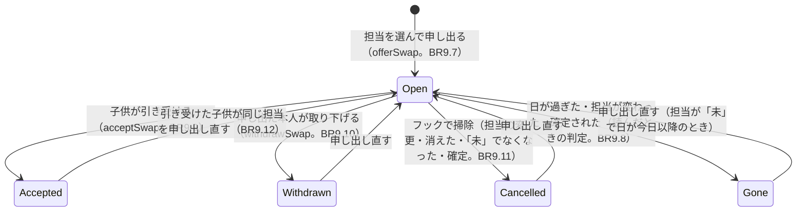

# 機能の仕様（Functional Spec）— U8 代わりにやる

U8（`u8-swap`）では、子供どうしが、お知らせ先のグループで担当を代わります。グループで「家事交代」と送ると、公式アカウントが申し出られる担当をボタンで返し、担当を選ぶと申し出がグループに出て、ほかの子供が「引き受ける」を押すと担当が変わります。受け持つのは US7.1 の AC7.1.1〜AC7.1.11 です（FR7.1〜FR7.5、NFR7）。データの形は `entities.md`、決まりは `rules.md` にあります。LINE のグループだけが入口で、画面（アプリ）には何も足しません。

ストーリー `US7.1`（担当を代わってもらう）をこの単位で作ります。AC1.2.5（登録されていないグループでの申し出を断る）は、U3 の決まり（`groupCommandGate.runGroupOperation`）を使い、U8 で申し出の操作をそこに差し込んで確かめます。

U8 で決めたこと:

- 申し出を始める言葉は「家事交代」だけ。前後の空白を除いて完全一致のときだけ受け付ける。「代わって」「かわって」は受け付けない [Q1]（BR9.1）。要件・ストーリーの「代わって」と送る、は「家事交代」と送る、に読み替える
- 管理者がグループで送ったら「代わってもらう申し出は子供だけができます」、1 対 1 で送ったら「代わってほしいときは、家族のグループで『家事交代』と送ってください」と返事する [Q2]（BR9.3、BR9.4）
- ボタンは日付の近い順（同じ日は種類の順）に 10 件まで。超えるときは「近い日の担当だけ出しています。ほかの担当は、その日が近づいたらまた『家事交代』と送ってください」を添える [Q3]（BR9.6）
- 引き受けた担当も、さらに申し出られる。何回引き継いでも `origin` は `swap` [Q4]（BR9.12）
- 引き受けた担当は、画面には何も出さない。担当の子供の名前が変わるだけで、元の子供も履歴も残さない [Q5]（BR9.13）
- 申し出は `Calendar` テーブルの `SWAP#<dutyId>` の項目に置く。新しいテーブル・索引・権限は足さない（BR9.19）
- 申し出が有効かは、読んだときの担当と月の状態から決める。フックで `cancelled` にするのは掃除で、api と line の両方で登録する（BR9.8、BR9.11）
- 返事はすべて reply で出し、push は使わない（BR9.14）

## 流れ

### F1 「家事交代」と送る（AC7.1.1〜AC7.1.3、BR9.1、BR9.2、BR9.5、BR9.6）

1. 子供が、お知らせ先のグループで「家事交代」と送る（前後の空白は無視。完全一致。BR9.1）
2. 受け口は、二度処理しない記録を書く前に「家事交代」にあたるかを確かめ、あたらなければ打ち切る（雑談には反応しない）
3. グループの入口（`runGroupOperation`）が、グループの登録 → 送った人が友だちで家族のメンバーか、を確かめる（BR9.2）。登録がなければ「このグループは家族のお知らせ先として登録されていません」、メンバーでなければ NOT_FAMILY_MEMBER の文で断る
4. 送った人が管理者なら「代わってもらう申し出は子供だけができます」と返事して終わる（BR9.3）
5. 子供なら `listSwappableDuties(ctx, today)` を呼ぶ。今月と来月を並行して読み、自分の・今日以降の・「未」の・確定していない月の担当を集める（BR9.5）
6. 返事:
   - 1 件以上: 「代わってほしい担当を選んでください」と、日付の近い順の担当のボタン（「1/8 皿洗い」）を 10 件まで。11 件以上なら案内を添える（AC7.1.1、BR9.6）
   - 0 件で今日の月が確定している: 「この月は確定済みです」（AC7.1.2）
   - 0 件でそれ以外: 「申し出られる担当はありません」（AC7.1.3）

### F2 担当を選んで申し出る（AC7.1.4、AC7.1.9、BR9.7、BR9.8）

1. 子供が、F1 の返事のボタン（`swap.offer`）を押す。押した人は、グループの入口を通る（BR9.2）
2. `offerSwap(ctx, dutyId, { now })` が、次の順に判定する（BR9.7）

```text
1 担当を探す（家族の中だけ）          → なければ NOT_FOUND
2 担当の子供が押した人か              → 違えば OFFER_OWNER_ONLY（管理者・ほかの子供）
3 月が確定していないか                → MONTH_CONFIRMED
4 「未」で、日が今日以降か            → DUTY_NOT_TODO
5 有効な申し出がすでにあるか（BR9.8）  → ALREADY_OFFERED
6 取引で書く（申し出の UpdateItem ＋ 担当の ConditionCheck ＋ 月の ConditionCheck）
```

3. 成功したら、グループに返事として「花子が 1月8日 の皿洗いを代わってくれる人を探しています」と、「引き受ける」「申し出をやめる」のボタンを出す（AC7.1.4）。ボタンの値には `dutyId` と新しい `offerId` を入れる
4. 同じ担当をもう一度申し出ると、5. で「この担当はもう申し出ています」と返事する（AC7.1.9）。取り下げたあと・引き受けられたあと・自動でなくなったあとは、5. を通って、新しい `offerId` の申し出に上書きできる

### F3 引き受ける（AC7.1.5〜AC7.1.7、BR9.9、BR9.12、BR9.13）

1. 子供が「引き受ける」（`swap.accept`）を押す
2. `acceptSwap(ctx, dutyId, offerId, { now })` が、申し出の項目と担当を並行して読み、次の順に判定する（BR9.9）

```text
1 申し出がない／offerId が違う／取り下げ済み・自動でなくなった → OFFER_GONE
2 開いているが、担当が変わった・日が過ぎた・確定された（BR9.8）  → OFFER_GONE
3 押した人が管理者、または申し出た本人                          → CANNOT_ACCEPT_OWN_OFFER
4 すでに引き受けられている                                      → OFFER_ALREADY_ACCEPTED
5 取引で書く（担当の子供を押した人に・origin=swap・version+1 ＋ 申し出を accepted に ＋ 月の確定の確認）
```

3. 取引は 3 項目で、全部書くか全部書かない。申し出の条件（`status=open` かつ `offerId` が同じ）が、同時に押した 2 人のうち 1 人だけを通す。負けた側は読み直して「この申し出はもう引き受けられています」になる（AC7.1.6）
4. 成功したら「太郎が 1月8日 の皿洗いを引き受けました」とグループに返事する（AC7.1.5）。太郎の自分の担当には触れない
5. 管理者や申し出た本人が押したら、担当は変わらず「この申し出には応えられません」（AC7.1.7）
6. 引き受けた担当は、画面では担当の子供の名前が変わるだけで、印も元の子供の名前も出ない [Q5]。この担当も、引き受けた子供が F1 から申し出られる [Q4]

### F4 申し出をやめる（AC7.1.8、BR9.10）

1. 申し出た子供が「申し出をやめる」（`swap.withdraw`）を押す
2. `withdrawSwap(ctx, dutyId, offerId, { now })` が判定する: 申し出がない・取り下げ済み・自動でなくなった → OFFER_GONE、押した人が本人でない → OFFER_OWNER_ONLY「この操作は申し出た人だけができます」、引き受け済み → OFFER_ALREADY_ACCEPTED、それ以外は申し出を `withdrawn` にする
3. 成功したら「花子が 1月8日 の皿洗いの申し出をやめました」と返事する。そのあと「引き受ける」を押すと「この申し出はもうありません」（AC7.1.8）

### F5 申し出が自動でなくなる（AC7.1.10、BR9.8、BR9.11）

1. 次のどれかが起きると、申し出は「なくなった」ものになる（FR7.5）
   - 管理者が担当の子供を変えた、または割り当ての保存し直しで担当が作り直された・消えた（U5。`child-changed`・`deleted`）
   - 担当が「未」でなくなった（U6 の記録、U7 の状態の変更。`onDutyRecorded`、`status-changed`）
   - その月が確定された（U7。確定の時点で「未」だった担当ごとの `status-changed`）
   - 担当の日が過ぎた（イベントなし。読んだときに今日と比べる）
2. 判定は読んだときに行う。申し出が開いていても、担当の `version` が申し出たときと違う・「未」でない・日が過ぎた・月が確定した、のどれかなら、「なくなった」と扱う（BR9.8）。フックが失敗しても、遅れても、結果は変わらない
3. フック（`onDutyReassigned` の 3 種類と `onDutyRecorded`）は、その担当の申し出が開いていれば `cancelled` にする掃除をする（BR9.11）。申し出がなければ、条件で断られて何も起きない
4. なくなった申し出の「引き受ける」を押すと「この申し出はもうありません」（AC7.1.8、AC7.1.10）

### F6 管理者・1 対 1・登録されていないグループ（BR9.2〜BR9.4、BR9.16）

| 場所と人 | 送った・押したもの | 返事 |
|----------|------------------|------|
| 登録されていないグループ | 「家事交代」やボタン | 「このグループは家族のお知らせ先として登録されていません」（AC1.2.5） |
| 家族のメンバーでない人 | 「家事交代」やボタン | 決まった文（NOT_FAMILY_MEMBER。家族の情報は入れない） |
| グループの管理者 | 「家事交代」 | 「代わってもらう申し出は子供だけができます」 [Q2] |
| グループの管理者 | 担当を選ぶ・申し出をやめる | 「この操作は申し出た人だけができます」 |
| グループの管理者 | 引き受ける | 「この申し出には応えられません」 |
| 1 対 1（誰でも） | 「家事交代」 | 「代わってほしいときは、家族のグループで『家事交代』と送ってください」 [Q1、Q2] |
| 1 対 1 | swap のボタンの値 | 何もしない（ボタンはグループにだけ出る） |
| ルーム（source.type が room） | なんでも | 何もしない |

### F7 速さ（AC7.1.11、BR9.17）

1. 「家事交代」「担当のボタン」「引き受ける」を合わせて 20 回行って、19 回以上で 3 秒以内に返事が届く
2. 読み取りは並行して走らせる（一覧: 月の Query 2 回＋種類の Query 1 回、選ぶ・引き受ける: 担当の探索＋申し出の GetItem＋種類の Query）。書き込みは 1 つの取引。LINE のプロフィール取得は呼ばない

## 申し出の状態の変わり方



文字での説明（図が表示されないとき）: 申し出は「受け付け中」から始まり、引き受けられる（accepted）、本人が取り下げる（withdrawn）、フックで掃除される（cancelled）のどれかになります。担当が変わった・日が過ぎた・月が確定した申し出は、項目が受け付け中のままでも、読んだときに「なくなった」と判定します。引き受け・取り下げ・掃除のあとに同じ担当を申し出し直すと、新しい申し出の ID で上書きされます。Gone は保存される状態ではなく、読んだときの判定です。

## 担当の変わり方（U8 の分）

引き受けの取引だけが、担当の `childUserId` を変え、`origin` を `swap` にし、`version` を 1 増やします（`status` は「未」のまま、記録の項目は空のまま）。

```text
担当の Update    : SET childUserId = :taker, origin = 'swap', version = version + 1, updatedAt = :now
                  条件 dutyId = :id AND version = :dutyVersion AND status = 'todo' AND childUserId = :offerer
申し出の Update  : SET status = 'accepted', acceptedByUserId = :taker, acceptedAt = :now
                  条件 status = 'open' AND offerId = :offerId
月の ConditionCheck : 確定していない（U5 の buildMonthGuard）
```

## 結果の印と返事の対応

返事はすべてグループへの reply です（push は使わない）。「読み直し」は、担当と申し出を読み直して判定し直すことです（BR9.15）。

| 操作 | 印 | LINE の返事 |
|------|----|------------|
| 一覧 | 成功 | 「代わってほしい担当を選んでください」＋ 担当のボタン（10 件まで）＋（超えるとき）案内 |
| 一覧 | `MONTH_CONFIRMED` | 「この月は確定済みです」 |
| 一覧 | `NO_SWAPPABLE_DUTY` | 「申し出られる担当はありません」 |
| 申し出 | 成功 | 「{名前}が {M}月{D}日 の{お手伝い}を代わってくれる人を探しています」＋「引き受ける」「申し出をやめる」 |
| 申し出 | `ALREADY_OFFERED` | 「この担当はもう申し出ています」 |
| 申し出 | `OFFER_OWNER_ONLY` | 「この操作は申し出た人だけができます」 |
| 申し出 | `MONTH_CONFIRMED` | 「この月は確定済みです」 |
| 申し出 | `NOT_FOUND`・`DUTY_NOT_TODO` | 「この担当は先に変更されました」 |
| 申し出 | `INTERNAL` | 「うまく申し出られませんでした。もう一度お試しください」 |
| 引き受け | 成功 | 「{名前}が {M}月{D}日 の{お手伝い}を引き受けました」 |
| 引き受け | `OFFER_ALREADY_ACCEPTED` | 「この申し出はもう引き受けられています」 |
| 引き受け | `CANNOT_ACCEPT_OWN_OFFER` | 「この申し出には応えられません」 |
| 引き受け | `OFFER_GONE` | 「この申し出はもうありません」 |
| 引き受け | `INTERNAL` | 「うまく引き受けられませんでした。もう一度お試しください」 |
| 取り下げ | 成功 | 「{名前}が {M}月{D}日 の{お手伝い}の申し出をやめました」 |
| 取り下げ | `OFFER_GONE`・`OFFER_ALREADY_ACCEPTED`・`OFFER_OWNER_ONLY` | 上の同じ印の文 |
| 取り下げ | `INTERNAL` | 「うまく申し出られませんでした。もう一度お試しください」 |

`NO_SWAPPABLE_DUTY`・`ALREADY_OFFERED`・`OFFER_ALREADY_ACCEPTED`・`OFFER_GONE`・`CANNOT_ACCEPT_OWN_OFFER`・`MONTH_CONFIRMED`・`DUTY_CHANGED` の文は C10 の既存の文言を使います。

## 契約への追加

契約（`inception/contract-design/contract-summary.md`）の決まりでは、項目・操作・理由の印を足すのは自由です。U8 の変更は `docs/contract-changes-u8.md` に一覧として残します。壊す変更はありません。

| 契約 | 区分 | 中身 |
|------|------|------|
| C3 postback | 足したもの（形） | `action=swap.offer&dutyId=<UUID>`、`action=swap.accept&dutyId=<UUID>&offerId=<UUID>`、`action=swap.withdraw&dutyId=<UUID>&offerId=<UUID>`。グループ（source.type が group）に届いたものだけを、生の文字列に対する正規表現で厳密に読む（BR9.16） |
| C3 message | 足したもの（言葉） | グループの text で、前後の空白を除いて「家事交代」と完全に一致 → `listSwappable`。1 対 1 の同じ言葉は案内だけ（BR9.1、BR9.4） |
| C8 `listSwappableDuties(ctx, today)` | 形（変更） | 契約の `Duty[] \| NO_SWAPPABLE_DUTY \| MONTH_CONFIRMED` の `Duty[]` を `SwappableDuty[]`（`dutyId`・`date`・`choreTypeId`・`choreName`。日付の近い順、同じ日は種類の順）にする。10 件への絞りは受け口 |
| C8 `offerSwap(ctx, dutyId, options)` | 形（変更） | `options` に `now` を入れる。結果は `{ offerId }` / `NOT_FOUND` / `OFFER_OWNER_ONLY` / `MONTH_CONFIRMED` / `DUTY_NOT_TODO` / `ALREADY_OFFERED` / `INTERNAL`。契約の `Offer` の代わりに、返事に必要な担当の日付・種類を添える |
| C8 `acceptSwap(ctx, dutyId, offerId, options)` | 形（変更） | `dutyId` を足す（申し出の項目のキーが担当の ID）。結果は `{ duty }` / `OFFER_GONE` / `CANNOT_ACCEPT_OWN_OFFER` / `OFFER_ALREADY_ACCEPTED` / `INTERNAL`。`NOT_FOUND` は `OFFER_GONE` に含める（ほかの家族のデータがあることを知らせない） |
| C8 `withdrawSwap(ctx, dutyId, offerId, options)` | 形（変更） | `dutyId` を足す。結果は成功 / `OFFER_GONE` / `OFFER_OWNER_ONLY` / `OFFER_ALREADY_ACCEPTED` / `INTERNAL` |
| C8 `onDutyReassigned` / `onDutyRecorded` | 使うもの | U8 が登録する。型は変えない（`kind` は `child-changed`・`deleted`・`status-changed` の 3 つ）。引き受けは `notifyDutyReassigned` を呼ばない |
| C6 `runGroupOperation` | 形（追加） | 操作関数に、押した人の表示名を第 2 引数で渡す（`FamilyContext` は変えない。既存の呼び出しは変わらない）。追加の読み取りはしない |
| C10 理由の印と文言 | 足したもの | `OFFER_OWNER_ONLY`（「この操作は申し出た人だけができます」）。LINE の文言（見出し、案内、管理者・1 対 1 の文、知らせと結果の文、失敗の文） |
| 更新するファイル | 足したもの（一覧） | `packages/shared` の `reasons.ts`（理由の印）、`messages.ts`（文言）、`messages.test.ts`（文言のテスト）の更新。`docs/contract-changes-u8.md` の一覧に入れる |
| データ | 足したもの | `Calendar` の `SWAP#<dutyId>` の項目（`SwapOffer`）。テーブル・索引・TTL・権限・環境変数は足さない |

## 受け入れ条件との対応

| 受け入れ条件 | 流れ | 決まり | U8 で作る範囲 |
|-------------|------|-------|-------------|
| AC7.1.1 「家事交代」で「1/8 皿洗い」のボタンが出る | F1 | BR9.1、BR9.2、BR9.5、BR9.6、BR9.16 | すべて |
| AC7.1.2 月が確定していて担当がなければ「この月は確定済みです」 | F1 | BR9.5 | すべて |
| AC7.1.3 「未」の担当がなければ「申し出られる担当はありません」 | F1 | BR9.5 | すべて |
| AC7.1.4 担当を選ぶと申し出と 2 つのボタンが出る | F2 | BR9.7、BR9.14 | すべて |
| AC7.1.5 引き受けると担当が変わり、自分の担当は動かない | F3 | BR9.9、BR9.14 | すべて |
| AC7.1.6 先に引き受けられていたら担当は変わらない | F3 | BR9.9 | すべて |
| AC7.1.7 本人か管理者が押したら応えられない | F3、F6 | BR9.3、BR9.9 | すべて |
| AC7.1.8 取り下げたあとは「もうありません」 | F4 | BR9.8、BR9.10 | すべて |
| AC7.1.9 同じ担当への二重の申し出を断る | F2 | BR9.7 | すべて |
| AC7.1.10 変更・日が過ぎる・「未」でなくなる・確定で申し出がなくなる | F5 | BR9.8、BR9.11 | すべて（フックの登録と読んだときの判定） |
| AC7.1.11 20 回中 19 回、3 秒以内に返事 | F7 | BR9.17 | 設計まで（計測はステージングの性能の確かめ） |
| AC1.2.5（US1.2。U3 の決まり） 登録されていないグループでの申し出を断る | F1、F6 | BR9.2 | 申し出の操作を入口に差し込むところまで（決まりの本体は U3） |

## 次の単位への引き継ぎ

- **U9（お小遣い）:** U8 は状態・記録・単価を書き換えない。引き受けても金額は変わらない（担当が「済」になったときに、その時点の担当の子供の記録として数える）。U8 から U9 への引き継ぎはない
- **U10（お知らせ）:** 16 時のリマインドは、その日の担当の子供を読むので、引き受けた担当は引き受けた子供の分として届く（`childUserId` が変わっているだけ）。U8 の返事は reply なので、月 200 通の無料枠（NFR1）には数えない
  - **作り手へ 15 分以内に知らせる対象のイベント（NFR2.66。U10 で仕組みを入れる）:** 画面にもグループにも出ず、ログでしか分からないものです。

    | イベント | 条件 | 重さ | 出る Lambda |
    |---------|------|------|------------|
    | `SWAP_REJECTED` | `reason = INTERNAL`（取引が 2 回続けて断られた） | error 相当 | `line` |
    | `REQUEST_ERROR` | 1 件でもある | error | `line`・`api` |
    | `LINE_REPLY_FAILED` | 1 件でもある（保存は済んでいるが返事が出ていない） | warn | `line` |
    | `DUTY_HOOK_FAILED`・`DUTY_RECORDED_HOOK_FAILED` | 1 件でもある（フックが投げた。保存の結果は変わらない） | error | `api`・`line` |
    | `DUTY_HOOKS_DONE` | `failed` が 1 以上 | warn | `api`・`line` |
    | `DUTY_HOOKS_TRUNCATED` | 1 件でもある（フックの打ち切り） | warn | `api` |
    | `CONFIRM_POST_READ_FAILED` | 1 件でもある（確定後の読み取りの失敗） | warn | `api` |

    詳しい項目は `construction/u8-swap/infrastructure-design/monitoring-design.md` の「Alerts」にも同じ表があります。
- **U11（加算・減額）:** U8 との引き継ぎはない
- **配備:** `line` の Lambda に、「家事交代」の message と swap の postback の入口を足す。`api` と `line` の起動の枠で、フックの登録（`registerSwapHooks`）を呼ぶ。環境変数（`CALENDAR_TABLE`、`CHORE_TYPES_TABLE`）と権限（`Calendar` に `GetItem`・`Query`・`UpdateItem`・`ConditionCheckItem`、`ChoreTypes` に `GetItem`・`Query`・`ConditionCheckItem`）は、`line` にも `api` にも U5・U6 で足し済みで、U8 では変えない。コード生成で `infrastructure/lib/app-stack.ts` を読んで足りていることを確かめ、CDK のテストの期待に「U8 で差分がない」ことを入れる
- **ドキュメント:** 上流の文書（`stories.md` の AC7.1.1〜AC7.1.3、`requirements.md` の FR7.1、`mockups.md`、`contract-summary.md`）の「代わって」と送る、の書き方を「家事交代」に直す更新は、コード生成の最初の手順（BDD の筋書きを書く前）で行う。コード生成の計画は、その手順を最初に置き、下の読み替え表を参照する
- **筋書き用の読み替え表**（上流の文書を直すまでの間と、筋書きを書くときの決め）:

| 筋書きの場所 | 上流の書き方 | 筋書きで使う言葉 |
|-------------|------------|----------------|
| AC7.1.1〜AC7.1.3 の送る言葉 | 「代わって」 | 「家事交代」 |
| 受け付けない言葉 | （書かれていない） | 「代わって」「かわって」は受け付けない（反応しない。BR9.1） |
| 返事の中の案内 | 「代わって」と送ってください | 「『家事交代』と送ってください」（BR9.4、BR9.6） |
| 直した日・直したファイル | （コード生成 Step 1a） | 2026-11-10 に `stories.md`（AC7.1.1〜AC7.1.3、AC7.1.11、「あとの段階で決めること」）、`requirements.md`（FR7.1、`[assumption]`）、`mockups.md`（T2、返事の表、注記）、`contract-summary.md`（C3）を「家事交代」に直した。この表は残す。一覧は `docs/contract-changes-u8.md` |

## Sources

- `inception/requirements-analysis/requirements.md`（FR7.1〜FR7.5、FR3.3、NFR1、NFR2、NFR4、NFR7、NFR11、レビュー R-04・R-05）
- `inception/user-stories/stories.md`（US7.1、AC7.1.1〜AC7.1.11、AC1.2.5、AC3.1.5、「あとの段階で決めること」）
- `inception/units-generation/unit-of-work.md`、`unit-of-work-story-map.md`（U8 の受け持つこと、AC1.2.5 の分担）
- `inception/refined-mockups/mockups.md`（T2）、`interaction-spec.md`（トークのボタン）
- `inception/domain-design/components.md`（カレンダーの部品、「代わりにやるの申し出」）
- `inception/contract-design/contract-summary.md`（C3、C8、C10）
- `construction/u5-assignment-calendar/functional-design/`、`docs/contract-changes-u5.md`（`origin`、`onDutyReassigned`、担当の書き込みの条件）
- `construction/u6-recording/functional-design/`、`docs/contract-changes-u6.md`（`onDutyRecorded`、1 対 1 の入口、`line` の権限）
- `construction/u7-review-confirm/functional-design/`、`docs/contract-changes-u7.md`（`status-changed`、月の確定）
- 既存コード（読むだけ）: `services/groupCommandGate.ts`、`services/oneToOneGate.ts`、`services/dutyReassignedHook.ts`、`services/dutyRecordedHook.ts`、`services/recordingService.ts`、`services/lineApiService.ts`、`repositories/calendarRepository.ts`、`handlers/line/`、`entries/line.ts`
- `functional-design-questions.md` の回答 [Q1]〜[Q5]

## Assumptions & Open Questions

- [assumption] 要件・ストーリーの「代わって」と送る、は、Q1 の答えにより「家事交代」と送る、に読み替えて設計しました。上流の文書は、この設計では書き換えず、コード生成の最初の手順（BDD の筋書きの前）で直します（「次の単位への引き継ぎ」の読み替え表を参照）
- [assumption] 管理者への返事と 1 対 1 の返事は Q2 の A のとおりです。管理者が「家事交代」と送ったときの文には言葉を入れず、1 対 1 の文には「『家事交代』と送ってください」と入れます（Q1 による読み替え）
- [assumption] Q5 の C（画面に何も出さず、元の子供を残さず、履歴も残さない）は、U5 の AC3.1.5・U5 の上書きの確認（BR6.7）と矛盾しません。確認は「今の担当の子供 → 作り直したあとの子供」で出す仕組みで、元の子供を使わないためです。矛盾する点は見つかりませんでした
- [assumption] 引き受けの取引は、担当・申し出・月の確認の 3 項目で、1 回の TransactWriteItems に収まります。項目数の上限と、費用 0 円（読み書きは数件）への影響はありません
- [assumption] AC7.1.11 の「3 秒以内」の計測は、ステージングの性能の確かめ（NFR の設計・コード生成の後の確かめ）で行います。設計では、読み取りを並行にして取引を 1 つにするところまでを決めます
- [assumption] 月の確定の掃除の件数と時間（目安: 300 件で NFR7 の 3 秒に収まるか）は、NFR 設計で決める項目です。手段の候補は (a) 測定で足りるとする、(b) フック側で限られた並行数にする、(c) 月単位のイベントを U7 の契約に足す、の 3 つです（BR9.11）。「Query で一括」は (c) が前提です。正しさは BR9.8 が守るので、掃除が遅れても結果は変わりません
- [assumption] 遅れたフックが新しい申し出を取り消す窓は、同じ要求の中だけで許容します。確定の取り消しのあとの申し出は、フックが成功していれば戻らず、失敗していれば戻ります。この差を許容し、戻し処理は作りません（実装が単純なため。BR9.8、BR9.11）
- [assumption] Q1 の完全一致は、U3 と同じく前後の空白を除いたうえでの一致と読みます（BR9.1）
- [assumption] 古い選択ボタンの文は、担当が引き受けなどで変わっていて元の持ち主が押したときは DUTY_CHANGED「この担当は先に変更されました」、押した人が管理者かほかの子供のときは OFFER_OWNER_ONLY のままです（BR9.7）
- [assumption] LINE の上限（Flex のボタンの文字 26 文字、template のボタンの文字と本文の長さ、altText、reply の通数）は、公式の資料をこの段階では確かめられていません。コード生成で確かめ、違えば BR9.6・BR9.7 の文字数を直します（rules.md の Assumptions）
- [assumption] 受け入れ条件の Given/When/Then は、BDD の決まり（`team.md` の Testing Posture）により、コード生成の最初に、AC7.1.1〜AC7.1.11 から書きます。テストの道具は NFR の設計で決まったもの（U5〜U7 と同じ）を使います
