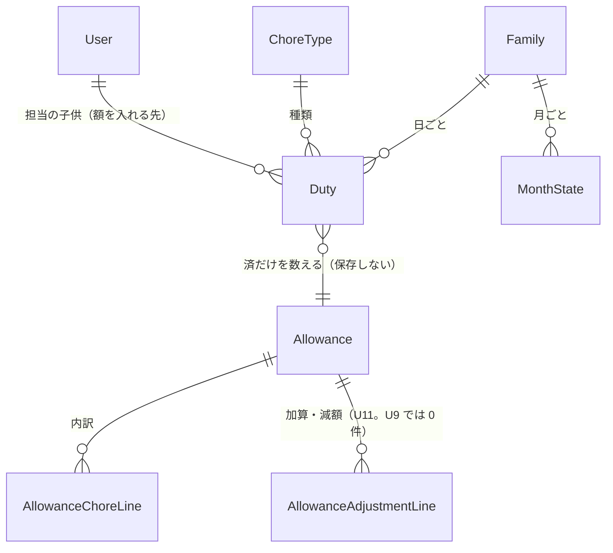

# データの形（Entities）— U9 お小遣いの額

U9（`u9-allowance`）で扱うデータの形です。U9 は**新しい保存先を作らず、何も書きません**。お小遣いの額は、どこにも保存せず、読むたびに「状態が済の担当」と、その担当に書き写された単価から計算します（FR8.1、ADR-005）。U9 が読むのは、U5 が作り U6・U7 が記録した「日ごとの担当（Duty）」の `status`・`childUserId`・`choreTypeId`・`unitPrice`、U5・U7 が持つ「月の状態（MonthState）」の `confirmed`、U4 の「お手伝いの種類（ChoreType）」の名前と並び順、U1・U2 の家族のメンバー（子供）の一覧です。持ち主の部品は `inception/domain-design/components.md` の Entity Ownership のとおりで、お小遣いの部品は担当・月の状態・種類・メンバーを**読むだけ**です（頼り方は一方向。ADR-001）。画面と U10・U11 に見せる「お小遣いの答え（Allowance）」は、計算の結果として作る値で、保存しません。使う技術にかかわらない、論理的な形だけを書きます。

## データの一覧（機械で読む形）

```yaml
entities:
  - name: Duty
    label: 日ごとの担当（U9 は読むだけ。数えるのは状態が済のものだけ）
    owner: カレンダー（担当と記録）
    description: >-
      ある日のあるお手伝いの担当。U5 が作り、U6・U7・U8 が書き換える。
      U9 は、ある月の「済」の担当を C8 の listDoneDuties で読み、書き写された単価 × 回数を、子供ごと・種類ごと・単価ごとに数える（FR8.1）
    attributes:
      - name: dutyId
        type: string
        required: true
        unique: true
        constraints: ログや照合に使う。U9 は変えない
      - name: date
        type: date
        required: true
        constraints: >-
          日本時間の日付。**どの月のお小遣いに数えるかは、この日付の月で決める**（記録した時刻 recordedAt の月ではない。NFR11）。
          例: 12 月 31 日の担当を 1 月 2 日に記録しても、12 月に数える
      - name: choreTypeId
        type: string
        required: true
        references: ChoreType.choreTypeId
        constraints: 内訳の行をまとめる単位（種類の ID。名前ではない [Q3]）
      - name: childUserId
        type: string
        required: true
        references: User.userId
        constraints: >-
          額を入れる子供。**記録した人（recordedBy）が誰でも、この子供に入れる** [Q1]。
          代わりにやる（U8）で引き受けた担当は、引き受けた子供そのものがここに入っているので、引き受けた子供の額になる。
          母親が「済にする」（U7）を押した担当も、担当の子供の額になる（記録した人は管理者のまま）。
          担当の子供を変えられるのは「未」のときだけ（U5・U8）なので、「済」である間はこの値は変わらない
      - name: status
        type: enum
        required: true
        allowed: [todo, done, skipped]
        constraints: >-
          数えるのは done だけ。todo（未）と skipped（×）は数えない。
          取り消し・やらなかったにする・確定の取り消しのあとも、読み直せば額がずれない（保存した合計がないため。FR6.1、FR8.1）
      - name: unitPrice
        type: integer
        required: false
        constraints: >-
          記録のときに書き写された単価（円。0 以上の整数）。U6・U7 が「済」にするとき status・recordedAt・recordedBy と同時に書く。
          U9 は「済」の担当のこの値**だけ**で金額を計算し、種類の今の単価（ChoreType.unitPrice）は使わない（FR2.2、ADR-003）。
          「空」は undefined か null のときだけ（0 円は有効な値で、空ではない）。「済」なのに空の担当は、U6・U7 の不変条件に反する異常なデータ。数えず、ログに残す（BR10.13）
      - name: recordedBy
        type: string
        required: false
        references: User.userId
        constraints: U9 は使わない（額を入れる先の判断に使わない [Q1]）
    constraints:
      - 読むだけ。担当を作らない・変えない・消さない
      - 月の担当は、月の項目をまとめて読む 1 回の Query（強い整合性）から取る。担当の数で読み取りの回数は増えない（NFR1.21。BR10.16）
    relationships:
      - target: MonthState
        cardinality: many-to-one
        direction: Duty → MonthState（確定しているかを読むだけ）
      - target: ChoreType
        cardinality: many-to-one
        direction: Duty → ChoreType（内訳の行の名前と並び順を読むだけ）
      - target: User
        cardinality: many-to-one
        direction: Duty → User（額を入れる子供）

  - name: MonthState
    label: 月の状態（U9 は確定しているかを読むだけ）
    owner: カレンダー（担当と記録）
    description: >-
      家族と月ごとの確定の状態。U5 が形を作り、U7 が書く。U9 は、画面の見出し（「確定していません」「確定済み」）のために `confirmed` を読む。
      確定していても、していなくても、額は同じ計算で出す [Q4]
    attributes:
      - name: confirmed
        type: boolean
        required: true
        default: false
        constraints: >-
          行がまだ無い月（記録のない月）は false として扱う（U5 のレビュー R-06、U7 の BR8.11）。
          確定している月は、担当・記録・状態が誰にも変えられないので、読み直しても額は変わらない（FR6.5）。
          確定を取り消すと、また変わりうる
    relationships: []

  - name: ChoreType
    label: お手伝いの種類（U9 は名前と並び順を読むだけ）
    owner: お手伝いの種類
    description: >-
      名前・単価・使う／使わない。U9 は、内訳の行に出す種類の**今の名前**と、行の並び順（U4 の一覧の並び）を、C7 の list で読む。
      今の単価（unitPrice）は計算に使わない
    attributes:
      - name: choreTypeId
        type: string
        required: true
        unique: true
        constraints: 内訳の行をまとめる単位 [Q3]
      - name: name
        type: string
        required: true
        constraints: >-
          行には**今の名前**を出す。名前を変えても、同じ種類の行は分かれない [Q3]。
          「使わない」にした種類も、名前は出す（過去の記録とお小遣いは残る。FR2.3、AC2.1.5）
      - name: active
        type: boolean
        required: true
        constraints: U9 は表示に使わない（「使わない」の種類も同じ行として出す）。並び順の手がかりとしてだけ、一覧の並びに含まれる
    constraints:
      - >-
        使われた種類は消せない（U4 の CHORE_TYPE_IN_USE）ので、「済」の担当の種類が一覧にないことは起きない。
        起きたら名前は代わりの文言で出し、ログに残す（BR10.13）
    relationships: []

  - name: Member
    label: 家族のメンバー（U9 は子供の一覧を読むだけ）
    owner: 家族とメンバー
    description: >-
      家族に今いる人（管理者と子供）。U9 は C6 の listMembers で、今いる子供を**家族に入った順**に読む（管理者は出さない [Q2]）。
      担当に出てくる子供が一覧にいないときは、強い整合性で 1 人ずつ確かめる（参加した直後の子供でも額が出る。U5 の NFR4.45 と同じ）
    attributes:
      - name: userId
        type: string
        required: true
        unique: true
      - name: displayName
        type: string
        required: true
        constraints: 行の見出しに出す名前
      - name: role
        type: enum
        required: true
        allowed: [admin, child]
        constraints: 行を出すのは child だけ。管理者は担当を持たないので、行を出さない [Q2]
    constraints:
      - >-
        家族から抜けた（または管理者が外した）子供は、listMembers に出ない。その子供の「済」の担当がその月にあれば、
        名前つきで行を出す [Q2]。名前は C6 の窓口で利用者の表示名だけを読む（BR10.19）。
        抜ける・外す操作そのものは最初の版にないかもしれない（requirements の「設計の段階で決めること」）が、
        行を出す決まりは先に用意しておく
    relationships: []

values:
  - name: Allowance
    label: 子供 1 人・1 か月分のお小遣いの答え（C9 getAllowances の戻りの 1 件）
    description: >-
      保存しない。読むたびに計算する（ADR-005）。画面（U9）、月末のまとめ（U10）、加算・減額（U11）が同じ形で使う [Q6]。
      U11 で加算・減額が入っても、この形は変わらない（adjustments に行が入り、total に足されるだけ）
    attributes:
      - name: childUserId
        type: string
        required: true
        references: User.userId
      - name: displayName
        type: string
        required: true
        constraints: 子供の表示名。今いる子供は C6 の一覧から、抜けた子供は BR10.19 のとおり
      - name: current
        type: boolean
        required: true
        constraints: >-
          今も家族にいる子供なら true、抜けた（外された）子供なら false。
          画面は区別せず同じように出す。U10 が月末のまとめに抜けた子供を含めるかの判断に使える
      - name: month
        type: string
        required: true
        constraints: 日本時間の年月（例 2027-01）
      - name: lines
        type: list
        required: true
        constraints: >-
          内訳の行（AllowanceChoreLine）の配列。その月にその子供の「済」の担当がなければ空の配列。
          並びは BR10.4（種類の並び順、同じ種類のなかでは単価の低い順）
      - name: adjustments
        type: list
        required: true
        constraints: >-
          加算・減額の行（AllowanceAdjustmentLine）の配列。**U9 では常に空の配列**。U11 が行を入れる [Q6]。
          U11 を作らなくても、空のままで額は正しい
      - name: total
        type: integer
        required: true
        constraints: >-
          合計（円の整数）= lines の amount の和 + adjustments の amount の和。**窓口が計算して返す**。呼び出し側は足し算をしない [Q6]。
          U9 では lines の和だけ。0 円を下回るとき（U11 の減額）も、計算どおりのマイナスをそのまま返し、0 円にそろえない（FR8.3）
    relationships:
      - target: AllowanceChoreLine
        cardinality: one-to-many
        direction: Allowance → AllowanceChoreLine
      - target: AllowanceAdjustmentLine
        cardinality: one-to-many
        direction: Allowance → AllowanceAdjustmentLine（U9 では 0 件）
  - name: AllowanceChoreLine
    label: 内訳の 1 行（種類 × 単価）
    description: >-
      ある子供の、ある種類の、ある単価の「済」の担当を数えた 1 行。種類の ID と単価の組ごとに 1 行 [Q3]。
      月の途中で単価が変わると、同じ種類でも単価ごとに行が分かれる（FR2.2、AC8.1.4）
    attributes:
      - name: choreTypeId
        type: string
        required: true
        references: ChoreType.choreTypeId
      - name: choreName
        type: string
        required: true
        constraints: 種類の今の名前 [Q3]
      - name: unitPrice
        type: integer
        required: true
        constraints: 記録のときに書き写された単価（円。0 以上の整数）。0 円の種類の行も出す（0 は有効な値で「空」ではない）
      - name: count
        type: integer
        required: true
        constraints: その単価で数えた「済」の担当の件数（1 以上。0 件の行は作らない）
      - name: amount
        type: integer
        required: true
        constraints: 小計 = unitPrice × count（円の整数）。画面では「100円 x 8回 = 800円」の形で出す
  - name: AllowanceAdjustmentLine
    label: 加算・減額の 1 行（U11 が入れる。U9 では作らない）
    description: >-
      U11 が足す行の形の席。U9 では配列が常に空なので、この行は作られない。
      具体的な項目は U11 の設計で決める（足すのは自由で、ここにある項目は消さない・意味を変えない）
    attributes:
      - name: adjustmentId
        type: string
        required: true
        constraints: 加算・減額の ID（U11 が付ける）
      - name: amount
        type: integer
        required: true
        constraints: 符号つきの円の整数。加算は正、減額は負（例 -200）
      - name: reason
        type: string
        required: true
        constraints: 理由（U11 では必須。FR8.2）
  - name: AllowanceMonthView
    label: 画面用 API の答え（GET /v1/months/{month}/allowances の 200 の本文）
    description: >-
      画面 S5 が 1 回の呼び出しで描ける形。保存しない。Allowance の配列に、見出しと月の移動に要る値を添える。
      月末のまとめ（U10）は Allowance の配列だけを窓口 getAllowances から受け取り、この形は使わない
    attributes:
      - name: month
        type: string
        required: true
        constraints: 答えの月（YYYY-MM。要求の月が current のときは、日本時間の今日の月）
      - name: confirmed
        type: boolean
        required: true
        constraints: その月が確定しているか。見出しに「確定していません」または「確定済み」を出すために使う [Q4]
      - name: today
        type: date
        required: true
        constraints: 裏側の日本時間の今日（U5 の MonthCalendar.today と同じ。画面や端末の時計は使わない）。S5 を直接開くときは、要求の月に current を指定すれば、この today と month が 1 回の答えで得られる（BR10.8）
      - name: firstMonth
        type: string
        required: true
        constraints: 月を移れる最初の月 = 家族が作られた月（日本時間）[Q4]
      - name: lastMonth
        type: string
        required: true
        constraints: 月を移れる最後の月 = 今日の月の翌月 [Q4]
      - name: allowances
        type: list
        required: true
        constraints: Allowance の配列（BR10.6 の子供の範囲と並び順）。子供がひとりもいなければ空の配列
    relationships:
      - target: Allowance
        cardinality: one-to-many
        direction: AllowanceMonthView → Allowance
```

## まとめ

- **新しい保存先はなく、書き込みもありません。** U9 は読み取り専用です。額も回数も保存せず、「読むたびに計算する」ので、取り消し・やらなかったにする・確定の取り消し・代わりにやるのあとも、読み直せば額がずれません（ADR-005）
- **数えるのは「済」の担当だけ**で、金額は担当に書き写された単価（`unitPrice`）だけから計算します。種類の今の単価は使いません。単価を変えても、すでに付いた記録の金額は変わりません（FR2.2）
- **額を入れる先は担当の子供（`childUserId`）です [Q1]。** 記録した人が母親でも子供でも変わらず、代わりに引き受けた担当は引き受けた子供の額になります
- **内訳の行は「種類の ID × 単価」ごとです [Q3]。** 名前は種類の今の名前で、名前を変えても行は分かれません。月の途中で単価が変わると、単価ごとに行が分かれます
- **答えの形（Allowance）は `lines`・`adjustments`・`total` を持ちます [Q6]。** U9 では `adjustments` は常に空で、`total` は `lines` の和です。U11 が `adjustments` に行を入れても、呼び出し側（画面・U10）は変わりません
- **画面用の答え（AllowanceMonthView）** は、画面が見出しと月の移動を描くための値（確定しているか・今日・移れる範囲）を添えた形で、保存しません

## データのつながり



文字での説明（図が表示されないとき）: 家族は日ごとの担当と月の状態を持ちます。担当は、お手伝いの種類と担当の子供を持ちます。お小遣いの答えは、状態が「済」の担当だけを子供ごとに数えて作る値で、保存しません。答えは種類 × 単価ごとの内訳の行を持ち、U11 が入れる加算・減額の行（U9 では 0 件）も持てます。

## Sources

- `inception/domain-design/components.md`（お小遣いの部品、Entity Ownership、ADR-001、ADR-003、ADR-005）
- `inception/contract-design/contract-summary.md`（C1 の `Duty`・`MonthCalendar`・`Allowance`・`GET /months/{month}/allowances`、C6 `listMembers`、C7 `list`、C8 `listDoneDuties`・`isMonthConfirmed`、C9 `getAllowances`）
- `inception/requirements-analysis/requirements.md`（FR2.2、FR2.3、FR5.8、FR6.1、FR6.5、FR8.1、FR8.3、NFR1、NFR7、NFR11）
- `inception/user-stories/stories.md`（US8.1、AC8.1.1〜AC8.1.4）
- `construction/u7-review-confirm/functional-design/entities.md`、`construction/u8-swap/functional-design/entities.md`（記録の 3 項目の不変条件、`unitPrice` の書き写し、`MonthState`、担当の子供の変更は「未」のときだけ）
- 既存コード（読むだけ）: `models.ts`（`DutyRecord`・`MonthStateRecord`）、`repositories/calendarRepository.ts`（`loadMonth`・`getMonthState`）、`services/calendarService.ts`（`buildMonthCalendar` の子供の補い方、`toDutyView`）、`services/familyMemberService.ts`（`listMembers`・`findFamilyChild`）、`services/choreTypeService.ts`（`list` の並び）、`handlers/calendar/getCalendar.ts`（入口の形）、`entries/api.ts`（振り分け表）
- `functional-design-questions.md` の回答 [Q1]〜[Q6]

## Assumptions & Open Questions

- [assumption] 画面用 API の答えの形（`AllowanceMonthView`）は、契約（`contract-summary.md`）の「`Allowance` の配列」から変わります。この入口はまだ誰も使っていないので、`/v2` を作らずに置き換えます（作り手が承認した例外）。変えた理由は、見出しの「確定していません／確定済み」と月の移れる範囲を、画面が 1 回の呼び出しで描けるようにするためです。窓口 `getAllowances` の戻りは契約どおり `Allowance[]` のままです。契約への追加は `docs/contract-changes-u9.md` に残します
- [assumption] 契約の `Allowance` の案（`lines` に `kind: chore | adjustment` を入れる形）は、Q6 の A の形（`lines`・`adjustments`・`total`）に置き換えます。契約の `Allowance` は案で、まだ誰も使っていない入口なので、`/v2` を作らずに置き換えます（作り手が承認した例外。壊す変更の手順を省く扱いであり、契約に「中身は U9 で決める」という文言があるわけではありません）。理由は `docs/contract-changes-u9.md` に同じ文で残します。まだコードがないので、直す相手はありません
- [assumption] 抜けた子供の表示名の読み方（C6 の窓口を 1 つ足す）と、家族が作られた月を読む窓口（C6 に 1 つ足す）は、`functional-spec.md` の「契約への追加」に書きます。どちらも読み取りだけです
- [assumption] `AllowanceAdjustmentLine` の項目（`adjustmentId`・符号つきの `amount`・`reason`）は、U11 の設計が確定するまでの席です。U11 は項目を足すことはできますが、ここにある項目を消したり意味を変えたりしません
- [assumption] 家族から抜ける・外す操作は最初の版にあるか未定です（requirements の「設計の段階で決めること」）。ないなら `current: false` の行は実際には出ませんが、Q2 の A の決まりと実装は用意し、テストでは前提データで用意します
