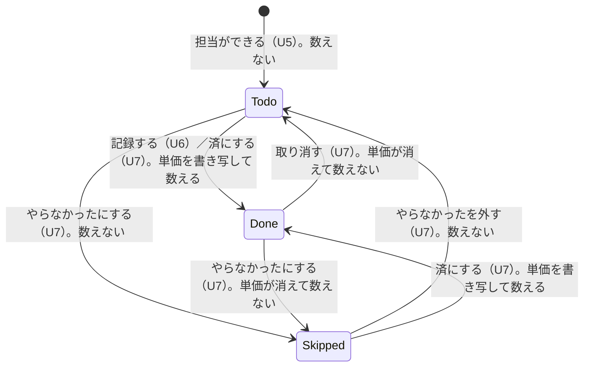
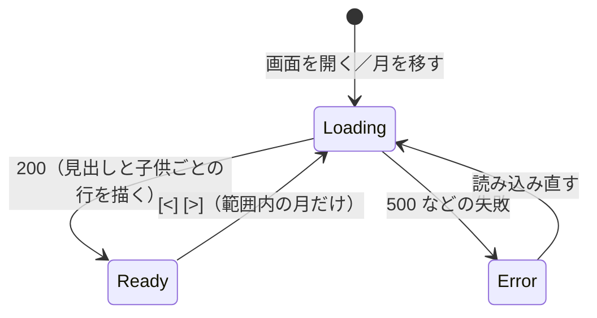

# 機能の仕様（Functional Spec）— U9 お小遣いの額

U9（`u9-allowance`）では、子供ごと・月ごとのお小遣いの額を、「状態が済の担当」に書き写された単価 × 回数を種類ごとに合計して、内訳つきで見せます。母親も子供も、同じ画面（S5）で家族の全員分を見られます。受け持つのは US8.1 の AC8.1.1〜AC8.1.4 で、あわせて US5.1 の AC5.1.13（記録がすぐ額に反映される。U6 が書き写し、U9 が表示）も確かめます（FR8.1、FR8.3、FR5.8）。加算・減額（FR8.2、AC8.2.x）は U11 です。データの形は `entities.md`、決まりは `rules.md` にあります。U9 は読み取りだけで、何も保存しません。

ストーリー `US8.1`（お小遣いの額を見る）をこの単位で作ります。

U9 で決めたこと:

- 額を入れる先は、済になった時点の「担当の子供」。記録した人（子供本人でも母親でも）で変わらず、代わりに引き受けた担当は引き受けた子供の額になる [Q1]（BR10.3）
- 行を出す子供は、今いる子供の全員（記録がなくても 0 円で）と、その月に済の担当がある抜けた子供（名前つき）。管理者は出さない。並びは家族に入った順 [Q2]（BR10.6）
- 内訳の行は「種類の ID × 単価」ごと。名前は種類の今の名前（「使わない」にした種類も出す）。並びは種類の並び順、同じ種類のなかでは単価の低い順 [Q3]（BR10.4）
- 画面は日本時間の今月で開く。[<] [>] で、家族が作られた月から今日の月の翌月まで移れる。確定していない月に「暫定」などの別の言葉や色は足さない [Q4]（BR10.8、BR10.9）
- 家族の全員が全員の額を見られる。トークで額を返す機能は作らない [Q5]（BR10.1）
- 窓口の答え（`Allowance`）は「子供、内訳の行、加算・減額の行、合計」。U9 では加算・減額の行は常に空で、合計は窓口が計算して返す [Q6]（BR10.5、BR10.7）
- 額も回数も保存しない。読むたびに、強い整合性で読んだ「済」の担当から計算する（BR10.2、BR10.12）

## 流れ

### F1 お小遣いの画面を開く（AC8.1.1、AC8.1.2、AC8.1.3、BR10.1、BR10.8〜BR10.11）

1. 家族のメンバーが、カレンダー（S1）の「お小遣い」の入口から S5 を開く。入口はメンバー全員に出す。S5 の「戻る」でカレンダーに戻る
2. 画面は、今日の月（日本時間）で `GET /v1/months/{month}/allowances` を呼ぶ。S1 から開くときは、S1 のカレンダーの答え（`MonthCalendar.today`。裏側の日本時間の今日）の月で呼ぶ。S5 を直接開くとき（ブックマークなど）は `month=current` で 1 回だけ呼ぶ（裏側が今日の月として扱い、答えの `month` と `today` に実際の値を入れる）。どちらも端末の時計は使わない。呼び出しの間は読み込み中の表示を出す
3. 画面は答え（`AllowanceMonthView`）を次のとおり描く
   - 見出し: 「[<] 2027年1月のお小遣い [>]」。その下に、`confirmed` が false なら「確定していません」、true なら「確定済み」[Q4]（BR10.9）
   - 子供ごとの行（`allowances` の順）: 見出しに名前と合計（例 「太郎 1,400円」）。その下に内訳の行
   - 内訳の 1 行: 「皿洗い 100円 x 8回 = 800円」「風呂掃除 150円 x 4回 = 600円」（BR10.11）。単価が途中で変わった月は「皿洗い 100円 x 3回」「皿洗い 120円 x 1回」のように行が分かれる（AC8.1.4）
   - 記録のない子供（`lines` が空）: 合計は「0円」、内訳の場所に「今月の記録はまだありません（0 円）」（AC8.1.2、BR10.10）。見ている月が今日の月でなければ「この月の記録はまだありません（0 円）」
   - ログインしているのが子供なら、その子供自身の行を太字と緑の枠で目立たせ、見出しに「（あなた）」を添える（BR10.11）。管理者には目立たせる行はない
4. 金額はすべて円の整数で、桁区切りつき（AC8.1.3）。マイナスは「-200円」と記号つきで出し、0 円にそろえない（FR8.3。U11 で加算・減額が入るときに表れる）
5. S5 には、加算・減額のボタンも、確定のボタンも置かない（それぞれ U11、U7 の入口。BR10.9、BR10.18）

### F2 月を移す（BR10.8、BR10.12）

1. [<] を押すと前の月、[>] を押すと次の月の答えを読み、見出しと内訳を描き直す。月の指定は `YYYY-MM`
2. 家族が作られた月（`firstMonth`）では [<] を、今日の月の翌月（`lastMonth`）では [>] を無効にする。無効は、押せないだけでなく、読み上げでも無効だと分かる状態にする（NFR9）
3. [<] [>] は読み込み中も押せる。押すたびに目標の月だけを更新し、最後の押しから 250 ms 待ってから、最新の目標の月だけを要求する。要求には連番を付け、最新の番号の答えだけを描く（遅れて届いた古い番号の答えは捨てる）。「飛んでいる要求」は連番が最も新しい要求とし、その月が目標の月と同じときだけ重ねて出さない（違う月なら、2 月→3 月→2 月と戻っても、新しい連番で 2 月の要求を出す）。月を移している間は、直前の月の内容を薄く残さず、読み込み中を出す
4. 確定していない月、確定済みの月、未来の月は、同じ計算と同じ見せ方。違うのは見出しの下の「確定していません」「確定済み」だけ [Q4]

### F3 額を計算する（裏側。AC8.1.1〜AC8.1.4、AC5.1.13、BR10.2〜BR10.7、BR10.12、BR10.13）

`getAllowances(ctx, month)` の中の手順です。読み取りだけで、何も書きません。

```text
1 読む（同時に始める。担当と月の状態は強い整合性）
    a 月の項目 loadMonth(familyId, month) の 1 回の Query → 担当（全部）と月の状態   ← C8 listDoneDuties / isMonthConfirmed が使う
    b C6 listMembers(ctx) → 今いる子供（家族に入った順）
    c C7 list(ctx) → 種類の今の名前と並び順
2 済だけを取り出す: status = done の担当（月は担当の date の月）。todo・skipped は数えない
    unitPrice が空（undefined か null のときだけ。0 円は有効）の「済」は数えず、ログに残す（BR10.13）
3 子供ごとに分ける: 担当の childUserId で分ける（記録した人は見ない）[Q1]
    一覧にいない子供は、まず listMembers の管理者（role が admin）の一覧と突き合わせる。管理者の ID なら行を作らず、ログに ALLOWANCE_DUTY_OWNER_NOT_CHILD を残す
    管理者でなければ findFamilyChild で確かめる（今も子供なら current）。抜けた子供は表示名だけを C6 findDisplayName で読む
4 行を作る: 子供ごとに (choreTypeId, unitPrice) でまとめて count → amount = unitPrice × count。名前は c の今の名前 [Q3]
    並べる: 種類の並び順 → 同じ種類では単価の低い順
5 加算・減額の行を取る（差し込み口。U9 の既定は空）→ adjustments
6 total = lines の amount の和 + adjustments の amount の和（0 円を下回ってもそのまま）[Q6]
7 対象の子供を決めて並べる: 今いる子供の全員 + 済のある抜けた子供。今いる子供を家族に入った順、抜けた子供を表示名の順 [Q2]
```

「画面用 API」は、これに 3 つの値（`confirmed`、`today`、`firstMonth`・`lastMonth`）を添えて返す。窓口 `getAllowances` は `Allowance[]` だけを返す。

### F4 記録や修正がすぐ額に反映される（AC5.1.13、BR10.2、BR10.12）

1. 子供が記録する（U6）、管理者が「済にする」「取り消す」「やらなかったにする」「外す」を押す（U7）、子供が担当を引き受ける（U8）と、担当の状態と `unitPrice` が書き換わる
2. そのあとにお小遣いの画面を開く（または月を移す、「読み込み直す」を押す）と、強い整合性で読むので、新しい状態の「済」だけが数に入る
3. 例: 太郎の 1 月の皿洗い（100 円）が 3 回あり、1 回記録すると、画面を開き直したときに 4 回・400 円と出る（AC5.1.13）。その記録を取り消すと、また 3 回・300 円に戻る
4. 画面は自動では読み直さない。開いたとき、月を移したとき、「読み込み直す」を押したときだけ読む

### F5 読み取りが失敗したとき（BR10.13）

1. 思いがけない失敗は 500 INTERNAL。画面は「表示できませんでした。もう一度お試しください」と「読み込み直す」を出す（AC4.1.5 と同じ文言）
2. 「読み込み直す」を押すと、同じ月でもう一度読む。何も書いていないので、二重に何かが起きることはない
3. 失敗は、作り手に 15 分以内に知らせる共通の仕組み（NFR2）に乗る

## 誰が何を見るか

| 場面 | 母親（管理者） | 子供 | メンバーでない人・ブロック中の人 |
|------|---------------|------|-------------------------------|
| S5 のお小遣いの画面 | 家族の全員分の額と内訳 | 家族の全員分の額と内訳。自分の行を太字と緑の枠で目立たせ、「（あなた）」を添える | 見られない（403） |
| 抜けた子供の過去の月 | 記録があれば名前つきで見える | 同じ | 見られない |
| 管理者の行 | 出さない（担当を持たない） | 出さない | － |
| 加算・減額のボタン | U11 が足す（U9 にはない） | 出さない | － |
| LINE のトークで額を聞く | できない（機能なし） | できない | － |
| 月末のまとめ（U10） | グループに届く（子供ごとの合計） | 同じ | － |

## 数える・数えないの対応（担当の状態と額）



文字での説明（図が表示されないとき）: 担当は「未」「済」「×」のどれかで、お小遣いに数えるのは「済」のときだけです。「済」になるとき（記録、または済にする）に、その時点の単価が担当に書き写され、その金額で数えます。「済」でなくなると（取り消す、やらなかったにする）、単価が消えて数えなくなります。U9 は状態を変えず、読むたびにこの時点の「済」だけを数え直します。

## 画面 S5 の状態



文字での説明（図が表示されないとき）: 画面は、読み込み中、表示できた、失敗、の 3 つの状態を行き来します。月を移すたびに読み込み中に戻り、短い待ち時間のあとで最後に選んだ月だけを要求し、最新の番号の答えだけを描きます。失敗のときは「読み込み直す」で読み込み中に戻ります。

## U9 で作る画面用 API

| 操作 | だれが | 流れ | 結果 |
|------|-------|------|------|
| `GET /v1/months/{month}/allowances`（`{month}` は `YYYY-MM` または `current`）| 家族のメンバー全員 | F1、F2、F3 | 200 `AllowanceMonthView` / 401 / 403 `NOT_FRIEND`・`NOT_FAMILY_MEMBER` / 422 `INVALID_MONTH` / 500 `INTERNAL` |

どの操作も U1 の共通の確かめ（セッション、ブロック中の 403 `NOT_FRIEND`、家族のメンバー）を先に通します。確かめの順番は、セッション → ブロック中 → 家族のメンバー → 月の形（422）です。要求に本文はなく、家族や子供を指す入力もありません（家族はセッションから決まる）ので、404 `NOT_FOUND` は起きません。LINE からの操作はありません（U9 は画面だけ）。

### 答えの形（例）

1 月、太郎は皿洗い 100 円が 8 回と風呂掃除 150 円が 4 回、次郎は記録なしの例です。

```json
{
  "month": "2027-01",
  "confirmed": false,
  "today": "2027-01-20",
  "firstMonth": "2026-11",
  "lastMonth": "2027-02",
  "allowances": [
    {
      "childUserId": "<太郎の userId>",
      "displayName": "太郎",
      "current": true,
      "month": "2027-01",
      "lines": [
        { "choreTypeId": "<皿洗いの ID>", "choreName": "皿洗い", "unitPrice": 100, "count": 8, "amount": 800 },
        { "choreTypeId": "<風呂掃除の ID>", "choreName": "風呂掃除", "unitPrice": 150, "count": 4, "amount": 600 }
      ],
      "adjustments": [],
      "total": 1400
    },
    {
      "childUserId": "<次郎の userId>",
      "displayName": "次郎",
      "current": true,
      "month": "2027-01",
      "lines": [],
      "adjustments": [],
      "total": 0
    }
  ]
}
```

窓口 `getAllowances(ctx, month)` が返すのは、上の `allowances` の配列だけです。U11 が加算・減額を入れると、`adjustments` に `{ adjustmentId, amount: -200, reason }` のような行が入り、`total` がそれを足した値になります。形は変わりません。

## 画面の文言

| 場面 | 文言 |
|------|------|
| 見出し | 「{年}年{月}月のお小遣い」（例 2027年1月のお小遣い）|
| 確定していない月 | 「確定していません」|
| 確定している月 | 「確定済み」（U5 の `MONTH_CONFIRMED_LABEL`）|
| 内訳の 1 行 | 「{種類の名前} {単価}円 x {回数}回 = {小計}円」|
| 子供の合計 | 「{合計}円」（桁区切りつき。マイナスは「-200円」）|
| 記録のない子供（今日の月）| 「今月の記録はまだありません（0 円）」|
| 記録のない子供（ほかの月）| 「この月の記録はまだありません（0 円）」|
| 子供がひとりもいない | 「お小遣いを表示する子供がまだいません」|
| 自分の行（子供が見るとき）| 見出しに「（あなた）」を添える |
| 名前が読めない抜けた子供 | 「名前が分からない子供」|
| 種類が見つからない行 | 「不明なお手伝い」|
| 失敗 | 「表示できませんでした。もう一度お試しください」と「読み込み直す」|

## エラー・端の場面

| 場面 | 結果 | 画面 |
|------|------|------|
| セッションがない | 401 | ログインし直し（U1 の共通の扱い）|
| ブロック中 | 403 `NOT_FRIEND` | U1 の共通の案内 |
| 家族のメンバーでない | 403 `NOT_FAMILY_MEMBER` | 「このアプリは家族のメンバーだけが使えます」|
| 月の形が違う（`2027-13`、`abc`） | 422 `INVALID_MONTH` | 「月の指定が正しくありません」（画面からは起きない）|
| 読み取りの失敗 | 500 `INTERNAL`（一部だけは返さない）| 失敗の文言と「読み込み直す」|
| 記録のない月・家族に子供がいない月 | 200（今いる子供は 0 円、子供がいなければ `allowances` は空）| 0 円の行／案内 |
| 「済」なのに単価が空 | 200。その担当は数えず、ログに残す | 通常どおり（額が少なく見えうる）|
| 範囲外の月（`lastMonth` より先など）| 200（計算して返す）| 画面は範囲内の月しか作らない |
| 確定していない月が月をまたいだ | 200。そのまま計算（確定の有無で計算は変わらない）| 見出しは「確定していません」|

## 受け入れ条件との対応

| 受け入れ条件 | 流れ | 決まり | U9 で作る範囲 |
|-------------|------|-------|-------------|
| AC8.1.1 800 円・600 円の内訳と合計 1,400 円 | F1、F3 | BR10.2、BR10.3、BR10.4、BR10.5、BR10.7、BR10.11 | すべて |
| AC8.1.2 記録のない子供は「今月の記録はまだありません（0 円）」| F1、F3 | BR10.6、BR10.10 | すべて |
| AC8.1.3 金額はすべて円の整数 | F1、F3 | BR10.5、BR10.11 | 円の整数の計算と表示まで（マイナスの表示は U11 の AC8.2.6・AC8.2.7）|
| AC8.1.4 単価が変わったら記録ごとの単価で合計 | F3 | BR10.2、BR10.4 | すべて |
| AC5.1.13（US5.1。U6 と共有）記録がすぐ 4 回・400 円に | F4 | BR10.2、BR10.12 | 表示の側（書き写しは U6）|

あわせて確かめるもの（ほかの単位の受け入れ条件。U9 では追加の作りは要らない）: AC4.1.3（家族の全員が全員のお小遣い額を見られる。BR10.1）、AC1.1.11（メンバーでない人に中身を見せない。BR10.1）、AC2.1.4（単価変更前後が 420 円。BR10.2、BR10.4）、AC2.1.5（「使わない」にした種類のお小遣いが残る。BR10.4）、AC4.1.7（お小遣いの画面の色・押す場所・文字での状態表示。BR10.11）、AC9.1.5・AC9.1.6（月末のまとめが U9 の額を使う。BR10.17）。

## テストの筋書きの候補（Given/When/Then）

コード生成で、`team.md` の Testing Posture（BDD）により、受け入れ条件からシナリオを先に書きます。ここは、設計から見つけた筋書きの候補です（例の名前は `stories.md` と同じ。金額は円）。

| # | Given | When | Then | もと |
|---|-------|------|------|------|
| S1 | 太郎の 1 月に、皿洗い 100 円が 8 回、風呂掃除 150 円が 4 回の「済」がある | お小遣いを読む | 太郎の行は 皿洗い 100円 x 8回 = 800円、風呂掃除 150円 x 4回 = 600円、合計 1,400円 | AC8.1.1 |
| S2 | 今日が 2027 年 1 月 20 日（日付を固定する）。次郎の 1 月の「済」がない（次郎は今いる子供）| 今日の月（2027-01）のお小遣いを読む | 次郎の行があり、`lines` は空、合計 0、画面に「今月の記録はまだありません（0 円）」。別の月を見ているときは「この月の…」になる | AC8.1.2 |
| S3 | 太郎の 1 月の皿洗い（100 円）が 3 回 | お小遣いを読む | `unitPrice`・`count`・`amount`・`total` はすべて整数。画面は 300円 | AC8.1.3 |
| S4 | 皿洗いを 100 円で 3 回記録したあと、種類の単価を 120 円に変え、1 回記録 | お小遣いを読む | 皿洗い 100円 x 3回 = 300円 と 皿洗い 120円 x 1回 = 120円 の 2 行、合計 420円 | AC8.1.4、AC2.1.4 |
| S5 | S4 の状態で、種類の単価をさらに 200 円に変えた | お小遣いを読む | 2 行と合計は S4 のまま（今の単価を使わない）| FR2.2 |
| S6 | 太郎の皿洗い（100 円）が 3 回 | 太郎が 1 回記録し、お小遣いを読み直す | 皿洗い 100円 x 4回 = 400円 | AC5.1.13 |
| S7 | S6 のあと | 管理者が 1 回を取り消し、読み直す | 3 回・300円に戻る（保存した合計に頼らない）| FR6.1、BR10.2 |
| S8 | 太郎の担当が「未」と「×」と「済」で 1 件ずつ | お小遣いを読む | 「済」の 1 件だけが数に入る | BR10.2 |
| S9 | 管理者が太郎の担当を「済にする」（120 円で書き写し）| お小遣いを読む | 太郎の行に 120 円が入る（記録した人は管理者でも太郎の額）| BR10.3、FR6.3 |
| S10 | 花子の担当を次郎が引き受け、次郎が記録した | お小遣いを読む | 次郎の額に入り、花子の額には入らない | BR10.3、FR7.3 |
| S11 | 皿洗いの名前を「食器洗い」に変えた。月の「済」は 3 回 | お小遣いを読む | 1 行（「食器洗い」）のまま。行は分かれない | BR10.4 |
| S12 | 皿洗いを「使わない」にした。過去の月に「済」がある | その月を読む | 皿洗いの行が名前つきで残る | AC2.1.5、BR10.4 |
| S13 | 風呂掃除（150 円）と皿洗い（100 円）。種類の並びは「皿洗い、風呂掃除」| お小遣いを読む | 行の順は 皿洗い → 風呂掃除。同じ種類の中では単価の低い順 | BR10.4 |
| S14 | 単価 0 円の種類の「済」が 2 回ある | お小遣いを読む | 「0円 x 2回 = 0円」の行が出る（単価 0 円は有効な値で、「空」ではない）。「記録はまだありません」は出ない。異常のログ（ALLOWANCE_DUTY_WITHOUT_PRICE）も残さない | BR10.4、BR10.10、BR10.13 |
| S15 | 12 月 31 日の担当を 1 月 2 日に記録した | 12 月と 1 月を読む | 12 月の額に入り、1 月には入らない | BR10.2、NFR11 |
| S16 | 1 月 31 日 23:59（日本時間）と 2 月 1 日 0:00 に、それぞれその日の担当を記録 | 1 月と 2 月を読む | それぞれ 1 月と 2 月の額に 1 件ずつ | NFR11、AC5.1.14 |
| S17 | 管理者・太郎・花子・次郎がいる | お小遣いを読む | 行は太郎・花子・次郎（家族に入った順）。管理者の行はない | BR10.6 |
| S18 | 家族から抜けた子供の 1 月の「済」がある | 1 月を読む | 今いる子供の後ろに、名前つきで行が出る（`current` は false）| BR10.6、BR10.19 |
| S19 | 同じ抜けた子供で、その月の「済」がない | その月を読む | 行は出ない | BR10.6 |
| S20 | 太郎が子供として見る | S5 を開く | 太郎の行が太字・緑の枠で「（あなた）」つき。花子・次郎の額も見える | BR10.1、BR10.11、AC4.1.3 |
| S21 | 管理者が見る | S5 を開く | 目立たせる行はない。全員の額が見える | BR10.11 |
| S22 | 家族のメンバーでない人 | 読む | 403 `NOT_FAMILY_MEMBER`。中身は返らない | AC1.1.11 |
| S23 | 月が `2027-13` | 読む | 422 `INVALID_MONTH`（DynamoDB を読まない）| BR10.8 |
| S24 | 1 月が確定している | 読む | `confirmed` は true、見出しの下は「確定済み」。額は確定前と同じ | BR10.9 |
| S25 | 1 月が確定していない | 読む | `confirmed` は false、見出しの下は「確定していません」。別の言葉や色は足さない | BR10.9、Q4 |
| S26 | 家族が 2026 年 11 月に作られ、今日は 2027 年 1 月 20 日 | S5 を開く | 開く月は 2027-01。[<] は 2026-11 まで、[>] は 2027-02 まで。端のボタンは無効 | BR10.8 |
| S27 | 加算・減額の差し込み口に、太郎へ -200 円を返すテスト用の取り付け（S1 の状態）| 読む | `adjustments` に 1 行、合計 1,200円（800 + 600 - 200）| AC8.2.6 の準備、BR10.5、BR10.7 |
| S28 | S27 の差し込み口で、次郎は 100 円 x 1 回と -300 円 | 読む | 次郎の合計は -200円。0 円にそろえない | AC8.2.7 の準備、BR10.5 |
| S29 | 差し込み口が空（U11 なし）| 読む | `adjustments` は空、合計は内訳の和 | BR10.7 |
| S30 | 「済」なのに `unitPrice` が空の担当がある | 読む | その担当は数えない。ログに `ALLOWANCE_DUTY_WITHOUT_PRICE`。画面は開く | BR10.13 |
| S30b | 担当の子供が管理者の ID の「済」の担当がある | 読む | 行を作らない。ログに `ALLOWANCE_DUTY_OWNER_NOT_CHILD`。`findFamilyChild` や `findDisplayName` は呼ばない。抜けた子供（管理者でなく一覧にもいない）の行は S18 のとおり出る | BR10.13、BR10.6 |
| S31 | 読み取りが失敗する | 読む | 500 `INTERNAL`。画面は失敗の文言と「読み込み直す」。押すと再読み込み | AC4.1.5、BR10.13 |
| S32 | 月を続けて移す（遅い応答が後から届く）| 画面で操作 | 250 ms 待って最後に選んだ月だけ要求され、古い番号の答えは捨てられ、最新の答えだけが描かれる。2 月の要求中に 3 月の要求を出してから 2 月へ戻ると、最新の連番の要求は 3 月なので、新しい連番の 2 月の要求が出て描かれる（同じ月の重ね出しは、最新の連番の要求の月と目標の月が同じときだけ避ける） | BR10.12 |
| S33 | ステージングで家族 4 人分のデータ | 画面を 20 回開く | 19 回以上が 3 秒以内 | NFR7、BR10.16 |
| S35 | S5 を直接開く（S1 を経由しない）| `month=current` で 1 回呼ぶ | 答えの `month` は日本時間の今日の月、`today` が入っている。カレンダーの先読みはない。月を移すときは、答えの `firstMonth`・`lastMonth` を使う | BR10.8、BR10.16 |
| S34 | U10 が `role: system` の ctx で呼ぶ | `getAllowances` | 家族の全員分の `Allowance[]` が返る（管理者でなくてよい）| BR10.7、BR10.17 |

## 契約への追加

契約（`inception/contract-design/contract-summary.md`）の決まりでは、項目・操作・理由の印を足すのは自由です。U9 の変更は `docs/contract-changes-u9.md` に一覧として残し、下の置き換えの理由（例外の扱い）もそこに同じ文で書きます。

置き換えの理由: 契約の `Allowance`（`lines` に `kind: chore | adjustment`）は案で、`packages` にはまだ `Allowance` も `allowances` の入口もなく、誰も使っていない。応答を `AllowanceMonthView` に包むのは、本来は契約の「壊す変更（画面用 API）」（`/v2` を足して古いほうを残す）に当たるが、使う人がいないので `/v2` を作らずに置き換える。これは作り手が承認した例外である（契約に「`Allowance` の中身は U9 の設計で決める」という文言があるわけではない）。

| 契約 | 区分 | 中身 |
|------|------|------|
| C1 `Allowance` | 置き換えたもの（契約の案。誰も使っていない）| 契約の案（`kind: chore \| adjustment` を持つ `lines`）を、Q6 の形に置き換える（契約の案で、誰も使っていないため）。項目は `childUserId`・`displayName`・`current`・`month`・`lines`（`choreTypeId`・`choreName`・`unitPrice`・`count`・`amount`）・`adjustments`（U11 の席。`adjustmentId`・`amount`・`reason`）・`total` |
| C1 `GET /months/{month}/allowances` | 変えたもの（応答の形。`/v2` を作らない例外）| 応答を `Allowance[]` から `AllowanceMonthView`（`month`・`confirmed`・`today`・`firstMonth`・`lastMonth`・`allowances`）に包む。まだ誰も使っていない入口なので `/v2` を作らずに置き換える（作り手が承認した例外）。`{month}` に `current` も使える（足したもの）。422 `INVALID_MONTH`、403 `NOT_FRIEND`・`NOT_FAMILY_MEMBER`、500 `INTERNAL` |
| C9 `getAllowances(ctx, month)` | 決めたもの（窓口）| 契約のまま `Allowance[]` を返す。管理者でなくてよく、`role: system` の ctx（U10）でも呼べる。失敗は投げる。加算・減額の行は計算の中の差し込み口で受け取る（U9 の既定は空）|
| C8 `listDoneDuties(ctx, month)` | 作るもの（契約にあった窓口）| 月の担当のうち「済」で `unitPrice` を持つものを返す。月の項目を読む 1 回の Query に基づく |
| C8 `isMonthConfirmed(ctx, month)` | 作るもの（契約にあった窓口）| 月の状態の `confirmed`（行がなければ false）。U11 の確定の確かめ、U10 のリマインドでも使う |
| C6 `findDisplayName(ctx, userId)` | 足したもの（窓口）| 利用者の表示名だけを強い整合性で返す。見つからなければ `NOT_FOUND`。抜けた子供の名前に使う（BR10.19）|
| C6 `getFamilyCreatedAt(ctx)` | 足したもの（窓口）| 家族の作成時刻（UTC）。`firstMonth`（日本時間の月）の計算に使う |
| C10 文言 | 足したもの（文言）| 「{年}年{月}月のお小遣い」、「確定していません」、「今月の記録はまだありません（0 円）」、「この月の記録はまだありません（0 円）」、「お小遣いを表示する子供がまだいません」、「（あなた）」、「名前が分からない子供」、「不明なお手伝い」 |

既存の印と文言 `NOT_FAMILY_MEMBER`・`NOT_FRIEND`・`INVALID_MONTH`・`INTERNAL`・`MONTH_CONFIRMED_LABEL`（「確定済み」）・「読み込み直す」・「表示できませんでした。もう一度お試しください」は、そのまま使います。

## 次の単位への引き継ぎ

- **U10（お知らせ）:** 月末のまとめ（FR9.2）は、月の最後の日の 21 時に `{ familyId, role: system }` の ctx で `getAllowances(ctx, 月)` を呼び、各 `Allowance` の `displayName` と `total` で「1月のお小遣い 太郎 1,200円 / 花子 900円 / 次郎 600円」を作る（AC9.1.5）。U9 は送らない（BR10.17）。`getAllowances` は失敗したら一部だけ返さず投げるので、U10 は送る前に失敗に気づき、送信の失敗と同じ「15 分以内に作り手に知らせる」仕組み（FR9.5、NFR2）に乗せる。まとめは確定していてもいなくても送る（FR6.5）。送ったあとに記録が変わっても送り直さず、画面の額が新しい額になる（AC9.1.6）。抜けた子供（`current: false`）をまとめに含めるかは U10 が決める。リマインド（16 時）で確定している月を送らない判断には、U9 が作る `isMonthConfirmed` を使う（AC9.1.4）
- **U11（加算・減額）:** 計算の中の差し込み口に「子供ごとの加算・減額の行」を返す本物を取り付け、`adjustments` に行を入れる。`total` は U9 の式（BR10.5）が足すので、画面と U10 は直さない。確定している月の加算・減額の追加・削除を `MONTH_CONFIRMED` で断る（AC8.2.5）のは U11 で、そのために U9 は `isMonthConfirmed` と `AllowanceMonthView.confirmed` を用意する。S5 の「加算・減額を入れる」「消す」のボタン（確定している月は出さない）、加算・減額の行の描き方、理由・金額の入力は U11。マイナスの表示（AC8.2.6、AC8.2.7）は U11 で確かめる。AC8.2.6 の内訳の「-200円」は、`adjustments` の行（加算・減額の行）として描く（`lines` には入れない）。U9 の計算と表示はマイナスを 0 円にそろえない作りにしておく。U11 を外しても U9 は差し込み口が空のまま動く
- **配備:** `api` の Lambda に、`GET /v1/months/{month}/allowances` の入口を足す（`entries/api.ts` の振り分け表に 1 行）。環境変数（`CALENDAR_TABLE`、`CHORE_TYPES_TABLE`、ユーザーと家族のテーブル）と権限（`Calendar` の `GetItem`・`Query`、`ChoreTypes` の `Query`、ユーザーと家族の読み取り）は U1〜U8 で足し済み。足りているかはコード生成で `infrastructure/lib/app-stack.ts` を読んで確かめ、足りない権限があれば、その差分だけを U9 で足す（なければ CDK のテストの期待に「U9 で差分がない」ことを入れる）。Families の読みは、`listMembers` と `getFamilyCreatedAt` で別々に読まず、1 回にまとめられる実装にする（BR10.16）。`line` と `scheduled`（お知らせ用）の Lambda には U9 は何も足さない（U10 が `getAllowances` を使うときに、必要な権限を U10 で足す）
- **画面:** カレンダー（S1）に「お小遣い」の入口を足し、S5 の画面（`AllowancePage`）と月を移す部品を新しく作る。S5 の確定の表示は文字だけ（BR10.9）。アクセシビリティ（NFR9）は AC4.1.7 のとおり

## Sources

- `inception/requirements-analysis/requirements.md`（FR2.2、FR2.3、FR4.3、FR4.5、FR5.8、FR6.1、FR6.5、FR8.1〜FR8.3、FR9.2、FR9.3、FR9.5、NFR1、NFR2、NFR4、NFR7、NFR9、NFR11）
- `inception/user-stories/stories.md`（US8.1、AC8.1.1〜AC8.1.4、AC5.1.13、AC5.1.14、AC4.1.3、AC4.1.5、AC4.1.7、AC1.1.11、AC2.1.4、AC2.1.5、AC8.2.5〜AC8.2.7、AC9.1.4〜AC9.1.6）
- `inception/units-generation/unit-of-work.md`、`unit-of-work-story-map.md`（U9 の受け持つこと、「記録がすぐお小遣いの額に反映される」「加算・減額を内訳に含める」の分担）
- `inception/refined-mockups/mockups.md`（S5、S6）
- `inception/domain-design/components.md`（お小遣いの部品、Entity Ownership、ADR-001、ADR-003、ADR-005）
- `inception/contract-design/contract-summary.md`（C1 の `Duty`・`MonthCalendar`・`Allowance`、C6〜C10、familyScope）
- `construction/u5-assignment-calendar/functional-design/`、`docs/contract-changes-u5.md`（月の項目の読み方、`MonthCalendar.today`、`MONTH_CONFIRMED_LABEL`）
- `construction/u6-recording/functional-design/`、`docs/contract-changes-u6.md`（記録の 3 項目の不変条件、`unitPrice` の書き写し）
- `construction/u7-review-confirm/functional-design/`、`docs/contract-changes-u7.md`（状態の変わり方、取り消しで `unitPrice` が消えること、確定、BR8.13）
- `construction/u8-swap/functional-design/`、`docs/contract-changes-u8.md`（引き受けで担当の子供が変わるのは「未」のときだけ）
- 既存コード（読むだけ）: `services/calendarService.ts`（`getMonthCalendar`・`buildMonthCalendar`・`toDutyView`）、`services/recordingService.ts`、`repositories/calendarRepository.ts`（`loadMonth`・`getMonthState`）、`services/familyMemberService.ts`（`listMembers`・`findFamilyChild`）、`services/choreTypeService.ts`（`list` の並び）、`handlers/calendar/getCalendar.ts`・`params.ts`、`entries/api.ts`（振り分け表）、`packages/shared/src/api-types.ts`・`messages.ts`・`jstDate.ts`
- `functional-design-questions.md` の回答 [Q1]〜[Q6]

## Assumptions & Open Questions

- [assumption] 契約への追加は、U1〜U8 と同じく `docs/contract-changes-u9.md` に一覧として残します。応答の形を `Allowance[]` から `AllowanceMonthView` に包む変更は、まだ誰も使っていない入口なので壊す変更になりません。窓口 `getAllowances` の戻りは契約どおりです
- [assumption] 最初の月は、S1 のカレンダーの答えが持つ `today`（裏側の日本時間の今日）の月で決めます。S5 は S1 から開く（F1）ので、`today` はすでに手元にあり、端末の時計は使いません。S5 を直接開く場合（ブックマークなど）は、`month=current` で S5 の API を 1 回だけ呼びます（裏側が今日の月として扱い、答えに実際の `month` と `today` を入れる）ので、カレンダーを先に呼ぶ 2 回の読みは起きません（BR10.8、BR10.16）。S5 の答えにも `today` を添えるので、月を移したあとの「今日の月」の判断（記録のない子供の文言）は、その答えの `today` を使います
- [assumption] 「家族が作られた月から翌月まで」の「翌月」は、今日の月の翌月（`lastMonth`）と読みました。割り当て（U5）で来月を入れられる範囲と合わせるためです。「家族が作られた月の翌月」の意味なら、承認時に指示してください
- [assumption] 範囲外の月を直接指定されても、裏側は断らず計算して返します（BR10.8）。範囲は見せ方の決まりです
- [assumption] 抜けた子供の表示名を読む C6 の窓口（`findDisplayName`）と、家族の作成時刻を読む窓口（`getFamilyCreatedAt`）は、U9 のコード生成で足します。どちらも読み取りで、家族のデータの範囲を広げません（名前は家族の担当に出てきた ID のものだけを読む）
- [assumption] S5 に確定のボタンは置きません（U7 がカレンダーに置いた。BR10.9）。`mockups.md` の S5 は置く絵になっているので、承認時に S5 にも置くと指示があれば、U7 の確認の小窓を使い回して足せます
- [assumption] 「今月の記録はまだありません（0 円）」の文言は、見ている月が今日の月のときだけそのまま出し、ほかの月は「この月の…」にします。子供がひとりもいないときの案内も、設計で足した文言です（BR10.10）
- [assumption] 異常なデータ（「済」なのに単価がない、種類がない、管理者の担当）は、数えずにログへ残し、画面を止めません（BR10.13）。通常の書き込みでは作られない前提です
- [assumption] 3 秒以内（NFR7）の計測は、ステージングの性能の確かめ（NFR 設計・コード生成の後の確かめ）で行います。設計では、読み取りを並行にして 1 回の Query で月の担当をまとめて読むところまでを決めます
- [assumption] 受け入れ条件の Given/When/Then は、BDD の決まり（`team.md` の Testing Posture）により、コード生成の最初に、AC8.1.1〜AC8.1.4 と AC5.1.13 から書きます。上の筋書きの候補はそのもとにします。テストの道具は NFR の設計で決まったもの（U5〜U8 と同じ）を使います
