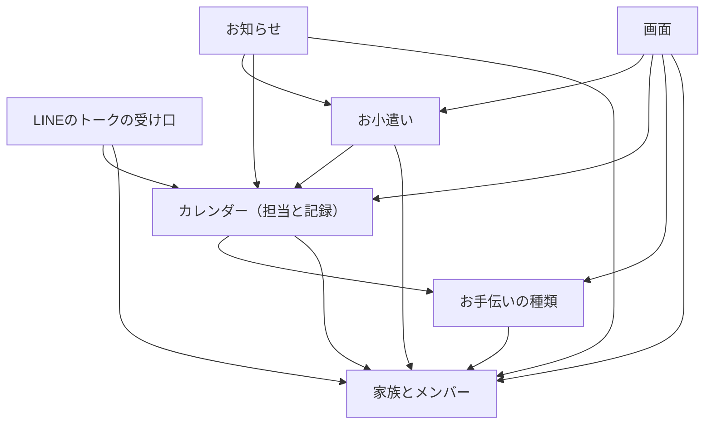

# 部品の分け方（ドメイン設計）

要件（`inception/requirements-analysis/requirements.md`）とストーリー（`inception/user-stories/stories.md`）をもとに、作るコードを 7 つの部品に分けます。ここで決めるのは、部品の分け方、部品どうしの頼り方、どのデータをどの部品が持つかです。どう配備するか（1 つにまとめるか、分けるか）は次の「作業単位の分割」で、使う技術の細かい選択はあとの段階で決めます。

決めたこと（`domain-design-questions.md` の回答）:

- 部品は、質問の前提に示した案のとおり 7 つに分ける（まとめの確認で「Looks correct」）
- 「月の確定」と「代わりにやる」は「カレンダー（担当と記録）」が持つ [Q1]
- 記録を付けるときに、その時点の単価を担当に書き写す [Q2]
- 「LINE のトークの受け口」を独立した部品にする [Q3]
- お小遣いの額は、読むときに記録と加算・減額から計算し、合計は保存しない [Q4]

## 部品の一覧（機械で読む形）

```yaml
components:
  - name: 家族とメンバー
    summary: 友だち登録した利用者、家族、招待、管理者か子供か、お知らせ先を持つ
    behaviour: >-
      公式アカウントを友だち登録した利用者を記録し、家族を作る・招待で参加するを受け付ける。
      利用者がどの家族のメンバーで、管理者か子供かを答え、ほかの部品の「この操作をしてよいか」の確認に使われる。
      家族のグループをお知らせ先として 1 つ登録し、登録し直すと置き換える。
    responsibilities:
      - 友だち登録した利用者の LINE のユーザー ID と表示名を記録する（FR1.1）
      - 家族を作る、招待を待つを選べるようにし、作った人を管理者にする（FR1.2、FR1.3）
      - 招待用のリンクを作り、参加した利用者を子供にする（FR1.4）
      - お知らせ先のグループを 1 家族に 1 つ登録し、置き換える（FR1.5）
      - 利用者がどの家族のメンバーか、管理者か子供かを答える（FR1.7、NFR4）
    depends_on: []
    dependents:
      - お手伝いの種類
      - カレンダー（担当と記録）
      - お小遣い
      - お知らせ
      - LINEのトークの受け口
      - 画面
    external_dependencies:
      - LINE ログイン（画面からの利用者の認証の確かめ）
      - DynamoDB
    entities:
      - 利用者
      - 家族
      - 招待
      - お知らせ先
  - name: お手伝いの種類
    summary: お手伝いの名前・単価・説明と、使う・使わないを持つ
    behaviour: >-
      管理者がお手伝いの種類を登録・変更する。単価を変えると、変えたあとに付く記録から新しい単価が使われる。
      使わないにした種類は新しい割り当てで選べない。割り当てに一度も使われていない種類だけ消せる。
      カレンダーは記録を付けるときに、ここから今の単価を受け取る。
    responsibilities:
      - 種類ごとの名前・単価・説明を登録し、変更する（FR2.1）
      - 今の単価を答える（FR2.2。書き写すのはカレンダー）
      - 種類を使わないにし、新しい割り当てで選べないようにする（FR2.3）
      - 割り当てに使われていない種類だけを消す（FR2.4）
    depends_on:
      - 家族とメンバー
    dependents:
      - カレンダー（担当と記録）
      - 画面
    external_dependencies:
      - DynamoDB
    entities:
      - お手伝いの種類
  - name: カレンダー（担当と記録）
    summary: 月の割り当て、日ごとの担当とその状態（未・済・×）、代わりにやる、月の確定を持つ
    behaviour: >-
      管理者が保存した月の割り当てから日ごとの担当を作り、保存し直したときは明日以降の「未」の担当だけを作り直す。
      子供の記録と、管理者の取り消し・済にする・やらなかったにする・やらなかったを外すを、状態の表（FR6.1）のとおりに受け付ける。
      記録するときは、その時点の単価を担当に書き写す。
      代わりにやるの申し出・引き受け・取り下げと、自動でなくなる決まりを受け持つ。
      月の確定と確定の取り消しを持ち、確定している月の変更をすべて断る。
    responsibilities:
      - 月の割り当てを保存し、日ごとの担当を作る。担当が重なる割り当ては断る（FR3.1、FR3.4）
      - 日ごとの担当の変更と、保存し直したときの作り直しと上書きの確認内容を作る（FR3.2、FR3.3）
      - 担当の状態を FR6.1 の表のとおりにだけ変える（FR5.1、FR5.3〜FR5.7、FR6.1〜FR6.4、FR6.6）
      - 記録するときに、記録した時刻・記録した人・その時点の単価を担当に残す（FR2.2、FR5.1、FR6.3）
      - カレンダーと日ごとの表示に使う担当の一覧を答える（FR4.1〜FR4.4）
      - 代わりにやるの申し出・引き受け・取り下げ・自動でなくなる決まり（FR7.1〜FR7.5）
      - 月の確定と確定の取り消し、確定している月の変更を断る（FR3.5、FR6.5）
      - 済の担当の一覧と、月が確定しているかを、お小遣いとお知らせに答える（FR5.8、FR9.1）
    depends_on:
      - 家族とメンバー
      - お手伝いの種類
    dependents:
      - お小遣い
      - お知らせ
      - LINEのトークの受け口
      - 画面
    external_dependencies:
      - DynamoDB
    entities:
      - 月の割り当て
      - 担当
      - 月の状態
      - 代わりにやるの申し出
  - name: お小遣い
    summary: お小遣いの額の計算と、加算・減額を持つ
    behaviour: >-
      子供ごと・月ごとに、カレンダーから済の担当を読み、担当に書き写された単価 × 回数を種類ごとに合計し、加算・減額を足して内訳つきで答える。
      合計は保存せず、読むたびに計算する。マイナスの合計もそのまま答える。
      加算・減額の記録と消すは、月が確定していないときだけ受け付ける（確定はカレンダーに問い合わせる）。
    responsibilities:
      - 子供ごと・月ごとのお小遣いの額を内訳つきで計算する（FR8.1、FR8.3）
      - 加算・減額を記録し、消す（FR8.2。最初の版から外してよい）
      - 確定している月の加算・減額を断る（FR6.5）
    depends_on:
      - 家族とメンバー
      - カレンダー（担当と記録）
    dependents:
      - お知らせ
      - 画面
    external_dependencies:
      - DynamoDB
    entities:
      - 加算・減額
  - name: お知らせ
    summary: 毎日 16 時のリマインドと月末 21 時のまとめを、お知らせ先のグループに送る
    behaviour: >-
      決まった時刻に動き、16 時はその日の担当を、月の最後の日の 21 時は各子供のお小遣いの額を、お知らせ先に送る。
      その日の月が確定しているとき、または担当がない日は、16 時のリマインドを送らない。
      送ったことを記録して、同じお知らせを二重に送らない。送れなかったときは作り手に知らせる。
    responsibilities:
      - 毎日 16 時にその日の担当を送る。確定している月と担当がない日は送らない（FR9.1）
      - 月の最後の日の 21 時に各子供のお小遣いの額を送る（FR9.2、FR9.3）
      - 返事ではないお知らせを FR9.1 と FR9.2 だけにする（FR9.4、NFR1）
      - 送ったお知らせを記録し、やり直しでも二重に送らない。失敗を作り手に知らせる（FR9.5、NFR2）
      - 日本時間で時刻と日付を扱う（NFR11）
    depends_on:
      - 家族とメンバー
      - カレンダー（担当と記録）
      - お小遣い
    dependents: []
    external_dependencies:
      - LINE Messaging API（プッシュで送る）
      - 決まった時刻に動かす仕組み（AWS のスケジューラ）
      - 作り手への失敗の知らせ（AWS の監視と通知）
      - DynamoDB
    entities:
      - 送ったお知らせの記録
  - name: LINEのトークの受け口
    summary: 公式アカウントに届く話しかけ・ボタン・友だち登録・グループへの参加を受け取り、ほかの部品に渡して返事をする
    behaviour: >-
      LINE から届いたものであることを確かめてから、届いたものを読み解く。
      友だち登録とグループへの参加は家族とメンバーに、リッチメニューの「やった」とグループの「代わって」・「引き受ける」・「申し出をやめる」はカレンダーに渡す。
      結果をもとに、LINE の返事（記録しました、確定済みです、この申し出はもうありません など）を返す。自分ではデータを持たない。
    responsibilities:
      - LINE から届いたことを確かめる（NFR4）
      - 友だち登録とグループへの参加・お知らせ先の登録を家族とメンバーに渡す（FR1.1、FR1.5）
      - リッチメニューの「やった」をカレンダーに渡し、本人にだけ返事をする（FR5.1〜FR5.4）
      - 「代わって」・「引き受ける」・「申し出をやめる」をカレンダーに渡し、グループに返事をする（FR7.1〜FR7.5）
      - 返事を 3 秒以内に返す（NFR7）
    depends_on:
      - 家族とメンバー
      - カレンダー（担当と記録）
    dependents: []
    external_dependencies:
      - LINE Messaging API（受け取りと返事）
    entities: []
  - name: 画面
    summary: LINE の中とパソコンのブラウザで開く画面（S0〜S7）
    behaviour: >-
      LINE の認証で利用者を見分けて画面を開き、カレンダー・日ごとの詳しい内容・割り当て・お手伝いの種類・お小遣い・家族の設定を表示する。
      操作はそれぞれの部品に頼み、結果を表示する。自分ではデータを持たない。
    responsibilities:
      - LINE の中とブラウザで、LINE の認証を使って画面を開く（FR1.6）
      - カレンダーと日ごとの詳しい内容を表示する。状態を文字でも表す（FR4.1〜FR4.5、NFR9）
      - 割り当て、お手伝いの種類、記録の確認・修正・確定、お小遣い、加算・減額、家族の設定の画面（FR1〜FR8 の画面の操作）
      - 操作の前の確認と、操作のあとの知らせ（元に戻すボタンは置かない）を表示する
    depends_on:
      - 家族とメンバー
      - お手伝いの種類
      - カレンダー（担当と記録）
      - お小遣い
    dependents: []
    external_dependencies:
      - LINE の画面の仕組み（LIFF）と LINE ログイン
      - 画面の部品集（どれを使うかは設計で決める）
    entities: []
```

## 部品のつながり



文字での説明（図が表示されないとき）: 矢印は「頼る」向きです。

- 画面は、家族とメンバー・お手伝いの種類・カレンダー・お小遣いに頼ります
- LINE のトークの受け口は、家族とメンバー・カレンダーに頼ります
- お知らせは、家族とメンバー・カレンダー・お小遣いに頼ります
- お小遣いは、家族とメンバー・カレンダーに頼ります
- カレンダーは、家族とメンバー・お手伝いの種類に頼ります
- お手伝いの種類は、家族とメンバーに頼ります
- 家族とメンバーは、どこにも頼りません

頼り方は一方向で、輪になっていません。入口は「画面」「LINE のトークの受け口」「お知らせ」の 3 つで、入口どうしは頼り合いません。

## Component Summary（部品のまとめ）

| 部品 | 受け持つこと | 頼る部品 | 関わるストーリー |
|------|-------------|---------|----------------|
| 家族とメンバー | 利用者、家族、招待、管理者か子供か、お知らせ先 | なし | US1.1、US1.2 |
| お手伝いの種類 | 名前・単価・説明、使わない、消す | 家族とメンバー | US2.1 |
| カレンダー（担当と記録） | 割り当て、担当と状態、記録、代わりにやる、確定 | 家族とメンバー、お手伝いの種類 | US3.1、US4.1、US5.1、US6.1、US7.1 |
| お小遣い | 額の計算、加算・減額 | 家族とメンバー、カレンダー | US8.1、US8.2 |
| お知らせ | 16 時のリマインド、月末のまとめ、二重送信を防ぐ | 家族とメンバー、カレンダー、お小遣い | US9.1 |
| LINE のトークの受け口 | LINE から届くものの受け取りと返事 | 家族とメンバー、カレンダー | US1.1、US1.2、US5.1、US7.1 |
| 画面 | S0〜S7 の画面 | 家族とメンバー、お手伝いの種類、カレンダー、お小遣い | US1.1〜US8.2 |

## Entity Ownership（データの持ち主）

データは、それを持つ部品だけが書きます。ほかの部品は、持ち主の部品に頼んで読むか変えます。

| データ | 持ち主 | 主な中身 | 書く操作 |
|--------|--------|---------|---------|
| 利用者 | 家族とメンバー | LINE のユーザー ID、表示名、入っている家族、管理者か子供か | 友だち登録、家族を作る、招待で参加する |
| 家族 | 家族とメンバー | 家族の名前、管理者 | 家族を作る |
| 招待 | 家族とメンバー | 招待用のリンクの印、家族 | 招待用のリンクを作る |
| お知らせ先 | 家族とメンバー | 家族、グループの ID（1 家族に 1 つ） | 登録する、登録し直す |
| お手伝いの種類 | お手伝いの種類 | 名前、今の単価、説明、使う・使わない | 登録、変更、使わない、消す |
| 月の割り当て | カレンダー | 月、種類 × 子供 × 曜日 | 保存する、保存し直す |
| 担当 | カレンダー | 日付、種類、担当の子供、状態（未・済・×）、記録した時刻、記録した人、書き写した単価 | 作る、変更、記録、取り消し、済にする、やらなかったにする、やらなかったを外す、引き受ける |
| 月の状態 | カレンダー | 月、確定しているか、確定した時刻 | 確定する、確定を取り消す |
| 代わりにやるの申し出 | カレンダー | 担当、申し出た子供、有効か（引き受けた、取り下げた、自動でなくなった） | 申し出る、引き受ける、取り下げる、自動でなくす |
| 加算・減額 | お小遣い | 子供、月、加算か減額か、金額、理由 | 記録する、消す |
| 送ったお知らせの記録 | お知らせ | 家族、種類（リマインド・まとめ）、日付、送った結果 | 送ったとき |

お小遣いの額は、どの部品にも保存しません。お小遣いの部品が、読むたびに担当（済のもの、書き写した単価）と加算・減額から計算します [Q4]。

## External Dependencies（外の仕組みへの頼り）

| 外の仕組み | 使う部品 | 使い方 |
|-----------|---------|-------|
| LINE ログイン | 家族とメンバー、画面 | 画面を開いた人が誰かを確かめる（FR1.6、NFR4） |
| LINE の画面の仕組み（LIFF） | 画面 | LINE の中で画面を開く（FR1.6） |
| LINE Messaging API（受け取りと返事） | LINE のトークの受け口 | 話しかけ・ボタン・友だち登録・グループへの参加を受け取り、返事をする（FR1.1、FR1.5、FR5、FR7） |
| LINE Messaging API（プッシュ） | お知らせ | 16 時と月末 21 時のお知らせを送る。月 200 通の無料枠に収める（FR9、NFR1） |
| DynamoDB | データを持つ 5 つの部品 | データを保存する（制約） |
| AWS のスケジューラ | お知らせ | 決まった時刻にお知らせの処理を動かす（FR9.1、FR9.2） |
| AWS の監視と通知 | お知らせ（ほかの部品のエラーも） | 失敗を 15 分以内に作り手に知らせる（FR9.5、NFR2） |

細かい AWS のサービスの選び方は、あとの段階（インフラの設計）で決めます。

## Rationale（なぜこの分け方か）

- データの持ち主を 1 つに決めると、書き換えの決まりを 1 か所で確かめられる。特に、確定している月の変更を断る決まり（FR6.5）と、状態の表（FR6.1）は、担当を持つカレンダーだけで守れる [Q1]
- 単価を担当に書き写すので、お小遣いの計算は担当を読むだけで済み、お手伝いの種類の変更の歴史を持たなくてよい [Q2]
- LINE の決まり（届いたものの確かめ方、返事の形）が変わっても、直すのは LINE のトークの受け口だけで済む [Q3]
- お小遣いの額を保存しないので、取り消しや確定の取り消しのあとでも額がずれない。家族 4 人の量なら、読むたびに計算しても速さ（NFR7）に問題は出にくい [Q4]
- 頼り方を一方向にして輪をなくしたので、下の部品（家族とメンバー、お手伝いの種類）から順に作って確かめられる。walking skeleton では、画面 → 家族とメンバー → データの保存 → LINE のトークの受け口の返事、の流れを最初につなげられる

### Alternatives Rejected（選ばなかった案）

- 「確定」をお小遣いに持たせる案 [Q1 の B]: 確定は担当・記録・割り当ても止めるので、カレンダーがお小遣いに頼ることになり、頼り方が輪になる
- 「代わりにやる」を独立した部品にする案 [Q1 の C]: 申し出は担当の状態や確定と強く結び付いていて、分けると担当を変える決まりが 2 か所に散らばる
- お手伝いの種類が単価の歴史を持ち、計算のときに探す案 [Q2 の B]: 計算のたびに歴史を探す必要があり、FR6.3 の「操作した時点の単価」とも合わせにくい
- それぞれの部品が LINE の受け取りを直接持つ案 [Q3 の B]: LINE から届いたかの確かめ（NFR4）が何か所にも散らばる
- お小遣いの合計を保存しておく案 [Q4 の B]: 取り消し・状態の変更・確定の取り消しのたびに直す必要があり、ずれる恐れがある。家族 4 人の量では速さの利点が小さい
- 部品をもっと少なくし、裏側を 1 つの部品にまとめる案: データの持ち主があいまいになり、確定の決まりを守る場所がはっきりしない。配備を 1 つにまとめるかどうかは、部品の分け方とは別に次の段階で決める

## Sources

- Initial description: [desc] LINE から使うお手伝いカレンダー、母親が子供に家事を分担し、お小遣いを支払う。画面は React、裏側は Lambda 上の Node.js（TypeScript）
- `inception/requirements-analysis/requirements.md`（FR1〜FR9、NFR1〜NFR11、制約）
- `inception/user-stories/stories.md`（US1.1〜US9.1）
- `inception/refined-mockups/mockups.md`、`interaction-spec.md`（画面 S0〜S7、元に戻すボタンを置かないこと）
- `domain-design-questions.md` の回答 [Q1]〜[Q4]

## Assumptions & Open Questions

- [assumption] 1 つの家族に入るのは 4 人程度で、読むたびにお小遣いを計算しても NFR7（3 秒以内）を満たせる。人数が大きく増えたら見直す
- 配備の分け方（Lambda を 1 つにするか、入口ごとに分けるか）は、次の「作業単位の分割」で決める
- DynamoDB のテーブルとキーの形、AWS のスケジューラと監視の具体的なサービスは、あとの設計の段階で決める
