# 作業単位の頼り方（Unit of Work Dependency）

11 個の作業単位（`unit-of-work.md`）が、どの単位に頼るかを示します。ここで示すのは頼り方の形だけです。どの順で作るか、どこがいちばん大事かは、「作る順の計画（delivery-planning）」で決めます。

## 頼り方の決め方

- 単位は、ストーリーの「使う流れの順」に一本の列としてつなぎ、並行して作らない [Q8]
- 加算・減額（U11）だけは使う流れの順から外し、列のいちばん最後（お知らせのあと）に置く。ほかのどの単位も U11 に頼らないので、U11 を作らなくてもほかの単位はそのまま動く [Q4、Q10]
- それぞれの単位は、すぐ前の単位に頼る。すぐ前の単位は、その前までのすべての単位の上にできているので、前のどの単位の働きも使える

## 頼り方の図

```mermaid
flowchart LR
    U1["U1 最初の形と家族を作る"]
    U2["U2 招待"]
    U3["U3 お知らせ先"]
    U4["U4 お手伝いの種類"]
    U5["U5 割り当てとカレンダー"]
    U6["U6 記録"]
    U7["U7 確認・修正と確定"]
    U8["U8 代わりにやる"]
    U9["U9 お小遣いの額"]
    U10["U10 お知らせ"]
    U11["U11 加算・減額"]

    U2 --> U1
    U3 --> U2
    U4 --> U3
    U5 --> U4
    U6 --> U5
    U7 --> U6
    U8 --> U7
    U9 --> U8
    U10 --> U9
    U11 --> U10
```



文字での説明（図が表示されないとき）: 矢印は「頼る」向きです。U2 は U1 に、U3 は U2 に、というように、U11 まで、それぞれの単位がすぐ前の単位に頼ります。U1 はどこにも頼りません。輪はありません。

## 本当の頼り方と、列にしたための頼り方

一本の列にしたため [Q8]、部品の上では頼っていない単位どうしもつながっています。あとで並行して作ることにした場合に、どこを外せるかが分かるように、本当に必要な頼り方を残しておきます。

| 単位 | 本当に必要な頼り先 | 列にしたための頼り先 |
|------|------------------|------------------|
| U1 | なし | なし |
| U2 | U1（家族、認証の確かめ） | なし |
| U3 | U1（家族、管理者か子供か、LINE の受け口） | U2 |
| U4 | U1（家族、管理者の確かめ） | U3 |
| U5 | U1（家族のメンバー）、U4（種類） | なし（U4 が本当の頼り先） |
| U6 | U5（担当）、U4（今の単価） | なし |
| U7 | U6（済の担当、記録した時刻） | なし |
| U8 | U3（お知らせ先のグループ）、U5（担当）、U7（状態の変更と確定で申し出がなくなる決まり） | なし |
| U9 | U6（済の担当と書き写した単価） | U8 |
| U10 | U3（お知らせ先）、U5（その日の担当）、U7（月の確定）、U9（お小遣いの額） | なし |
| U11 | U9（お小遣いの計算の窓口）、U7（月の確定） | U10 |

## 単位どうしのつながり

単位どうしは、同じコードの中で、部品ごとに決めた関数の窓口を通してつながります [Q6]。ネットワーク越しには呼び合いません。データは持ち主の部品だけが書きます（`components.md` の Entity Ownership）。

| 頼る単位 | 頼られる単位 | つながり | 中身 |
|---------|------------|---------|------|
| U2〜U11 | U1 | 関数の窓口 | 利用者がどの家族のメンバーか、管理者か子供かを答える。画面からの要求の認証と、LINE から届いたことの確かめ |
| U2〜U11 | U1 | 共有する型の置き場所 | 画面と裏側でやりとりするデータの型。各単位が必要な型を足す [Q9] |
| U2〜U11 | U1 | AWS CDK の構成 | 3 つの Lambda（画面用、LINE 用、お知らせ用）と DynamoDB に、各単位が処理を足す [Q5] |
| U5 | U4 | 関数の窓口 | 使う種類の一覧。割り当てに使われたかを U4 に返す |
| U6、U7 | U4 | 関数の窓口 | 今の単価を受け取り、担当に書き写す（ADR-003） |
| U6、U7、U8 | U5 | 関数の窓口と共有データ | 担当と月の状態（どれもカレンダーの部品が持つ） |
| U8 | U3 | 関数の窓口 | お知らせ先のグループかどうか |
| U9、U11 | U6、U7 | 関数の窓口 | 済の担当の一覧と書き写した単価、月が確定しているか |
| U10 | U3、U5、U7、U9 | 関数の窓口 | お知らせ先、その日の担当、月が確定しているか、各子供のお小遣いの額 |
| U11 | U9 | 関数の窓口 | お小遣いの計算に加算・減額を足す |

## 並行して作れる単位

一本の列にしたので [Q8]、並行して作る単位の組はありません。作れる順番は U1 → U2 → … → U11 の 1 つだけです。

上の「本当に必要な頼り方」だけで見ると、たとえば U2・U3・U4 はどれも U1 にだけ頼っていて、並行して作ることもできます。並行して作ることにする場合は、この段階に戻って頼り方を直します。

## 最初の形（walking skeleton）

- 列のいちばん先頭は U1 で、U1 はどこにも頼りません。U1 が最初の形です
- U1 だけで、次の流れが本物の機能として端から端まで動きます。LINE でログインする → 画面を開く → 裏側の処理（画面用の Lambda）を呼ぶ → 家族を DynamoDB に保存する → 友だち登録に公式アカウント（LINE 用の Lambda）が返事をする
- AWS CDK の構成の土台、認証の確かめ、共有する型の置き場所も U1 で作るので、ほかの単位ができていなくてもステージングに配備して確かめられます
- U1 を見せる内容と、確かめるコマンドは「作る順の計画」で決めます

## 頼り方の一覧（機械で読む形）

```yaml
units:
  - name: u1-skeleton-family
    kind: service
    depends_on: []
  - name: u2-invitation
    kind: service
    depends_on: [u1-skeleton-family]
  - name: u3-notification-group
    kind: service
    depends_on: [u2-invitation]
  - name: u4-chore-types
    kind: service
    depends_on: [u3-notification-group]
  - name: u5-assignment-calendar
    kind: service
    depends_on: [u4-chore-types]
  - name: u6-recording
    kind: service
    depends_on: [u5-assignment-calendar]
  - name: u7-review-confirm
    kind: service
    depends_on: [u6-recording]
  - name: u8-swap
    kind: service
    depends_on: [u7-review-confirm]
  - name: u9-allowance
    kind: service
    depends_on: [u8-swap]
  - name: u10-notifications
    kind: service
    depends_on: [u9-allowance]
  - name: u11-adjustments
    kind: service
    depends_on: [u10-notifications]
```

## Sources

- `unit-of-work.md`
- `inception/domain-design/components.md`（部品どうしの頼り方、データの持ち主）
- `inception/domain-design/decisions.md`（ADR-001、ADR-003）
- `inception/user-stories/stories.md`（ストーリーどうしの関係、使う流れの順）
- `aidlc/spaces/default/memory/team.md`（walking skeleton）
- `units-generation-questions.md` の回答 [Q4]〜[Q6]、[Q8]〜[Q10]

## Assumptions & Open Questions

- 一本の列にしたため [Q8]、本当には頼っていない単位どうしもつながっています。並行して作りたくなったときは、上の「本当に必要な頼り方」をもとに、この段階で頼り方を直します
- 単位どうしの窓口の形（関数の引数と結果、エラーの返し方）は、次の「契約の設計（contract-design）」で決めます
